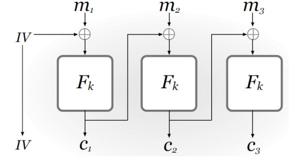
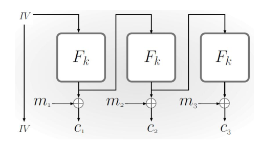
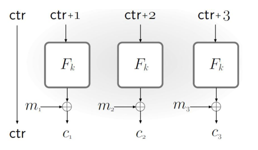
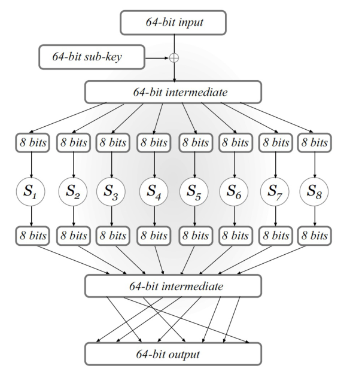
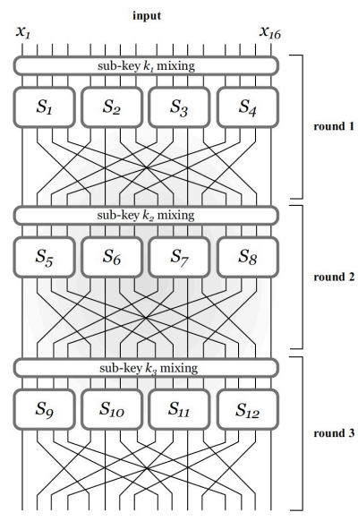
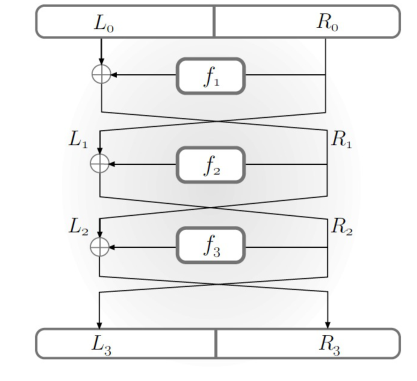
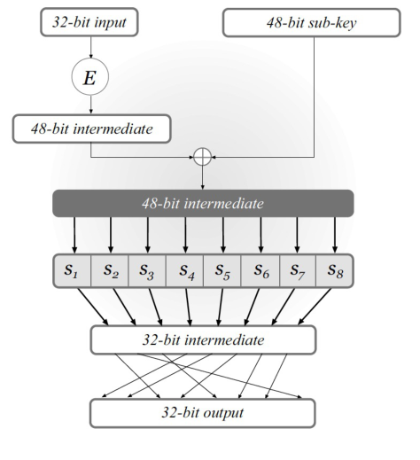
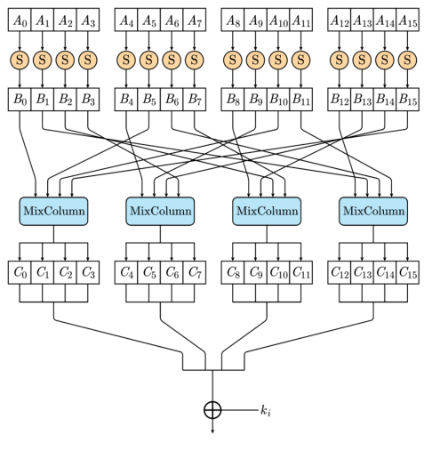

# 分组密码

CRYPTOGRAPHY · 0520 分钟阅读

## 分组密码与安全目标：

### 什么是分组密码：

分组密码，又称块密码，将一个固定长度的输入分组变成同样长度的输出分组

它是一个高效的，带密钥的置换函数

$$
F:\{0,1\}^n\times\{0,1\}^l\to\{0,1\}^l.
$$

这里 $n$ 为密钥长度（Key Length），$l$ 为分组长度（Blocklength）。固定密钥 $k\in\{0,1\}^n$ 后，记：

$$
F_k(x)\overset{\mathrm{def}}=F(k,x).
$$

$F_k$ 必须是 $\{0,1\}^l$ 上的双射，即每个输出恰好对应一个输入；已知密钥时，$F_k$ 与逆函数 $F_k^{-1}$ 都必须能够高效计算

### 希望它具有什么安全性：

理论上，希望分组密码表现得像伪随机置换（Pseudorandom Permutation，PRP）；当敌手还可以查询逆函数时，相应目标是强伪随机置换（Strong PRP）

敌手只知道置换算法，不知道具体密钥

对 $n$ 位均匀密钥，穷举搜索需要约 $2^n$ 次候选密钥试验，这也是我们希望块密码的攻击复杂度

## 分组密码的工作模式：

工作模式（Mode of Operation）规定如何多次调用分组密码，结合初始化向量、计数器或反馈关系，处理多个明文分组

为与工作模式中的公式对应，本节改用 $n$ 表示**分组长度<strong>，用 $l$ 表示</strong>消息的分组数**：

$$
m=\langle m_1,m_2,\ldots,m_l\rangle,
\qquad m_i\in\{0,1\}^n.
$$

| 模式 | 送入 $F_k$ 的内容 | 主要机制 | 
| --- | --- | --- | 
| ECB | $m_i$ | 每个明文分组独立加密 | 
| CBC | $c_{i-1}\oplus m_i$ | 用前一密文链接当前明文 | 
| OFB | $y_{i-1}$ | 将输出反馈，连续产生密钥流 | 
| CTR | $\mathrm{ctr}+i$ | 对计数器求值，产生各块密钥流 | 

### ECB 模式（Electronic Code Book）：

#### 加密方式：

ECB 将每个明文分组直接输入同一个 $F_k$：
$$
c=\langle F_k(m_1),F_k(m_2),\ldots,F_k(m_l)\rangle.
$$

解密逐块计算：

$$
m_i=F_k^{-1}(c_i).
$$

#### 安全性：

 图中从左到右分别为原图、ECB 加密图和使用安全模式得到的加密图。ECB 不能隐藏由大量重复分组构成的轮廓

可以用一个单次窃听挑战直接说明问题。取两个不同分组 $a\neq b$，选择等长消息：

$$
M_0=\langle a,a\rangle,
\qquad M_1=\langle a,b\rangle.
$$

若挑战密文的两个分组相等，就猜测 $M_0$；否则猜测 $M_1$。因为 $F_k$ 为双射，这个判断总是正确，因此 ECB 不能安全保护一般的多分组消息，更不满足 CPA 安全

### CBC 模式（Cipher Block Chaining）：

#### 加密方式：

CBC 每次加密一条消息时，重新独立均匀选择一个 $n$ 位初始化向量（Initialization Vector，IV），先与明文异或，再执行分组加密：
$$
\begin{align*}
c_0&:=IV,\\
c_i&:=F_k(c_{i-1}\oplus m_i),\qquad i=1,\ldots,l.
\end{align*}
$$

最终密文包含 IV：

$$
c=\langle c_0,c_1,\ldots,c_l\rangle.
$$

 

IV 可以公开，接收者需要它来恢复第一个分组

解密先求逆，再去掉前一密文分组：

$$
\begin{align*}
F_k^{-1}(c_i)&=c_{i-1}\oplus m_i,\\
m_i&=F_k^{-1}(c_i)\oplus c_{i-1}.
\end{align*}
$$

#### 安全性：

如果 $F$ 是一个 PRF（伪随机函数），那么 CBC 模式就是 CPA 安全的

CBC 的缺点在于，它的加密必须是“串行”的，即只能在计算出上一个分组的密文后才能计算下一组密文，无法并行计算，效率较低

### OFB 模式（Output Feedback）：

#### 加密方式：

OFB 不直接对明文执行置换，而是从 IV 开始反复调用 $F_k$，生成密钥流：
$$
\begin{align*}
y_0&:=IV,\\
y_i&:=F_k(y_{i-1}),\qquad i=1,\ldots,l,\\
c_i&:=m_i\oplus y_i.
\end{align*}
$$

每条消息的 IV 独立均匀选择，密文为：

$$
c=\langle IV,c_1,\ldots,c_l\rangle.
$$

 

接收者用相同密钥和 IV 重新生成 $y_1,\ldots,y_l$，然后计算：

$$
m_i=c_i\oplus y_i.
$$

因此，加密和解密都只需要 $F_k$ 的正向计算，不需要 $F_k^{-1}$，底层函数在结构上也不必可逆

$y_i$ 依赖于 $y_{i-1}$，所以**密钥流生成是串行的**。但它不依赖明文，可以在消息到达前预计算；密钥流生成完后，各块异或本身可以并行完成

#### 安全性：

在 PRF 假设、独立均匀 IV 和受控数据量下，OFB 可实现 CPA 安全。重复使用相同密钥与 IV 会生成完全相同的密钥流，使两份密文的异或等于两份明文的异或

### CTR 模式（Counter）：

#### 加密方法：

CTR 为每条消息选择一个均匀随机的起始值 $\mathrm{ctr}$，以不同计数器值产生各块掩码：
$$
\begin{align*}
y_i&:=F_k(\mathrm{ctr}+i),\\
c_i&:=m_i\oplus y_i,\qquad i=1,\ldots,l.
\end{align*}
$$

密文为：

$$
c=\langle\mathrm{ctr},c_1,\ldots,c_l\rangle.
$$

 

图中首块使用 $\mathrm{ctr}$，随后为 $\mathrm{ctr}+1,\mathrm{ctr}+2$；上面的公式从 $i=1$ 开始，首块使用 $\mathrm{ctr}+1$ 

这里把计数器编码为 $n$ 位字符串，$\mathrm{ctr}+i$ 按计数器空间计算；同一密钥下必须避免计数器输入重复，尤其不能因回绕而再次使用同一输入

解密同样只使用正向函数：

$$
m_i=c_i\oplus F_k(\mathrm{ctr}+i).
$$

每个 $y_i$ 都可以独立计算，因此 CTR 的**加密和解密都可以并行**，也可以预计算密钥流，或直接处理指定位置的分组而不计算之前的分组

#### 安全性：

如果 $F$ 是 PRF ，那么 CTR 就是安全的

### 为什么这些条件与安全性有关：

对于 OFB 和 CTR，可以先设想将 $F_k$ 替换为真正随机函数。只要函数输入尚未被查询过，其对应输出就是新的均匀随机掩码，因而与明文异或后隐藏明文内容

- CTR 的主要异常是不同位置使用相同的计数器输入
- OFB 的主要异常是不同轨迹相遇或同一轨迹循环，导致后续密钥流复用
- CBC 中，新的随机 IV 与链式混合使各次函数输入得到随机化；证明仍要控制输入碰撞等异常

若总共处理 $Q$ 个分组，相关生日碰撞项通常具有 $O(Q^2/2^n)$ 的量级，常数和具体事件依模式而定。这个量级说明了为什么安全性不仅取决于密钥长度，也取决于分组长度和单个密钥下处理的数据量

将底层随机函数或随机置换替换回安全的伪随机原语，再加上碰撞事件的概率界，才能得到完整的计算安全结论。**随机 IV 或不同计数器是构造条件，底层伪随机性也是不可缺少的假设** 

### 四种模式的使用差异：

| 性质 | ECB | CBC | OFB | CTR | 
| --- | --- | --- | --- | --- | 
| 每条消息的初始信息 | 无 | 随机 IV | 随机 IV | 起始计数器 | 
| 加密是否需要逆函数 | 否 | 否 | 否 | 否 | 
| 解密是否需要逆函数 | 是 | 是 | 否 | 否 | 
| 加密能否直接并行 | 是 | 否 | 密钥流串行，异或可并行 | 是 | 
| 解密能否直接并行 | 是 | 是 | 密钥流串行，异或可并行 | 是 | 
| 能否预计算与明文无关的密钥流 | 不适用 | 不适用 | 可以 | 可以 | 
| 在正确条件下是否 CPA 安全 | 否 | 是 | 是 | 是 | 

ECB、CBC 按完整分组处理数据，遇到不足一个分组的末尾通常需要无歧义填充；OFB、CTR 可以生成足够长的密钥流后截取所需部分，直接处理最后不足一个分组的消息

这些模式本身不提供消息认证。例如 OFB、CTR 中若将密文改为 $c_i\oplus\Delta$，解密出的对应明文就会变成 $m_i\oplus\Delta$。CPA 保密性不等于能够检测篡改

## 分组密码的设计思想：

### 雪崩效应（Avalanche Effect）：

为了接近随机置换，我们希望输入中很小的变化，经过若干轮后能够影响输出的所有位置

这里“影响每一位”表示每个输出位置都有机会随输入改变，并不是要求每次改变输入都让所有输出位确定翻转。对于理想化的随机行为，改变一个输入比特后，输出通常约有一半比特发生变化

雪崩效应可以避免局部输入变化只造成局部输出变化，但它只是设计目标和检查指标，**不能单独作为 PRP 安全证明** 

### 混淆与扩散（Confusion and Diffusion）：

直接设计一个巨大而看似随机的置换很困难，可以先设计较小的非线性变换与混合操作，再重复多轮，将局部变化逐渐传播到整个分组

- **混淆（Confusion）**：使密钥、输入与输出之间的关系复杂，避免简单代数关系直接暴露密钥信息
- **扩散（Diffusion）**：将局部输入的信息分散到多个输出位置，使后续变换同时受到多个部分影响

小块替换负责引入复杂局部关系，跨块混合负责传播影响，两者反复组合，形成较大分组上的复杂置换

## 代换—置换网络（SPN）：

### 每一轮的操作：

代换—置换网络（Substitution-Permutation Network，SPN）通常在每一轮依次执行：

1. **密钥混合（Key Mixing）**：将当前的 input 与本轮子密钥（sub-key）异或
2. **代换（Substitution）**：将状态拆成若干小块，第 i 块输入固定的可逆（invertible）代换函数 $S_i$，即 S 盒（S-box）
3. **置换（Permutation）**：重新排列各个 S 盒输出的比特，使它们进入下一轮的不同小块

 

图中 64 位状态先与 64 位轮密钥异或，再拆成八个 8 位小块分别通过 $S_1,\ldots,S_8$，最后将输出比特交叉重排

S 盒和混合置换的规则是固定、公开的，保密的是密钥。即使敌手完全了解这些结构，也应难以恢复密钥或区分整体置换与随机置换，这体现了 Kerckhoffs 原则

### 多轮组合与子密钥：

每轮输出继续作为下一轮输入。主密钥通过密钥编排（Key Schedule）生成各轮子密钥，子密钥不应被当作互相独立选取的秘密，除非具体构造明确如此规定

对于包含 $r$ 轮“密钥混合—代换—置换”、最后再加一次密钥混合的结构，总共使用 $r+1$ 个子密钥

最后一次混合发生在最后一个公开变换之后。否则，敌手可以直接逆掉最后的公开变换，相当于从密文中去掉最后这部分结构

### 解密：

SPN 中每一步都必须可逆：

- 已知轮密钥时，异或相同密钥即可撤销密钥混合
- S 盒是双射，可以应用 $S_i^{-1}$ 
- 比特置换可以应用其逆置换

例如，将一轮状态变换写为：

$$
x'=P(S(x\oplus k_i)),
$$

其中 $S$ 表示所有小块 S 盒的并行组合，$P$ 表示混合置换，则：

$$
x=S^{-1}(P^{-1}(x'))\oplus k_i.
$$

### SPN 中的雪崩效应：

如果 S 盒使单个输入比特的变化引起多个输出比特变化，而混合置换又把这些变化送入下一轮的多个 S 盒，影响范围就会不断扩大

第一轮中，一处变化可能只影响一个 S 盒；经过跨块置换，第二轮就可能影响多个 S 盒，后续逐步传播到整个分组

## Feistel 网络：

### 用不可逆组件构造可逆函数：

SPN 的每一个部分都要求可逆，而 Feistel 网络通过左右两半之间的异或与交换，使轮函数即使不可逆，整体仍然可逆

考虑一个平衡的 $l$ 位 Feistel 网络，$l$ 为偶数，将输入拆成两个 $l/2$ 位的部分 $L_0,R_0$ 

第 $i$ 轮使用子密钥 $k_i$ 和公开的带密钥轮函数 $\hat f_i$，记：

$$
f_i(R)\overset{\mathrm{def}}=\hat f_i(k_i,R),
\qquad f_i:\{0,1\}^{l/2}\to\{0,1\}^{l/2}.
$$

$\hat f_i$ 的算法公开，而未知 $k_i$ 时，敌手不知道实际选定的具体函数 $f_i$ 

### 一轮的加密与逆变换：

第 $i$ 轮的更新为：

$$
\begin{align*}
L_i&:=R_{i-1},\\
R_i&:=L_{i-1}\oplus f_i(R_{i-1}).
\end{align*}
$$

 

已知输出 $(L_i,R_i)$ 时，第一条等式已经直接给出旧的右半：

$$
R_{i-1}=L_i.
$$

于是可以正向计算 $f_i(R_{i-1})=f_i(L_i)$，再由第二条等式恢复旧的左半：

$$
L_{i-1}=R_i\oplus f_i(L_i).
$$

因此，一轮逆变换完整地写为：

$$
\begin{align*}
R_{i-1}&:=L_i,\\
L_{i-1}&:=R_i\oplus f_i(R_{i-1}).
\end{align*}
$$

全过程只调用 $f_i$，不需要 $f_i^{-1}$，也不需要从 $f_i(R)$ 的值反求 $R$。原因是 <strong>$R$ 已经作为另一半原样保留在输出中</strong> 

### 多轮解密与 SPN 的区别：

多轮加密是多个可逆轮变换的复合，解密从最后一轮向前依次恢复，使用的子密钥顺序相反

在配合适当左右交换约定后，加解密可以共享相同的 Feistel 结构，但若直接按照上面的 $(L_i,R_i)$ 定义推导，应使用明确的逆变换，避免遗漏首尾交换

| 比较项 | SPN | Feistel 网络 | 
| --- | --- | --- | 
| 如何处理状态 | 对整个状态做可逆代换与混合 | 将状态分为左右两半，异或并交换 | 
| 局部函数是否必须可逆 | S 盒需要可逆 | 轮函数不需要可逆 | 
| 解密是否需要局部逆函数 | 需要逆 S 盒与逆混合操作 | 只需要轮函数正向计算 | 
| 可逆性的来源 | 每一步都是双射 | 一半直接保留，另一半可由异或恢复 | 

## DES 与 3DES：

### DES 的基本结构：

数据加密标准（Data Encryption Standard，DES）采用 16 轮 Feistel 网络，分组长度为 64 位，有效密钥长度为 56 位

64 位分组被拆成两个 32 位部分。每轮使用 48 位子密钥，轮函数接收 32 位输入并输出 32 位结果：
$$
\hat f_i:\{0,1\}^{48}\times\{0,1\}^{32}\to\{0,1\}^{32}.
$$

### DES 的轮函数 ：

 

轮函数的处理过程为：

1. **扩展（Expansion）**：通过 $E$ 将 32 位输入扩展成 48 位，其中部分输入位被重复使用
2. **密钥混合**：与 48 位轮密钥异或
3. **S 盒代换**：拆成八个 6 位小块，分别经过八个 S 盒，每个 S 盒输出 4 位，总共得到 32 位
4. **置换**：重排这 32 位，将局部变化分散到后续轮次

用 $R$ 表示本轮右半，$S$ 表示八个 S 盒的组合，$P$ 表示最后的置换，可以将轮函数写成：

$$
f_i(R)=P(S(E(R)\oplus k_i)).
$$

DES 的缺点在于，密钥的长度太短了

### 3DES 的两种构造：

三重 DES（Triple-DES，3DES）通过多次调用 DES 扩大密钥搜索难度，采用“加密—解密—加密”（Encrypt–Decrypt–Encrypt，EDE）结构

令 $F$ 为 DES，三密钥版本使用独立的 $k_1,k_2,k_3$：

$$
F''_{k_1,k_2,k_3}(x)
\overset{\mathrm{def}}=
F_{k_3}\left(F_{k_2}^{-1}(F_{k_1}(x))\right).
$$

其逆变换为：

$$
x=F_{k_1}^{-1}\left(F_{k_2}(F_{k_3}^{-1}(c))\right).
$$

双密钥版本令第三个密钥等于第一个密钥：

$$
F''_{k_1,k_2}(x)
\overset{\mathrm{def}}=
F_{k_1}\left(F_{k_2}^{-1}(F_{k_1}(x))\right).
$$

使用中间解密操作的一个好处是兼容单 DES：当所有密钥都相同时，三次调用化简为：

$$
F_k(F_k^{-1}(F_k(x)))=F_k(x).
$$

三密钥版本有 168 位独立密钥材料，但不能直接称其具有 168 位安全强度；中间相遇（Meet-in-the-Middle）类攻击使其通常以约 112 位安全强度来衡量

## AES：

### 参数与结构：

高级加密标准（Advanced Encryption Standard，AES）采用基于代换与混合的 SPN 结构，分组长度始终为 128 位

| 版本 | 密钥长度 | 分组长度 | 轮数 | 
| --- | --- | --- | --- | 
| AES-128 | 128 位 | 128 位 | 10 | 
| AES-192 | 192 位 | 128 位 | 12 | 
| AES-256 | 256 位 | 128 位 | 14 | 

AES-256 的“256”表示密钥长度，不表示一次处理 256 位明文

与 DES 的 Feistel 结构不同，AES 通过可逆字节代换和可逆线性混合，直接更新整个 128 位状态

### AES 的轮变换：

将 128 位状态看成 16 个字节，可按 $4\times4$ 的字节矩阵组织。典型中间轮依次包含：

1. **字节代换（SubBytes）**：每个字节通过同一个可逆 S 盒，引入非线性关系
2. **行移位（ShiftRows）**：对状态矩阵各行做不同距离的循环移位，使不同列的字节重新组合
3. **列混合（MixColumns）**：对每列做可逆线性变换，使一个字节的影响扩散到同列的多个字节
4. **轮密钥加（AddRoundKey）**：将当前状态与本轮 128 位轮密钥逐位异或

 

图中 $A_i$ 表示进入 S 盒的字节，$B_i$ 为代换后的字节，连线体现行移位，经过 MixColumns 后得到 $C_i$，最后与轮密钥 $k_i$ 异或

AES 的 MixColumns 是有限域上的可逆线性混合，并非单纯交换比特位置。因此，将 AES 归入 SPN 结构时，“置换与混合”应理解为可逆扩散操作，而不能把所有扩散步骤都当作比特重排

### 扩散与可逆性：

SubBytes 在单个字节内引入非线性关系，但不会单独将影响传播到其他字节。ShiftRows 将字节重新分配到不同列，MixColumns 再在列内混合，反复多轮后形成更大范围的扩散

这也说明“非线性”和“扩散”承担不同作用：只做公开线性变换缺少足够复杂的非线性关系，只做独立字节代换又难以隐藏跨字节结构

AES 解密按相反顺序撤销各步，使用逆 S 盒、逆行移位、逆列混合，并通过再次异或撤销轮密钥加。整个结构可逆，但具体安全性还依赖 S 盒、线性层、轮数和密钥编排的共同设计

