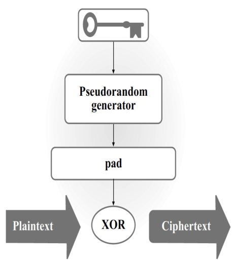
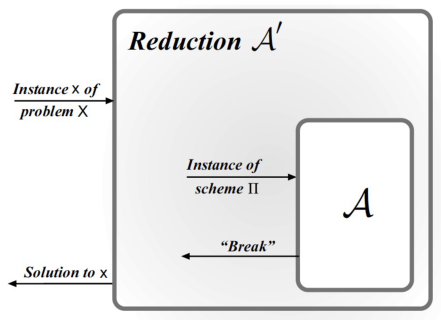

# 计算安全

CRYPTOGRAPHY · 0224 分钟阅读

## 从完美保密到计算安全：

### 为什么放宽安全要求：

完美保密（Perfect Secrecy）要求密文不泄露任何关于明文的信息，即便敌手拥有无限的计算能力，也无法通过密文改善对明文的判断。但这种要求的代价很高，例如一次一密（One-Time Pad，OTP）的密钥至少要和明文一样长，而且不能重复使用。

计算安全允许用较短的密钥保护较长的消息，为此引入两点放宽：

- 只考虑**计算能力受限的高效敌手**。
- 允许敌手以**可忽略的概率或优势**突破安全目标，具体衡量方式由攻击实验决定。

| 比较项 | 完美保密 | 计算安全 |
| --- | --- | --- |
| 敌手能力 | 可以无限计算 | 概率多项式时间 |
| 密文透露的信息 | 在统计意义上不增加明文信息 | 高效算法无法有效提取受保护的信息 |
| 不可区分游戏 | 猜测成功率为 $1/2$ | 猜测成功率至多为 $1/2+\operatorname{negl}(n)$ |
| 安全依据 | 信息论性质 | 计算困难性假设及安全归约 |

注意，完美保密并不表示敌手“永远猜不中”。敌手仍然可以随机猜测；安全要求限制的是**观察密文后能获得多少额外优势**。

同样，对所有高效敌手安全，也不能推出对无限计算能力的敌手安全。计算安全的方案可能被穷举破解，只是所需计算量超出了允许的范围。

### 安全参数（Security Parameter）：

用正整数 $n$ 表示安全参数，将一个密码方案看成随 $n$ 变化的一族算法。$n$ 经常对应密钥长度，但并非所有方案都严格满足“密钥长度等于 $n$”。

增大 $n$ 通常会提高攻击成本，同时也增加密钥生成、加解密、存储或传输的成本。因此，安全参数用来描述安全性与使用成本之间的关系。

安全性需要结合具体构造分析，不能仅凭“密钥更长”就判断方案一定更安全。

## 高效敌手与可忽略函数：

### 概率多项式时间算法（PPT）：

将高效敌手建模为概率多项式时间算法（Probabilistic Polynomial Time，PPT）：

- **概率算法**可以使用随机比特，因此相同输入下可能有不同执行过程与输出。
- **多项式时间**要求其运行时间被安全参数的某个固定多项式所界定，例如 $n^2$、$n^4$ 或 $10^8n^4$。

一般的多项式可以写成：

$$
p(n)=a_dn^d+a_{d-1}n^{d-1}+\cdots+a_1n+a_0.
$$

其中次数 $d$ 和系数不随 $n$ 改变。$2^n$、$n^n$ 等运行时间不属于多项式时间。

选择多项式时间，主要是为了给“可有效计算”一个便于组合与分析的数学边界

多项式时间算法调用多项式次多项式时间子程序后，整体仍然是多项式时间。

**多项式时间是渐近模型，不保证每一个具体参数下都实际可行。** 高次多项式或很大的常数也可能带来巨大开销；而固定的小参数下，指数时间计算也可能完成。

### 可忽略函数（Negligible Function）：

仅仅让攻击成功概率趋于零还不够。例如单次攻击成功概率为 $1/n$，独立重复 $n$ 次后，至少成功一次的概率为：

$$
1-\left(1-\frac1n\right)^n\longrightarrow 1-e^{-1}.
$$

定义非负函数 $\mu:\mathbb N\to\mathbb R_{\geq 0}$ 为可忽略函数（Negligible Function），如果对任	意正多项式 $p$，都存在阈值 $N$，使得：

$$
\forall n>N,\qquad \mu(n)<\frac1{p(n)}.
$$

等价地，对任意正整数 $c$，都存在阈值 $N_c$，使得：

$$
\forall n>N_c,\qquad \mu(n)<\frac1{n^c}.
$$

通常用 $\operatorname{negl}(n)$ 表示某个可忽略函数，它并不特指同一个表达式

### 超多项式函数（Superpolynomial Function）：

#### 定义：

若一个最终为正的函数 $f(n)$ 满足：对任意正常数 $c$，当 $n$ 足够大时都有
$$
f(n)>n^c,
$$

则称其为超多项式函数（Superpolynomial Function）

#### 与可忽略函数的关系：

对最终为正的函数，$f(n)$ 是超多项式函数，当且仅当 $1/f(n)$ 是可忽略函数

若可忽略函数在某些位置取零，则不能直接把其倒数当作处处有定义的实值函数。

### 典型例子与证明：

#### $2^{-n}$ 是可忽略函数：

对任意固定正整数 $c$，需要证明充分大的 $n$ 满足：

$$
2^{-n}<n^{-c}\quad\Longleftrightarrow\quad 2^n>n^c.
$$

可以直接用二项式定理构造阈值，而不依赖“指数增长快于多项式增长”这一结论。

固定任意正整数 $c$。当 $n\geq 2(c+1)$ 时，二项式展开中的各项均非负，因此只保留第 $c+1$ 次项便有：

$$
2^n=(1+1)^n=\sum_{j=0}^{n}\binom nj
\geq\binom n{c+1}
=\frac{n(n-1)\cdots(n-c)}{(c+1)!}.
$$

分子共有 $c+1$ 个因子。由于 $n\geq 2(c+1)>2c$，对每个 $j\in\{0,\ldots,c\}$ 都有 $n-j\geq n/2$，于是：

$$
2^n\geq\frac{(n/2)^{c+1}}{(c+1)!}
=n^c\cdot\frac{n}{2^{c+1}(c+1)!}.
$$

选择仅依赖于 $c$ 的整数阈值：

$$
N_c=\max\left\{2(c+1),\ 2^{c+1}(c+1)!\right\}.
$$

则对<strong>每一个整数 $n>N_c$</strong>，上述估计均成立，且

$$
\frac{n}{2^{c+1}(c+1)!}>1.
$$

因此，对所有 $n>N_c$ 都有：

$$
2^n>n^c
\quad\Longrightarrow\quad
2^{-n}<\frac1{n^c}.
$$

#### $1/n$ 以及固定的 $1/n^d$ 都不可忽略：

对 $\mu(n)=1/n$，取 $c=2$，则对所有 $n>1$ 都有：

$$
\frac1n>\frac1{n^2}.
$$

因此无法找到满足可忽略定义的阈值。

同理，对任意固定正整数 $d$，取 $c=d+1$，就能说明 $1/n^d$ 不可忽略。即使 $d=10000$，也不能仅凭数值很小就称其可忽略。

#### $1/n!$ 是可忽略函数：

对任意正整数 $c$，当 $n\geq2(c+1)$ 时，$n!$ 中最后 $c+1$ 个因子都至少为 $n/2$，因此：

$$
n!\geq\left(\frac n2\right)^{c+1}
=n^c\cdot\frac n{2^{c+1}}.
$$

再取 $n>2^{c+1}$，便有 $n!>n^c$，从而 $1/n!<1/n^c$。因为 $c$ 任意，所以 $1/n!$ 可忽略。

### 可忽略函数的封闭性质：

设 $\mu_1,\mu_2$ 是可忽略函数，$p$ 是正多项式。

1. 若非负函数 $f(n)$ 在充分大的 $n$ 上满足 $f(n)\leq\mu_1(n)$，则 $f$ 也可忽略。因为对任意逆多项式，只需同时越过两个阈值即可。

2. $\mu_1(n)+\mu_2(n)$ 可忽略。对任意正多项式 $q$，充分大的 $n$ 上有 $\mu_1(n)<1/(2q(n))$ 和 $\mu_2(n)<1/(2q(n))$，相加便小于 $1/q(n)$。

3. $p(n)\mu_1(n)$ 可忽略。对任意正多项式 $q$，用可忽略定义取上界 $1/(p(n)q(n))$，再乘以 $p(n)$ 即可。

   若改为负多项式 $q$ ，在数学上这条性质也成立。但在密码学中，概率都非负，故这里只考虑正多项式x

因此，**多项式次累积不会将可忽略概率放大为不可忽略概率**。固定有限项可忽略函数相加，也是可忽略的。

### 为什么重复攻击仍然无效：

假设每次独立尝试的成功概率为 $\mu(n)$，重复 $t(n)$ 次，至少成功一次的概率为：

$$
\Pr[\text{至少成功一次}]
=1-(1-\mu(n))^{t(n)}
\leq t(n)\mu(n).
$$

若 $t(n)$ 为多项式，右侧仍然可忽略。

实际上，上界本身不要求独立。设第 $i$ 次成功的事件为 $E_i$，只要每个事件的概率都至多为 $\mu(n)$，由并集界（Union Bound）：

$$
\Pr\left[\bigcup_{i=1}^{t(n)}E_i\right]
\leq\sum_{i=1}^{t(n)}\Pr[E_i]
\leq t(n)\mu(n).
$$

注意，若敌手会根据之前获得的信息调整攻击，则需要重新论证各次成功概率的上界，不能直接假设它始终等于独立单次攻击的概率。

### 计算安全的渐近定义：

针对明确规定的攻击类型，若任意 PPT 敌手 $A$ 的成功概率可忽略，就称方案满足相应的计算安全要求

等价地：
$$
\forall A\in\mathrm{PPT},\ \forall p>0\text{（多项式）},\ \exists N,
\quad\forall n>N,\quad
\Pr[\text{$A$ 攻击成功}]<\frac1{p(n)}.
$$

阈值 $N$ 可以依赖于敌手 $A$ 和多项式 $p$。渐近定义本身不保证 $n\leq N$ 时的安全程度；选定具体参数时，还需考虑实际攻击成本。

## 私钥加密与 EAV 安全：

### 带安全参数的私钥加密方案：

私钥加密方案（Private-key Encryption Scheme）由三个高效算法组成：

$$
\Pi=(\operatorname{Gen},\operatorname{Enc},\operatorname{Dec}).
$$

| 算法 | 输入与输出 | 作用 |
| --- | --- | --- |
| 密钥生成 $\operatorname{Gen}$ | $k\leftarrow\operatorname{Gen}(1^n)$ | 根据安全参数生成密钥 |
| 加密 $\operatorname{Enc}$ | $c\leftarrow\operatorname{Enc}_k(m)$ | 用密钥将明文变成密文 |
| 解密 $\operatorname{Dec}$ | $m:=\operatorname{Dec}_k(c)$ | 用同一密钥恢复明文 |

$1^n$ 表示由 $n$ 个 1 组成的一元串，其长度正好为 $n$。这样，以输入长度衡量的多项式时间就对应于安全参数 $n$ 的多项式时间。

$\leftarrow$ 允许算法使用随机性；$\overset{\$}{\leftarrow}$ 特别表示从给定集合均匀采样。$\operatorname{Enc}$ 可以是随机算法，也可以在特定安全目标下采用确定性算法；$\operatorname{Dec}$ 通常是确定性的。

常见的密钥生成方式是：

$$
k\overset{\$}{\leftarrow}\{0,1\}^n.
$$

加密方案首先需要满足正确性：对每个允许的明文 $m$ 和生成出的密钥 $k$，加密后应能恢复原消息，即

$$
\operatorname{Dec}_k(\operatorname{Enc}_k(m))=m.
$$

若加密只支持 $m\in\{0,1\}^{\ell(n)}$，就称其为消息长度为 $\ell(n)$ 的定长私钥加密方案（Fixed-length Private-key Encryption）

### 安全目标与威胁模型：

“加密是安全的”必须同时说明两件事：敌手能够做什么，以及希望阻止它得到什么

这里考虑窃听敌手（Eavesdropper）：敌手知道方案的算法，可以选择用于挑战的两条消息，随后观察其中一条消息的密文，但不知道密钥，也没有额外的加密查询接口。

安全目标是：**敌手无法有效判断密文对应两条候选消息中的哪一条** 

### 敌手不可区分性实验：

将实验记为 $\operatorname{PrivK}^{\mathrm{eav}}_{A,\Pi}(n)$，其中 eav 表示窃听攻击。

1. 敌手 $A$ 得到安全参数 $1^n$，输出两条合法明文 $m_0,m_1$，要求 $|m_0|=|m_1|$，并可保存自己的内部状态。
2. 挑战者生成 $k\leftarrow\operatorname{Gen}(1^n)$，均匀选择 $b\overset{\$}{\leftarrow}\{0,1\}$，计算 $c\leftarrow\operatorname{Enc}_k(m_b)$，将 $c$ 交给敌手。
3. 敌手根据密文及保存的状态输出猜测 $b'\in\{0,1\}$。
4. 若 $b'=b$，实验输出 1，表示敌手获胜；否则输出 0。

要求两条消息等长，是为了排除通过密文长度直接辨别消息的情形。一般的加密方案可以泄露消息长度，安全游戏不要求隐藏这种信息。

敌手可以自行挑选消息，使挑战更有利于自己；安全性必须对所有合法选择都成立。

### EAV 安全（窃听安全）的定义：

若对任意 PPT 敌手 $A$，都存在可忽略函数 $\mu$，使得对所有 $n$ 都有

$$
\Pr[\operatorname{PrivK}^{\mathrm{eav}}_{A,\Pi}(n)=1]
\leq\frac12+\operatorname{negl}(n),
$$

则称 $\Pi$ 在窃听攻击下具有不可区分加密，或称为 **EAV 安全（EAV-secure）**。

概率同时考虑密钥生成、挑战比特、加密算法及敌手自身使用的随机性。随机猜测就能以 $1/2$ 的概率获胜，因此只有超过 $1/2$ 的部分才反映有效攻击。

可以将猜测优势写为：

$$
\operatorname{Adv}^{\mathrm{guess}}_{A,\Pi}(n)
=\left|\Pr[\operatorname{PrivK}^{\mathrm{eav}}_{A,\Pi}(n)=1]-\frac12\right|.
$$

使用绝对值不改变安全要求：如果某个高效敌手总能明显低于 $1/2$，翻转它的输出就能明显高于 $1/2$ 

### 等价的两个分布定义：

分别固定挑战比特为 0 和 1。令

$$
q_b(n)=\Pr[A\text{ 在固定挑战比特为 $b$ 的实验中输出 }1].
$$

等价的安全定义要求：

$$
|q_1(n)-q_0(n)|\leq\operatorname{negl}(n).
$$

即：
$$
\left| \Pr[\mathrm{out}_{\mathcal{A}}(\mathrm{PrivK}^{\mathrm{eav}}_{\mathcal{A},\Pi}(n, 0)) = 1] - \Pr[\mathrm{out}_{\mathcal{A}}(\mathrm{PrivK}^{\mathrm{eav}}_{\mathcal{A},\Pi}(n, 1)) = 1] \right| \leq \mathrm{negl}(n).
$$
也就是说，敌手看到 $\operatorname{Enc}_k(m_0)$ 或 $\operatorname{Enc}_k(m_1)$ 时，输出行为几乎一样。

它与猜测成功概率的关系为：

$$
\begin{align*}
\Pr[b'=b]
&=\frac12\Pr[b'=0\mid b=0]+\frac12\Pr[b'=1\mid b=1]\\
&=\frac12(1-q_0(n))+\frac12q_1(n)\\
&=\frac12+\frac{q_1(n)-q_0(n)}2.
\end{align*}
$$

因此：

$$
\left|\Pr[b'=b]-\frac12\right|
=\frac12|q_1(n)-q_0(n)|.
$$

两种优势只差常数因子 2 ，是等价的

### 语义安全（Semantic Security）：

语义安全关注的是：高效敌手看到密文后，能否比只知道消息长度及已有辅助信息时，更有效地计算有关明文的信息。

在相应的窃听模型下，语义安全与不可区分性等价。不可区分性用一个二选一游戏表达安全目标，通常更方便进行构造与证明。

## 伪随机生成器（PRG）：

### 从一次一密出发：

一次一密用均匀随机的长掩码 $r$ 加密：

$$
c=r\oplus m,
\qquad r\overset{\$}{\leftarrow}\{0,1\}^{\ell}.
$$

它的完美保密性来自掩码的真正均匀随机，但发送双方必须共享长度为 $\ell$ 的密钥。

如果能将一个较短的随机种子扩展为较长、且高效敌手无法与均匀随机串区分的字符串，就有机会用短密钥替代长掩码。这正是伪随机生成器（Pseudorandom Generator，PRG）的用途。

### PRG 的定义：

设 $\ell$ 为多项式有界的输出长度函数，$G$ 为确定性多项式时间算法，对每个 $s\in\{0,1\}^n$ 都输出 $G(s)\in\{0,1\}^{\ell(n)}$。若满足以下两点，则称 $G$ 为 PRG：

- **扩展性（Expansion）**：对所有 $n$，$\ell(n)>n$。
- **伪随机性（Pseudorandomness）**：任意 PPT 区分器 $D$ 都满足

$$
\left|
\Pr[D(G(s))=1]-\Pr[D(r)=1]
\right|\leq\operatorname{negl}(n),
$$

其中

$$
s\overset{\$}{\leftarrow}\{0,1\}^n,
\qquad
r\overset{\$}{\leftarrow}\{0,1\}^{\ell(n)}.
$$

这里的<strong>区分器（Distinguisher）$D$</strong> 是一个试图判断输入字符串来自哪个分布的 PPT 算法。它的算法可以针对公开的 $G$ 设计，并不要求独立于 $G$。

约定： $D$ 输出 1 表示“猜测来自 PRG”，输出 0 表示“猜测来自均匀随机分布”

两个输入来源分别为：

| 输入来源 | 挑战字符串的产生方式 | 区分器看到的内容 |
| --- | --- | --- |
| PRG 分布 | 均匀选择 $s\in\{0,1\}^n$，计算 $y=G(s)$ | $1^n$ 和 $y$ |
| 均匀随机分布 | 均匀选择 $r\in\{0,1\}^{\ell(n)}$，令 $y=r$ | $1^n$ 和 $y$ |

两种情况下字符串长度相同，所以不能仅凭长度判断来源

我们称 $\ell(n)$ 是 $G$ 的拓展系数

### 确定性算法为什么能产生伪随机输出：

$G$ 本身不随机，而是一个确定性算法：相同的种子始终产生相同输出

随机性来自均匀采样的种子 $s$ 

因此，“输出看起来随机”是对分布 $G(U_n)$ 而言，其中 $U_n$ 表示 $n$ 位均匀随机串。它要求高效算法无法辨别该分布和 $U_{\ell(n)}$，并不要求每一段输出都呈现某种肉眼可见的特征。

### 伪随机不等于真正均匀随机：

$G$ 只有 $2^n$ 个可能输入，因此其像集至多包含 $2^n$ 个字符串；而 $\ell(n)$ 位均匀随机串有 $2^{\ell(n)}$ 种可能。

由于 $\ell(n)>n$，$G(s)$ 的分布不可能是整个 $\{0,1\}^{\ell(n)}$ 上的均匀分布。

一个不受计算限制的区分器可以枚举全部种子，检查输入 $y$ 是否属于 $G$ 的像集：

$$
D_{\mathrm{enum}}(y)=
\begin{cases}
1,&\exists s\in\{0,1\}^n:\ G(s)=y,\\
0,&\text{否则}.
\end{cases}
$$

$$
\Pr[D_{\mathrm{enum}}(r)=1]
=\frac{|\operatorname{Im}(G)|}{2^{\ell(n)}}
\leq2^{n-\ell(n)}.
$$

所以它的区分优势至少为：

$$
1-2^{n-\ell(n)}\geq\frac12.
$$

但直接枚举需要最多 $2^n$ 次计算 $G$，时间为 $O(2^n\operatorname{poly}(n))$，不属于 PPT。因此，这种区分方法不违背 PRG 的定义。

**PRG 的安全性来自高效计算下的不可区分，而非信息论上的分布相同** 

## 用 PRG 构造定长加密方案：

### 构造与正确性：

设 $G:\{0,1\}^n\to\{0,1\}^{l(n)}$ 为安全 PRG，用短密钥生成长掩码，再与明文异或：

定义方案 $\Pi=(\operatorname{Gen},\operatorname{Enc},\operatorname{Dec})$：

$$
\begin{align*}
\operatorname{Gen}(1^n)&:\quad k\overset{\$}{\leftarrow}\{0,1\}^n,\\
\operatorname{Enc}_k(m)&:=G(k)\oplus m,
\qquad m\in\{0,1\}^{l(n)},\\
\operatorname{Dec}_k(c)&:=G(k)\oplus c.
\end{align*}
$$

利用 $x\oplus x=0$：

$$
\operatorname{Dec}_k(\operatorname{Enc}_k(m))
=G(k)\oplus(G(k)\oplus m)=m.
$$

所以方案满足正确性。密钥长度为 $n$，明文和密文长度均为 $l(n)>n$，实现了用较短密钥加密较长消息

需要证明的安全结论是：<strong>若 $G$ 是安全 PRG，则该方案是 EAV 安全的定长私钥加密方案</strong> 

### 归约（Reduction）的方向：

安全归约将一个方案的安全性建立在已有的困难问题或安全原语上

假设问题 $X$ 对无法被 PPT 算法求解（hard）

现在，假设存在能够攻破 $\Pi$ 的高效敌手 $A$ 

然后，我们构造算法 $A'$，这个算法能够利用 $A$ 来成功解决 $X$ 

如果我们真的构造出了算法 $A'$ ，且 $A$ 真实存在，那么 $X$ 就可以在 PPT 算法下被求解，与条件矛盾

这就相当于说明了，能够解决 $\Pi$ 的 PPT 敌手 $A$ 是不存在的 

归约方向应写成：

$$
\text{解决 $X$}\ \leq\ \text{攻破 $\Pi$},
$$

表示“有了攻破 $\Pi$ 的子程序，就能解决 $X$”

### 构造 PRG 区分器 $A'$：

 令 $X$ 是区分 PRG 输出和均匀随机串

固定任意攻击 $\Pi$ 的 PPT 敌手 $A$，将其猜测优势记为 $\epsilon(n)$：

$$
\epsilon(n)=\left|\Pr[\operatorname{PrivK}^{\mathrm{eav}}_{A,\Pi}(n)=1]-\frac12\right|.
$$

构造 PRG 区分器 $A'$。它接收一个长度为 $l(n)$ 的字符串 $K$，需要判断 $K$ 来自 $G(s)$ 还是均匀随机串 $r$ 

$A'$ 的操作如下：

1. 运行 $A(1^n)$，得到两条挑战消息 $m_0,m_1\in\{0,1\}^{l(n)}$ 
2. 自行均匀选择 $b\overset{\$}{\leftarrow}\{0,1\}$ 
3. 将输入 $K$ 直接当作掩码，计算 $c:=K\oplus m_b$，把 $c$ 交给 $A$ 
4. 得到 $A$ 的猜测 $b'$。若 $b'=b$，则输出 1；否则输出 0 

$A'$ 知道自己选取的 $b$，所以能够判断 $A$ 是否猜中

$A$ 仍然只看到模拟的挑战密文

#### 输入为 PRG 输出时：

若 $K=G(s)$，其中 $s\overset{\$}{\leftarrow}\{0,1\}^n$，这时，挑战游戏就是 EAV ，那么：

$$
\Pr[A'(G(s))=1]
=\Pr[\operatorname{PrivK}^{\mathrm{eav}}_{A,\Pi}(n)=1]
=\frac12+\epsilon(n).
$$

#### 输入为真正随机串时：

若 $K=r\overset{\$}{\leftarrow}\{0,1\}^{l(n)}$，则 $\Pi$ 变成一次一密，那么：

$$
\Pr[A'(r)=1]
=\Pr[\operatorname{PrivK}^{\mathrm{eav}}_{A,\Pi'}(n)=1]
=\frac12.
$$

### 得出矛盾：

综合两种输入分布：

$$
\begin{align*}
\operatorname{Adv}^{\mathrm{prg}}_{A'}(n)
&=\left|\Pr[A'(G(s))=1]-\Pr[A'(r)=1]\right|\\
&=\left|\Pr[\operatorname{PrivK}^{\mathrm{eav}}_{A,\Pi}(n)=1]-\frac12\right|\\
&=\epsilon(n)\\
&=\operatorname{Adv}^{\mathrm{guess}}_{A,\Pi}(n).
\end{align*}
$$

因此，这个归约中 PRG 区分优势与加密猜测优势恰好相等

如果 $\epsilon(n)$ 是一个 **可区分函数** ，那么我们就可以构造出一个算法 $A'$ ，能够以不可忽略的概率区分 PRG 

并且，我们构造出的 $A'$ 本身也是 PPT 算法，因为：

只运行一次 $A$，选择一个随机比特，执行一次 $l(n)$ 位异或，最后比较两个比特：
$$
T_{A'}(n)=T_A(n)+O(l(n)).
$$

### 结论：

综上，我们通过规约证明了：如果 PRG 是计算安全的，那么加密算法 $\Pi$ 就是计算安全的

但需要明确，上述实验只给敌手一个挑战密文，因此证明的是**单次加密下的窃听安全**，不能直接推导为同一密钥加密多条消息时也安全

如果用同一密钥 $k$ 加密两条消息，会重复使用同一个掩码 $G(k)$：

$$
\begin{align*}
c_1 =G(k)\oplus m_1,\\
c_2 =G(k)\oplus m_2,\\
c_1\oplus c_2 =m_1\oplus m_2
\end{align*}
$$

这会泄露两条明文的异或关系；若其中一条明文已知，就能恢复另一条

