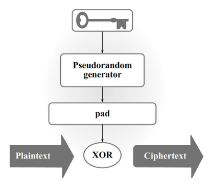
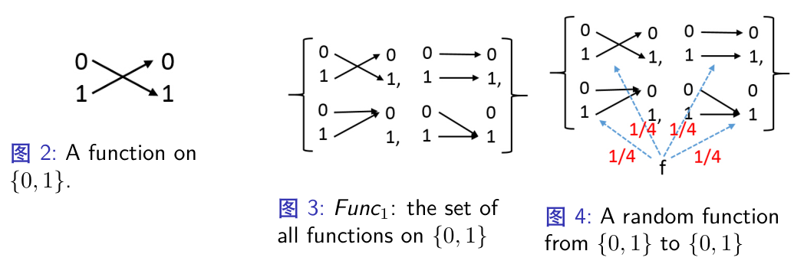
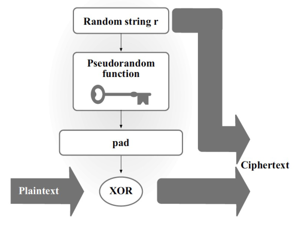
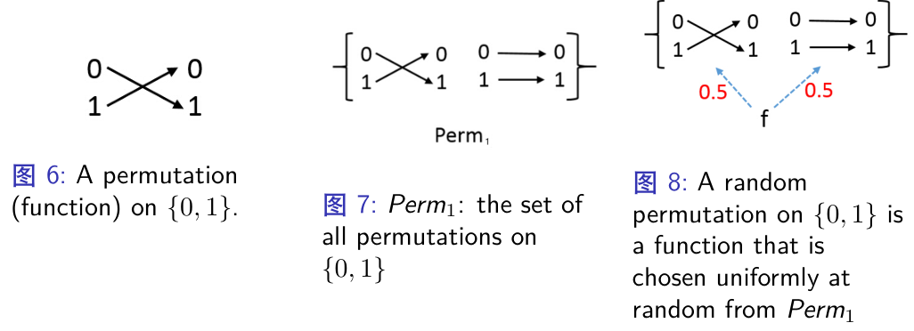

# CPA 安全与伪随机函数

CRYPTOGRAPHY · 0421 分钟阅读

## 为什么需要更强的安全性：

### 单次加密与多次加密：

之前的敌手不可区分性游戏 $\operatorname{PrivK}_{A,\Pi}^{eav}$ 中，敌手只能观察一个密文

但实际使用中，我们通常会用同一个密钥加密多个明文，敌手也就能观察到多个密文

那么，一个方案在单次加密时是安全的，是否代表它在多次加密时也安全？

**不一定**

例如，使用 PRG 构造加密方案：
$$
\operatorname{Enc}_k(m) := G(k) \oplus m
$$
每一次加密都使用相同的密钥 $k$ ，也就会生成同一个 pad：

如果我们分别加密两组明文：$(\text{cat},\text{cat})$ 和 $(\text{cat},\text{dog})$ ，那么：

- 第一组明文相同，得到的两个密文也相同
- 第二组明文不同，得到的两个密文也不同

这样，敌手只需要比较两个密文是否相等，就能知道加密的是哪一组明文

也就是说，**单次加密不可区分，不代表多次加密不可区分**

### 多消息窃听实验（Multiple-message eavesdropping experiment）：

我们将这个游戏记为 $\operatorname{PrivK}_{A,\Pi}^{mult}(n)$ ，其中 $n$ 是安全参数（security parameter）

游戏步骤：

- 敌手 $A$ 选择两组明文：
  $$
  \vec{M}_0 = (m_{0,1},...,m_{0,t}),\qquad
  \vec{M}_1 = (m_{1,1},...,m_{1,t})
  $$
  两组明文的数量相同，而且每个对应位置的明文长度相同，即 $|m_{0,i}| = |m_{1,i}|$

- 挑战者运行 $\operatorname{Gen}(1^n)$ 生成密钥 $k$ ，并均匀地选择一个 $b \in \{0,1\}$ 

- 挑战者用同一个密钥 $k$ 加密第 $b$ 组明文：
  $$
  c_i \leftarrow \operatorname{Enc}_k(m_{b,i}),\qquad i = 1,...,t
  $$
  然后将密文组 $\vec{C} = (c_1,...,c_t)$ 发送给敌手

- 敌手根据这些密文猜测 $b$ ，输出 $b'$
- 当 $b' = b$ 时，实验输出 1，表示敌手成功；否则输出 0

### 多次加密不可区分性（Indistinguishable multiple encryptions）：

定义：一个私钥加密方案 $\Pi = (\operatorname{Gen},\operatorname{Enc},\operatorname{Dec})$ 在窃听攻击下具有多次加密不可区分性，当且仅当对于任意 PPT 敌手 $A$ ，都存在一个可忽略函数 $\operatorname{negl}$ ，使得：
$$
\Pr[\operatorname{PrivK}_{A,\Pi}^{mult}(n) = 1]
\leq \frac{1}{2} + \operatorname{negl}(n)
$$
其中，PPT 表示概率多项式时间（Probabilistic Polynomial Time），也就是说敌手只能进行有效率的计算

通俗来说，即便敌手能看到同一个密钥加密得到的多个密文，也不能比随机猜测明显更好

前面的例子说明：对于这里的无状态加密方案，**需要在每次加密时引入随机性**，避免相同明文总是产生相同密文

## 选择明文攻击与 CPA 安全：

### 什么是选择明文攻击（Chosen-Plaintext Attack）：

选择明文攻击，简称 CPA，指敌手能够选择一些明文，让加密方对这些明文进行加密，并获取对应的密文

这比单纯观察密文更强，因为敌手可以主动选择输入，观察加密结果

CPA 也包含已知明文攻击（Known-Plaintext Attack）：敌手既然能够选择明文并获取密文，自然也就知道了明文与密文的对应关系

### 加密预言机（Encryption oracle）：

我们将这个能力记为 $\operatorname{Enc}_k(\cdot)$ 的预言机访问（oracle access）

通俗来说，敌手面前有一个加密黑盒：

- 输入一个自己选择的明文 $m$ 
- 黑盒用固定的秘密密钥 $k$ 加密，返回 $c \leftarrow \operatorname{Enc}_k(m)$ 
- 敌手可以多次查询，但不能直接获取密钥 $k$ 

如果加密算法是概率的，那么每次调用都会使用新的随机数

### CPA 不可区分性游戏（CPA indistinguishability experiment）：

我们将这个游戏记为 $\operatorname{PrivK}_{A,\Pi}^{cpa}(n)$ 

游戏步骤：

- 挑战者运行 $\operatorname{Gen}(1^n)$ 生成密钥 $k$ 
- 敌手 $A$ 获得安全参数 $1^n$ ，以及加密预言机 $\operatorname{Enc}_k(\cdot)$ 的访问权限
- 敌手可以先查询一些明文，然后选择两个等长明文 $m_0,m_1$ ，发送给挑战者
- 挑战者均匀地选择 $b \in \{0,1\}$ ，计算挑战密文：
  $$
  c^* \leftarrow \operatorname{Enc}_k(m_b)
  $$
  然后将 $c^*$ 发送给敌手

- 敌手在收到挑战密文后，**仍然可以继续查询加密预言机**，最后输出猜测 $b'$ 
- 当 $b' = b$ 时，实验输出 1；否则输出 0

整个游戏中使用的是同一个密钥 $k$ 

注意，敌手可以查询 $m_0,m_1$ 本身。如果一个无状态加密算法是确定性的，敌手就能将查询结果与挑战密文进行比较，从而区分两个不同的明文

### CPA 安全的定义：

一个私钥加密方案 $\Pi$ 是 CPA 安全的，当且仅当对于任意 PPT 敌手 $A$ ，都存在一个可忽略函数 $\operatorname{negl}$ ，使得：
$$
\Pr[\operatorname{PrivK}_{A,\Pi}^{cpa}(n) = 1]
\leq \frac{1}{2} + \operatorname{negl}(n)
$$
也就是说，即便敌手可以主动获取自己选择的明文的加密结果，也不能有效判断挑战密文对应的是 $m_0$ 还是 $m_1$ 

我们可以用伪随机函数（PRF）构造这样的加密方案

## 伪随机函数（Pseudorandom Functions）：

### 什么是伪随机函数：

如果我们想得到“看起来随机”的**字符串**，可以使用伪随机生成器（PRG）

如果我们想得到“看起来随机”的**函数**，就需要伪随机函数（PRF）

这里的“看起来随机”，是指有效率的敌手不能将它与真正随机选择的函数区分开

### 函数与随机函数（Random function）：

一个函数是从输入空间到输出空间的映射：
$$
f : \{0,1\}^{l_{in}} \rightarrow \{0,1\}^{l_{out}}
$$
如果 $l_{in} = l_{out}$ ，就称这个函数是保长的（length-preserving）

我们用 $\operatorname{Func}_n$ 表示所有从 $\{0,1\}^n$ 到 $\{0,1\}^n$ 的函数组成的集合

例如，当 $n = 1$ 时，输入只有 0 和 1，每个输入的输出都可以独立选择为 0 或 1，因此一共有四个函数：

一般情况下：

- 一共有 $2^n$ 个输入
- 每个输入都有 $2^n$ 种输出选择

所以函数的总数是：
$$
|\operatorname{Func}_n| = (2^n)^{2^n} = 2^{n\cdot 2^n}
$$
**随机函数**就是从 $\operatorname{Func}_n$ 中均匀随机地选择一个函数 $f$ 

注意，随机的是“选择哪个函数”。一旦选定了 $f$ ，同一个输入的输出就固定了：

- 重复查询相同的 $x$ ，总是得到相同的 $f(x)$ 
- 对不同的输入，输出是相互独立的均匀随机值，但也有可能相等

### 带密钥的函数（Keyed function）：

一个带密钥的函数有两个输入：
$$
F : \{0,1\}^{l_{key}} \times \{0,1\}^{l_{in}}
\rightarrow \{0,1\}^{l_{out}}
$$
其中，第一个输入是密钥 $k$ ，第二个输入是普通输入 $x$ 

本讲主要考虑 $l_{key}(n) = l_{in}(n) = l_{out}(n) = n$ 的情况

如果给定 $k,x$ 后，可以在多项式时间内计算 $F(k,x)$ ，就称 $F$ 是有效率的（efficient）

实际使用时，我们先选择并固定一个密钥 $k$ ，于是得到一个单输入函数：
$$
F_k(x) := F(k,x)
$$
也就是说，$F$ 是一族由密钥决定的函数，而 $F_k$ 是固定密钥之后的其中一个函数

### PRF 的定义：

令 $F$ 是一个有效率的保长带密钥函数（a length-preserving keyed function）

如果均匀随机选择密钥得到的 $F_k$ ，与均匀随机选择的函数 $f$ 无法被 PPT 区分器有效区分，就称 $F$ 是一个 PRF

形式化地，对于任意 PPT 区分器 $D$ ，都存在一个可忽略函数 $\operatorname{negl}$ ，使得：
$$
\left|
\Pr[D^{F_k(\cdot)}(1^n) = 1]
-
\Pr[D^{f(\cdot)}(1^n) = 1]
\right|
\leq \operatorname{negl}(n)
$$
上标表示区分器可以访问对应的函数预言机。它可以选择输入 $x$ 并获取函数值，但不知道秘密密钥 $k$

通俗来说，我们给敌手两个可能的黑盒：一个是 PRF，另一个是真正随机的函数。即便敌手进行了多次查询，也不能有效判断自己拿到的是哪一个

## 用 PRF 构造 CPA 安全的加密方案：

### 基本思路：

之前的问题是：同一个密钥 $k$ 每次都生成相同的 pad

现在，我们在每次加密时随机选择一个 $r$ ，将 $r$ 输入 PRF，生成 $F_k(r)$ 作为 pad，再与明文进行异或：

为了让接收者也能计算出相同的 pad，我们需要把 $r$ 和异或结果一起发送

### 构造方法：

令 $F : \{0,1\}^n \times \{0,1\}^n \rightarrow \{0,1\}^n$ 是一个 PRF，明文空间为 $\mathcal{M} = \{0,1\}^n$ 

- **Gen（密钥生成算法）**：输入 $1^n$ ，均匀随机地选择 $k \in \{0,1\}^n$ ，输出密钥 $k$ 

- **Enc（加密算法）**：输入密钥 $k$ 和明文 $m$ ，均匀随机地选择 $r \in \{0,1\}^n$ ，输出：
  $$
  c := \langle r,F_k(r) \oplus m \rangle
  $$

- **Dec（解密算法）**：输入密钥 $k$ 和密文 $c = \langle r,s \rangle$ ，输出：
  $$
  m := F_k(r) \oplus s
  $$

解密正确性由异或的性质直接得到：
$$
F_k(r) \oplus s
= F_k(r) \oplus (F_k(r) \oplus m)
= m
$$
注意，$r$ 不需要保密，它本身就是密文的一部分；需要保密的是密钥 $k$ 

如果两次加密恰好选择了相同的 $r$ ，就会重复使用相同的 pad。安全性证明中需要考虑这个事件的概率

### CPA 安全性：

结论：如果 $F$ 是 PRF，那么上面的加密方案 $\Pi$ 就是 CPA 安全的

证明分为两个步骤：先把 PRF 替换成真正随机的函数，再分析随机函数下敌手成功的概率

#### 第一步：将 PRF 替换为随机函数：

构造一个类似的方案 $\widetilde{\Pi}$ ，只将 $F_k$ 替换成一个真正随机的函数 $f$ ：
$$
c := \langle r,f(r) \oplus m \rangle
$$
这里的 $f$ 在整个游戏开始时选定，之后所有加密都使用同一个 $f$ 

如果某个 PPT 敌手在这两个方案中的成功概率有明显差异，我们就可以利用它区分 $F_k$ 和 $f$ ，这与 PRF 的定义矛盾

具体来说，PRF 区分器 $D$ 拿到函数黑盒 $O(\cdot)$ 后，可以作为 CPA 游戏的挑战者：

- 可以用 $\langle r,O(r)\oplus m\rangle$ 回答敌手的加密查询
- 敌手是否猜对，就成为区分器的输出

因此，假如 PPT 敌手在该 CPA 实验中能够进行有效判断，那么 $D$ 就能有效区分 $f$ 和 $F_k$ 

故必须有：
$$
\left|
\Pr[\operatorname{PrivK}_{A,\Pi}^{cpa}(n) = 1]
-
\Pr[\operatorname{PrivK}_{A,\widetilde{\Pi}}^{cpa}(n) = 1]
\right|
\leq \operatorname{negl}(n)
$$

这实际上就是对问题进行 **规约** 

#### 第二步：分析随机函数方案：

令挑战密文为 $c^* = \langle r^*,f(r^*) \oplus m_b \rangle$ ，敌手在挑战前后最多进行 $q(n)$ 次加密查询

分两种情况讨论：这些查询中的随机数 $r$ ，是否与挑战使用的 $r^*$ 相同

- **没有查询与 $r^*$ 相同**：

  $f(r^*)$ 是一个敌手没有见过的、独立的均匀随机 pad

  这样，挑战密文的第二部分就相当于一次一密，敌手只能随机猜测，成功概率为 $\frac{1}{2}$ 

- **至少有一次查询与 $r^*$ 相同**：

  敌手知道查询的明文与密文，因此可能恢复 $f(r^*)$ ，再判断挑战明文

  这种情况敌手成功概率为 $1$ 

每次加密都独立地选择一个 $n$ 位随机数，与 $r^*$ 相同的概率是 $\frac{1}{2^n}$ ，最多 $q(n)$ 次查询，则有：
$$
\Pr[\text{至少一次查询与挑战的随机数相同}]
\leq \frac{q(n)}{2^n}
$$
令 $E$ 表示“至少一次查询与挑战的随机数相同”，根据全概率公式：
$$
\begin{align*}
\Pr[\operatorname{PrivK}_{A,\widetilde{\Pi}}^{cpa}(n) = 1]
&= \Pr[\text{成功}\mid \neg E]\Pr[\neg E]
+ \Pr[\text{成功}\mid E]\Pr[E] \\
&\leq \frac{1}{2}\cdot 1 + 1\cdot \frac{q(n)}{2^n} \\
&= \frac{1}{2} + \frac{q(n)}{2^n}
\end{align*}
$$
这里不要求所有加密查询的随机数彼此不同，只需要挑战使用的 $r^*$ 没有在其他查询中出现

#### 合并两个步骤：

$$
\Pr[\operatorname{PrivK}_{A,\Pi}^{cpa}(n) = 1]
\leq \frac{1}{2} + \frac{q(n)}{2^n} + \operatorname{negl}(n)
$$
因为敌手是 PPT 的，所以 $q(n)$ 是多项式，而 $2^n$ 是指数增长的，$\frac{q(n)}{2^n}$ 是可忽略的

因此，敌手的成功概率至多为 $\frac{1}{2}$ 加上一个可忽略量，方案是 CPA 安全的

### CPA 安全与多次加密：

结论：**一个 CPA 安全的私钥加密方案，也具有多次加密下的 CPA 安全性** 

也就是说，只需要证明单个挑战密文的 CPA 安全，就能得到多个挑战密文的 CPA 安全

可以这样理解：将一组挑战密文中的明文从第 0 组逐个替换为第 1 组，每一步只改变一个明文

如果敌手能有效区分最开始和最后的两组密文，那么它必定能在某一步区分这一个明文的变化。而其他位置的密文可以通过加密预言机生成，这就违背了单个挑战密文的 CPA 安全性

这种逐个替换的方法叫做混合论证（hybrid argument）

## 伪随机置换（Pseudorandom Permutations）：

### 置换与随机置换：

置换（permutation）是从 $\{0,1\}^n$ 到自身的一一映射，也就是双射（bijection）

它与一般函数的区别是：**不同的输入一定得到不同的输出**，而且每一个输出都有唯一对应的输入

因此，置换存在逆函数，可以根据输出恢复输入

我们用 $\operatorname{Perm}_n$ 表示 $\{0,1\}^n$ 上所有置换组成的集合

例如，当 $n = 1$ 时，只有两个置换：保持 0、1 不变，或者交换 0、1

一般情况下，置换的总数是：
$$
|\operatorname{Perm}_n| = (2^n)!
= 2^n \cdot (2^n - 1) \cdot ... \cdot 1
$$
随机置换（random permutation），就是从 $\operatorname{Perm}_n$ 中均匀随机地选择一个置换 $f$ 

### 带密钥的置换与 PRP：

如果一个带密钥的函数 $F$ 满足：

- 输入长度与输出长度相同
- 对于每一个密钥 $k$ ，$F_k$ 都是一一映射

就称 $F$ 是带密钥的置换（keyed permutation）

我们将输入长度称为分组长度（block length）

如果给定密钥后，$F_k(x)$ 和逆函数 $F_k^{-1}(y)$ 都能在多项式时间内计算，就称它是有效率的

如果均匀随机选择密钥得到的 $F_k$ ，与真正随机的置换无法被 PPT 区分器有效区分，就称 $F$ 是伪随机置换，简称 PRP

注意，PRF 比较的对象是**随机函数**，PRP 比较的对象是**随机置换**

### PRP 与 PRF 的关系：

结论：如果一个 PRP 的分组长度足够大，那么它也可以作为 PRF

课件中的条件是：分组长度 $l_{in}(n) \geq n$ 

通俗来说，随机函数和随机置换的主要区别在于是否会出现输出碰撞（collision）：
$$
x \neq y,\qquad f(x) = f(y)
$$

- 随机置换中，不可能出现这种情况
- 随机函数中，可能出现这种情况

但如果输出空间足够大，敌手只进行了多项式次数的查询，那么观察到碰撞的概率是可忽略的

具体来说，对 $q(n)$ 个不同输入，随机函数出现输出碰撞的概率至多为：
$$
\frac{q(n)(q(n)-1)}{2\cdot 2^{l_{in}(n)}}
$$
当 $l_{in}(n) \geq n$ 时，这个概率是可忽略的，因此敌手难以利用碰撞区分随机函数与随机置换

## 强伪随机置换与分组密码：

### 强伪随机置换（Strong pseudorandom permutation）：

普通 PRP 的区分器只能查询正向函数

但实际使用中，合法用户可能还需要计算逆函数，所以我们进一步考虑：如果敌手也能查询逆函数，是否仍然无法区分？

如果给敌手正向函数与逆函数两个预言机后，$F_k$ 仍然与真正随机的置换不可区分，就称 $F$ 是强伪随机置换

形式化地，对于任意 PPT 区分器 $D$ ，都存在一个可忽略函数 $\operatorname{negl}$ ，使得：
$$
\left|
\Pr[D^{F_k(\cdot),F_k^{-1}(\cdot)}(1^n) = 1]
-
\Pr[D^{f(\cdot),f^{-1}(\cdot)}(1^n) = 1]
\right|
\leq \operatorname{negl}(n)
$$
其中 $k$ 是均匀随机选择的密钥，$f$ 是从 $\operatorname{Perm}_n$ 中均匀随机选择的置换，两种情况都包含 $D$ 的随机性

也就是说，即便敌手能够进行正向和反向查询，也不能有效判断黑盒是不是一个真正随机的置换

### 与分组密码（Block ciphers）的关系：

实际中的分组密码使用固定的密钥长度和分组长度，设计目标是实现安全的（强）伪随机置换

固定密钥之后，分组密码将一个明文分组映射为一个密文分组；解密则计算对应的逆函数

当分组长度足够大时，根据前面的 PRP 与 PRF 的关系，也可以在只需要正向函数的构造中，将安全的 PRP 当作 PRF 使用

## PRF 与 PRG 的关系：

### 用 PRF 构造 PRG：

令 $F$ 是一个 PRF，将种子 $s$ 作为密钥，依次计算不同输入上的函数值，然后拼接：
$$
G(s) := F_s(1) \parallel F_s(2) \parallel ... \parallel F_s(l)
$$
其中 $\parallel$ 表示拼接（concatenation）， $l$ 应为多项式规模

如果 $F_s$ 的输出长度为 $n$ ，那么 $G(s)$ 的输出长度就是 $ln$ ，当 $l > 1$ 时就实现了扩展

为什么它是伪随机的？如果将 $F_s$ 替换为真正随机的函数 $f$ ，由于输入互不相同，$f(1),...,f(l)$ 就是相互独立的均匀随机字符串，拼接后仍然是均匀随机字符串

如果敌手能区分 $G(s)$ 与均匀随机字符串，就能利用这些查询区分 PRF 与随机函数，违背 PRF 的安全性

### 用 PRG 的输出表示一个函数：

课件还给出了一个直观方法：把 PRG 的输出看作函数的完整查找表

假设函数输入为 $n$ 位，输出为 $t(n)$ 位。一共有 $2^n$ 个输入，每个输入都需要一个 $t(n)$ 位的输出，因此整张表需要：
$$
2^n \cdot t(n)
$$
位比特

将 $G(k)$ 的输出记为 $y_0,y_1,...$ ，把输入 $x \in \{0,1\}^n$ 看作一个从 0 到 $2^n-1$ 的整数，定义：
$$
F_k(x) := y_{x\cdot t(n)}y_{x\cdot t(n)+1}...y_{x\cdot t(n)+t(n)-1}
$$
也就是说，用 $x$ 作为索引，取出第 $x$ 个长度为 $t(n)$ 的块，作为函数输出

注意，课件第 40 页写的扩展长度是 $n\cdot 2^{t(n)}$ ，与这里给定的输入、输出长度及索引公式不一致。按照查找表所需的比特数，应为 $2^n\cdot t(n)$

而且，直接生成整张表需要指数长度的输出，因此这个方法主要用来理解两者的关系，不能直接作为有效率的 PRF 构造

要从通常的多项式时间 PRG 构造有效率的 PRF，还需要进一步的构造，本讲没有展开

