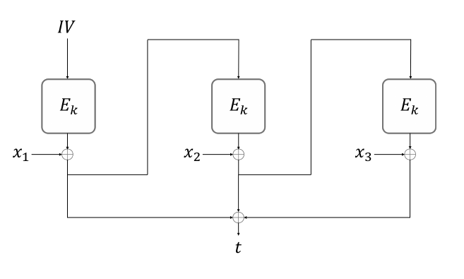

# 2023 密码学期中考试与解答

CRYPTOGRAPHY · 202315 分钟阅读

## 1.（20 分）

考虑 26 个罗马字母上的凯撒移位密码。我们把字母映射为 0–25 中的一个数字，记作 $x$，再加上一个密钥值 $k\in[0,25]$，计算 $y=x+k \bmod 26$，然后映射回字母表。若 $k$ 是均匀随机选取的，那么该密码是完全保密的。

(a) 证明：如果把 $k$ 的范围扩大到 $[0,30]$，该密码就不再是完全保密的。

(b) 通常，要达到完全保密所要求的均匀性，密钥空间的大小必须是密文空间大小的倍数，且密钥需均匀随机选取。不过也可以用其他方式（例如使用非线性的 KEYGEN 算法）实现完全保密。你能否在 $[0,30]$ 上设计一个 KEYGEN 算法，使该密码完全保密？

## 2.（20 分）

对下列每个函数，判断它们是否**必然**是关于 $n$ 的可忽略函数，并对 (d) 和 (e) 给出简要说明。

(a) $f_1(n)=2^{-\sqrt{\log n}}$。

(b) $f_2(n)=n^{-\log\log\log n}$。

(c) $f_3(n)=\dfrac{n!}{n^n}$。

(d) $f_4(n)=(g(n))^{n}$，其中 $g(n)$ 是不可忽略函数，且对所有 $n\ge 1$ 都有 $0<g(n)<1$。

(e) $f_5(n)=g(h(n))$，其中 $g(n)$ 与 $h(n)$ 都是可忽略的（且为正）。

## 3.（20 分）

考虑伪随机生成器 $G:\{0,1\}^{n}\to\{0,1\}^{2n}$，现定义 $G'=G(x)_{[0,n)}\,\|\,G(G(x)_{[n,2n)})$，证明 $G'$ 是 PRG，或者给出反例。

## 4.（20 分）

假设 $\Pi$ 是一个 CPA 安全的方案，其密钥空间为 $\{0,1\}^{n}$。令 $\Pi'$ 是一个派生方案，它对消息 $M$ 的加密如下：

$$
\mathit{Enc}_{K}^{\Pi'}(M)=\mathit{Enc}_{K}^{\Pi}(M)\,\|\,\mathit{LSB}(K)
$$

其中 $\mathit{LSB}(K)$ 是从密钥空间中均匀随机选取的 $K$ 的最低有效位。$\Pi'$ 是 CPA 安全的方案吗？证明你的答案。

## 5.（20 分）

本题研究一个基于 CFB 加密模式的 MAC 方案。考虑分组密码

$$
E:\{0,1\}^{64}\times\{0,1\}^{64}\to\{0,1\}^{64},
$$

其中 $E_k(x)=E(k,x)$ 表示用密钥 $k$ 对明文 $x$ 的加密。给定消息 $m\in\{0,1\}^{*}$ 与密钥 $k$，其 CFB-MAC 由如下方式得到：先用 CFB 加密模式、以 $E_k$ 加密 $m$，再把各输出分组异或合并。

更准确地说，对于消息

$$
m=x_1\|x_2\|\ldots\|x_n,
$$

我们有

$$
\text{CFB-MAC}_k(m)=y_1\oplus y_2\oplus\ldots\oplus y_n,
$$

其中对 $i=2,\ldots,n$ 有 $y_i=E_k(y_{i-1})\oplus x_i$，且 $y_1=E_k(IV)\oplus x_1$，$IV$ 为初始向量。为简单起见，我们假设所有消息的长度都是 64 比特的整数倍。本题所有小题中我们还假设 $IV$ 是常量且已知。

(a) 假设我们可以访问一个谕言机 $\mathcal{O}$，它在给定的秘密密钥 $k$ 与固定已知的 $IV$ 下计算 CFB-MAC。证明：只需向该谕言机查询一条消息，就能恢复 $E_k(IV)$。

(b) 假设给定 $IV$、$E_k(IV)$ 以及 $h\in\{0,1\}^{64}$。说明如何生成一个由两个分组组成的消息 $m$，使得 $\text{CFB-MAC}_k(m)=h$。

---

## 密码学期中考试解答

## 1.

(a)

$$
\Pr[C=0\mid M=0]=\Pr[k\in\{0,26\}]=\frac{2}{31},
$$

$$
\Pr[C=0\mid M=16]=\Pr[k=10]=\frac{1}{31},
$$

$$
\Pr[C=0\mid M=0]\neq\Pr[C=0\mid M=16].
$$

(b) 我们以概率 $\frac{1}{52}$ 选取密钥 $\{0,1,2,3,4,26,27,28,29,30\}$，以概率 $\frac{1}{26}$ 选取其他密钥，那么该移位密码仍然完全保密。

实际上，你只需保证
$\Pr[k\in\{0,26\}]=\Pr[k\in\{1,27\}]=\ldots=\Pr[k\in\{4,30\}]=\Pr[k=5]=\Pr[k=6]=\ldots=\Pr[k=25]$
成立。

## 2.

(a) 否。当 $n>2$ 时，$\sqrt{\log n}<\log n$，$f_1(n)=2^{-\sqrt{\log n}}>2^{-\log n}$。而 $2^{-\log n}=n^{-1}\neq O(n^{-2})$ 是不可忽略的。因此，$f_1(n)$ 是不可忽略的。

(b) 是。对任意常数 $c$，对满足 $\log\log\log n\ge c+1$（即所有 $n>2^{2^{2^{c+1}}}$）的所有 $n$，都有 $0<n^{\,c-\log\log\log n}<n^{-1}$。由夹逼引理：

$$
\lim_{n\to\infty}n^{-1}=0\ \Longrightarrow\ \lim_{n\to\infty}\frac{n^{c}}{n^{\log\log\log n}}=0
$$

(c) 是。由斯特林近似，我们知道

$$
n!\sim\sqrt{2\pi n}\left(\frac{n}{e}\right)^{n}
$$

因此，

$$
f_3(n)\sim\sqrt{2\pi n}\left(\frac{1}{e}\right)^{n}
$$

对任意常数 $c$，我们有

$$
\lim_{n\to\infty}n^{c}\cdot f_3(n)\sim\lim_{n\to\infty}\frac{\sqrt{2\pi}\,n^{\,c-\frac{1}{2}}}{e^{n}}=0
$$

(d) 否。假设 $g(n)=\dfrac{n}{n+1}$，它满足要求：对所有 $n\ge 1$ 有 $0<g(n)<1$，且 $f_4(n)$ 是不可忽略的，因为

$$
\lim_{n\to\infty}f_4(n)=\lim_{n\to\infty}(g(n))^{n}=\lim_{n\to\infty}\left(\frac{n}{n+1}\right)^{n}=1
$$

(e) 否。因为 $h(n)$ 是可忽略的，当 $n\to\infty$ 时 $h(n)\to 0$，但当 $n\to 0$ 时，可忽略函数可能不再是可忽略的。例如，当 $g(n)=e^{-n}$ 时，对任意 $h(n)$，

$$
\lim_{n\to\infty}f_5(n)=\lim_{n\to\infty}\frac{1}{e^{h(n)}}=1
$$

## 3.

$G'$ 是 PRG。

首先，我们定义 $H(y)=y_{[0,n)}\,\|\,G(y_{[n,2n)})$，其中 $y$ 是一个随机的 $2n$ 比特串。由于 $G$ 是 PRG，所以对任意 PPT 算法 $\mathcal{D}$，存在可忽略函数 $negl_1$ 使得

$$
\left|\Pr[\mathcal{D}(H(y))=1]-\Pr[\mathcal{D}(G'(x))=1]\right|\le negl_1(n).
$$

否则，我们可以基于 $\mathcal{D}$ 构造一个区分器 $\mathcal{D}'$：$\mathcal{D}'(s)=\mathcal{D}(s_{[0,n)}\,\|\,G(s_{[n,2n)}))$，使得

$$
\begin{aligned}
&\left|\Pr[\mathcal{D}'(r)=1]-\Pr[\mathcal{D}'(G(x))=1]\right|\\
&=\left|\Pr[\mathcal{D}(H(r))=1]-\Pr[\mathcal{D}(G'(x))=1]\right|
\end{aligned}
$$

是不可忽略的，这与 $G$ 是 PRG 相矛盾。

类似地，我们可以证明：对任意 PPT 算法 $\mathcal{D}$，存在可忽略函数 $negl_2$ 使得

$$
\left|\Pr[\mathcal{D}(H(y))=1]-\Pr[\mathcal{D}(r)=1]\right|\le negl_2(n),
$$

其中 $r$ 是一个随机的 $3n$ 比特串。

综上，对任意 PPT 算法 $\mathcal{D}$，存在可忽略函数 $negl_1$ 与 $negl_2$ 使得

$$
\begin{aligned}
&\left|\Pr[\mathcal{D}(G'(x))=1]-\Pr[\mathcal{D}(r)=1]\right|\\
&=\left|\left(\Pr[\mathcal{D}(G'(x))=1]-\Pr[\mathcal{D}(H(y))=1]\right)+\left(\Pr[\mathcal{D}(H(y))=1]-\Pr[\mathcal{D}(r)=1]\right)\right|\\
&\le\left|\Pr[\mathcal{D}(H(y))=1]-\Pr[\mathcal{D}(r)=1]\right|+\left|\Pr[\mathcal{D}(H(y))=1]-\Pr[\mathcal{D}(G'(x))=1]\right|\\
&\le negl_1(n)+negl_2(n)
\end{aligned}
$$

是可忽略的，这意味着 $G'$ 也是 PRG。

## 4.

$\Pi'$ 是 CPA 安全的。

假设 $\Pi'$ 不是 CPA 安全的，并且存在一个敌手 $\mathcal{A}'$，它能以不可忽略的概率赢下 $\Pi'$ 的 CPA 游戏。我们基于 $\mathcal{A}'$ 构造一个敌手 $\mathcal{A}$ 来攻破 $\Pi$：

1. $\mathcal{A}$ 第一次运行 $\mathcal{A}'$，收到 $m_0,m_1$；
2. $\mathcal{A}$ 把 $m_0,m_1$ 发送给 $\mathcal{C}$；
3. $\mathcal{C}$ 均匀选取一个比特 $b\xleftarrow{\$}\{0,1\}$，并把 $c=\mathit{Enc}_{\Pi(K)}(m_b)$ 发送给 $\mathcal{A}$；
4. $\mathcal{A}$ 随机选取一个比特 $r_k\xleftarrow{\$}\{0,1\}$，并把 $c\|r_k$ 发送给 $\mathcal{A}'$；
5. $\mathcal{A}'$ 把猜测 $b'$ 发送给 $\mathcal{A}$；
6. $\mathcal{A}$ 第二次运行 $\mathcal{A}'$，收到 $m_0',m_1'$；
7. $\mathcal{A}$ 就消息 $m_0'$ 查询 $\mathcal{C}$ 的谕言机，得到密文 $c'=\mathit{Enc}_{\Pi(K)}(m_0')$；
8. $\mathcal{A}$ 把 $c'\|r_k$ 发送给 $\mathcal{A}'$；
9. $\mathcal{A}'$ 把猜测 $b''$ 发送给 $\mathcal{A}$；
10. 若 $b''=0$，则 $\mathcal{A}$ 输出 $b'$，否则输出 $\overline{b'}$。

我们记 $\Pr[\mathcal{A}'\ \text{胜出}\mid r_k=\mathit{LSB}(k)]=\frac{1}{2}+\epsilon_1(n)$，$\Pr[\mathcal{A}'\ \text{胜出}\mid r_k\neq\mathit{LSB}(k)]=\frac{1}{2}+\epsilon_2(n)$。

于是，

$$
\begin{aligned}
&\Pr[\mathcal{A}\ \text{胜出}]\\
&=\Pr[\mathcal{A}\ \text{胜出}\mid r_k=\mathit{LSB}(k)]\times\Pr[r_k=\mathit{LSB}(k)]+\Pr[\mathcal{A}\ \text{胜出}\mid r_k\neq\mathit{LSB}(k)]\times\Pr[r_k\neq\mathit{LSB}(k)]\\
&=\frac{1}{2}\Pr[\mathcal{A}\ \text{胜出}\mid r_k=\mathit{LSB}(k)]+\frac{1}{2}\Pr[\mathcal{A}\ \text{胜出}\mid r_k\neq\mathit{LSB}(k)]\\
&=\frac{1}{2}\Big(\Pr[b'=b\mid r_k=\mathit{LSB}(k)]\times\Pr[b''=0\mid r_k=\mathit{LSB}(k)]\\
&\qquad+\Pr[\overline{b'}=b\mid r_k=\mathit{LSB}(k)]\times\Pr[b''=1\mid r_k=\mathit{LSB}(k)]\Big)\\
&\quad+\frac{1}{2}\Big(\Pr[b'=b\mid r_k\neq\mathit{LSB}(k)]\times\Pr[b''=0\mid r_k\neq\mathit{LSB}(k)]\\
&\qquad+\Pr[\overline{b'}=b\mid r_k\neq\mathit{LSB}(k)]\times\Pr[b''=1\mid r_k\neq\mathit{LSB}(k)]\Big)\\
&=\frac{1}{2}\Big(\Pr[\mathcal{A}'\ \text{胜出}\mid r_k=\mathit{LSB}(k)]\times\Pr[\mathcal{A}'\ \text{胜出}\mid r_k=\mathit{LSB}(k)]\\
&\qquad+\Pr[\mathcal{A}'\ \text{失败}\mid r_k=\mathit{LSB}(k)]\times\Pr[\mathcal{A}'\ \text{失败}\mid r_k=\mathit{LSB}(k)]\Big)\\
&\quad+\frac{1}{2}\Big(\Pr[\mathcal{A}'\ \text{胜出}\mid r_k\neq\mathit{LSB}(k)]\times\Pr[\mathcal{A}'\ \text{胜出}\mid r_k\neq\mathit{LSB}(k)]\\
&\qquad+\Pr[\mathcal{A}'\ \text{失败}\mid r_k\neq\mathit{LSB}(k)]\times\Pr[\mathcal{A}'\ \text{失败}\mid r_k\neq\mathit{LSB}(k)]\Big)\\
&=\frac{1}{2}\left[\left(\frac{1}{2}+\epsilon_1(n)\right)^{2}+\left(\frac{1}{2}-\epsilon_1(n)\right)^{2}\right]+\frac{1}{2}\left[\left(\frac{1}{2}+\epsilon_2(n)\right)^{2}+\left(\frac{1}{2}-\epsilon_2(n)\right)^{2}\right]\\
&=\frac{1}{2}\left(\frac{1}{2}+2\epsilon_1^{2}(n)\right)+\frac{1}{2}\left(\frac{1}{2}+2\epsilon_2^{2}(n)\right)\\
&\ge\frac{1}{2}+\epsilon_1^{2}(n)
\end{aligned}
$$

其中 $\epsilon_1(n)$ 是不可忽略的，这与 $\Pi$ 是 CPA 安全的相矛盾。

## 5.

(a) 我们可以简单地向谕言机 $\mathcal{O}$ 查询一个只含一个分组的消息 $x$。谕言机返回值 $y=x\oplus E_k(IV)$。因此，$E_k(IV)$ 可由计算 $x\oplus y$ 得到。

(b) 令 $m=x_1\|x_2$，且 $x_1=E_k(IV)\oplus IV$。于是我们得到 $y_1=IV$ 以及 $y_2=h\oplus IV$。从而

$$
x_2=E_k(y_1)\oplus y_2=E_k(IV)\oplus IV\oplus h.
$$

