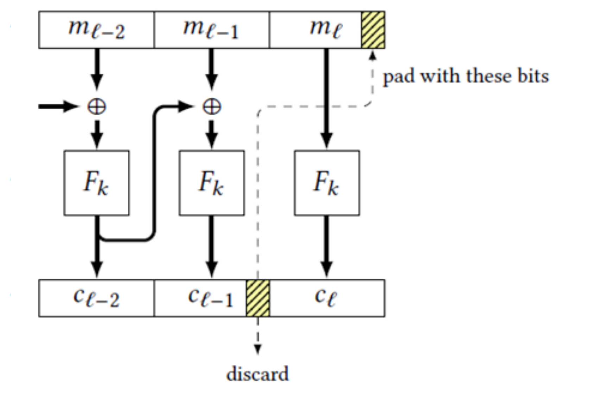

# 2025 期中试卷讲解

CRYPTOGRAPHY · 202527 分钟阅读

## Q1（10 分）：Kerckhoffs 准则与一次一密

### 题目

1. 什么是柯克霍夫准则（Kerckhoffs's Principle）？（5 分）
2. 请举出一个完美保密的加密算法的例子。为什么实际生活中，人们通常不会使用完美保密加密算法来保护数据？（5 分）

### 解答

#### 1）Kerckhoffs 准则

Kerckhoffs 准则的经典表述是：

> The cipher method must not be required to be secret, and it must be able to fall into the hands of the enemy without inconvenience.

即：**密码系统的安全性应当只依赖于密钥的保密，而不依赖于算法本身的保密**。即使加密算法、实现细节、协议格式等全部公开，只要密钥没有泄露，方案仍应是安全的。

这条准则的意义在于：

- 算法公开后可以接受公众分析，安全性更可信；
- 不需要频繁更换算法，只需要更换密钥；
- 更符合实际系统中算法会被逆向、泄露或被广泛实现的情形。

#### 2）完美保密的例子：一次一密（One-Time Pad）

一次一密用与明文等长的真随机密钥进行逐比特异或：

$$
c=m\oplus k,
$$

其中

$$
k\overset{\$}{\leftarrow}\{0,1\}^{|m|},
\qquad
|k|=|m|.
$$

解密为

$$
m=c\oplus k.
$$

一次一密满足完美保密。直观地说，对于任意明文 $m$ 和任意密文 $c$，都存在唯一的密钥 $k=m\oplus c$ 将 $m$ 加密为 $c$；当密钥在 $\{0,1\}^{|m|}$ 上均匀随机时，密文在整个密文空间上均匀分布，因此观察密文不会改变攻击者对明文的先验分布。

需要注意一次一密的三个条件：

1. 密钥必须与明文等长；
2. 密钥必须真正均匀随机；
3. 密钥只能使用一次，不能重用。

#### 3）为什么实际中不常用

一次一密虽然能达到完美保密，但代价很高：

- **密钥管理困难**：每次通信都要共享与消息等长的随机密钥，而且不能重复使用；
- **密钥分发问题**：安全地传送如此长的密钥本身就需要安全信道；
- **存储与带宽开销大**：密钥的存储、传输成本与消息本身相当，规模一大就难以承受。

因此，实际系统通常使用计算安全的方案（如基于 PRG、PRF、分组密码的方案），用较短的密钥保护大量数据。

## Q2（10 分）：可忽略函数

### 题目

若 $g,h$ 都是可忽略函数，则以下哪些函数 $f$ **一定是**可忽略的？请直接给出结论，不需要说明理由。（10 分）

1. $f(n)=(\log n)^{-\log n}$
2. $f(n)=\binom{n}{c}^{-1}=\left(\dfrac{n!}{c!(n-c)!}\right)^{-1}$
3.

$$
f(n)=
\begin{cases}
f\left(\dfrac n3\right), & n\equiv 0\pmod 3,\\[4pt]
3^{-n}, & \text{otherwise}
\end{cases}
$$

4. $f(n)=g(n)+h(n)$
5. $f(n)=g(n)/h(n)$

### 1）$f(n)=(\log n)^{-\log n}$：是

要证明 $f$ 可忽略，只需证明：对任意常数 $c>0$，当 $n$ 足够大时，

$$
(\log n)^{-\log n}<\frac{1}{n^c}.
$$

这是因为任意正多项式 $p(n)$ 最终都被某个单项式 $n^c$（取 $c=\deg p+1$ 即可）控制。

等价地，

$$
(\log n)^{\log n}>n^c.
$$

两边取自然对数：

$$
\log n\cdot \log\log n>c\log n.
$$

由于 $\log n>0$，可约去 $\log n$，得到

$$
\log\log n>c.
$$

因此只要取

$$
n_0=e^{e^c},
$$

则对所有 $n>n_0$，都有 $\log\log n>c$，上述不等式成立。

所以对任意常数 $c>0$，$f(n)<n^{-c}$ 最终成立，即 $f(n)$ 比任何多项式倒数都小：

$$
f(n)=(\log n)^{-\log n}=\operatorname{negl}(n).
$$

### 2）$f(n)=\binom{n}{c}^{-1}$：否

设 $c$ 为常数。则

$$
f(n)=\binom{n}{c}^{-1}
=\frac{c!(n-c)!}{n!}
=\frac{c!}{n(n-1)\cdots(n-c+1)}
=\Theta\left(n^{-c}\right).
$$

也就是说，$f(n)$ 只是多项式级别的衰减，并不是“比任何多项式倒数都快”。

取多项式 $p(n)=n^{c+1}$，则

$$
f(n)p(n)=\Theta(n)\to\infty,
$$

因此不可能对所有足够大的 $n$ 都有 $f(n)<1/p(n)$。所以 $f$ 不是可忽略函数。

### 3）递归定义的 $f$：否

当 $n=3^k$ 时，反复使用递归式：

$$
f(3^k)=f(3^{k-1})=\cdots=f(1).
$$

而 $1\not\equiv 0\pmod 3$，所以

$$
f(1)=3^{-1}=\frac13.
$$

因此存在无限多个 $n=3^k$，使得

$$
f(n)=\frac13,
$$

它并不趋于 $0$，更不可能小于任意多项式的倒数。所以 $f$ 不是可忽略函数。

### 4）$f(n)=g(n)+h(n)$：是

设 $g,h$ 都是可忽略函数。对任意正多项式 $p(n)$，存在 $N_1,N_2$，使得当 $n>N_1$ 时

$$
|g(n)|<\frac{1}{2p(n)},
$$

当 $n>N_2$ 时

$$
|h(n)|<\frac{1}{2p(n)}.
$$

取 $N=\max(N_1,N_2)$，则当 $n>N$ 时，

$$
|f(n)|
\le |g(n)|+|h(n)|
<\frac{1}{2p(n)}+\frac{1}{2p(n)}
=\frac{1}{p(n)}.
$$

所以 $f$ 可忽略。**两个可忽略函数之和仍可忽略**。

### 5）$f(n)=g(n)/h(n)$：否

可忽略函数对除法不封闭。反例：取

$$
g(n)=2^{-n},
\qquad
h(n)=2^{-2n}.
$$

二者都是可忽略函数，但

$$
f(n)=\frac{g(n)}{h(n)}
=\frac{2^{-n}}{2^{-2n}}
=2^n,
$$

它增长得比任何多项式都快，显然不是可忽略函数。

## Q3（20 分）：PRG 的变形

### 题目

假设 $G$ 是一个伪随机数发生器（PRG）。请问以下函数是否**一定**是伪随机数发生器？请简要说明理由。其中 $|a|$ 表示比特串 $a$ 的比特长度。（20 分）

1. 定义

$$
G'(s)\overset{\mathrm{def}}{=}G(s_1s_2\cdots s_{|s|-1})\,\|\,s_{|s|},
$$

其中 $\|$ 表示比特串拼接。

2. 定义

$$
G'(s)\overset{\mathrm{def}}{=}G(s)\oplus\left(s\,\|\,0^{|G(s)|-|s|}\right),
$$

其中 $\oplus$ 表示按位异或。

3. 定义 $G'(s)$ 如下：若二进制串 $s$ 中 $1$ 的个数恰好为 $\left\lfloor\dfrac{|s|}{2}\right\rfloor$，则

$$
G'(s)\overset{\mathrm{def}}{=}0^{|G(s)|},
$$

否则

$$
G'(s)\overset{\mathrm{def}}{=}G(s).
$$

4. 定义

$$
G'(s)=G\left(s\oplus 1^{|s|}\right).
$$

### 1）$G'(s)=G(s_1\cdots s_{|s|-1})\|s_{|s|}$：是

令 $n=|s|$。当 $s$ 均匀随机时：

- 前缀 $s_1s_2\cdots s_{n-1}$ 在 $\{0,1\}^{n-1}$ 上均匀随机；
- 最后一位 $s_n$ 是独立的均匀随机比特。

由 $G$ 的伪随机性，$G(s_1\cdots s_{n-1})$ 与同样长度的均匀随机串不可区分。再在末尾拼接一个独立均匀随机比特 $s_n$，得到的整体仍然与均匀随机串不可区分。

因此 $G'$ 是 PRG。

### 2）$G'(s)=G(s)\oplus(s\|0^{|G(s)|-|s|})$：不一定

构造一个反例。取一个 PRG $H$，定义

$$
G(s)=s_1\,\|\,H(s_2s_3\cdots s_n).
$$

也就是说，$G$ 直接输出种子的第一位，其余部分由一个 PRG 生成。可以验证 $G$ 仍是 PRG：第一位 $s_1$ 本身就是均匀随机的，后面的 $H(s_2\cdots s_n)$ 是伪随机的，且与 $s_1$ 独立。

但对这个 $G$，

$$
\begin{aligned}
G'(s)
&=G(s)\oplus\left(s\|0^{|G(s)|-n}\right)\\
&=\left(s_1\oplus s_1\right)\|\cdots\\
&=0\|\cdots.
\end{aligned}
$$

$G'(s)$ 的第一位恒为 $0$，而均匀随机串的第一位以 $1/2$ 的概率为 $0$。区分器只需检查第一位是否为 $0$，其区分优势至少为 $1/2$，不可忽略。

所以 $G'$ 不一定是 PRG。

### 3）在“一半为 1”的种子上输出全零：不一定

令 $n=|s|$。满足“$1$ 的个数恰好为 $\lfloor n/2\rfloor$”的种子所占比例为

$$
\frac{\binom{n}{\lfloor n/2\rfloor}}{2^n}.
$$

由斯特林公式

$$
n!\approx \sqrt{2\pi n}\left(\frac ne\right)^n,
$$

可得中心二项式系数的估计

$$
\binom{n}{\lfloor n/2\rfloor}
=\Theta\left(\frac{2^n}{\sqrt n}\right).
$$

因此

$$
\frac{\binom{n}{\lfloor n/2\rfloor}}{2^n}
=\Theta\left(\frac{1}{\sqrt n}\right),
$$

这是**不可忽略**的。

在这些种子上，

$$
G'(s)=0^{|G(s)|}.
$$

区分器可以检查 $G'(s)$ 是否全为零：

- 在 $G'$ 的输出中，全零串出现的概率至少为 $\Theta(1/\sqrt n)$；
- 在均匀随机串中，全零串出现的概率仅为 $2^{-|G(s)|}$，是可忽略的。

两者相差不可忽略，因此 $G'$ 不是 PRG。

### 4）$G'(s)=G(s\oplus 1^{|s|})$：是

映射

$$
s\mapsto s\oplus 1^{|s|}
$$

是 $\{0,1\}^{|s|}$ 上的一个置换（每个串与自己的按位取反配对）。因此，当 $s$ 均匀随机时，$s\oplus 1^{|s|}$ 也均匀随机。

于是

$$
G'(s)=G\left(s\oplus 1^{|s|}\right)
$$

的分布与 $G(s)$ 完全相同。若 $G$ 是 PRG，则 $G'$ 也一定是 PRG。

## Q4（20 分）：PRF 的变形

### 题目

已知 $F$ 是一个伪随机函数（PRF）。请问下面的 $F'$ 是否一定是伪随机函数？请简要说明理由。（20 分）

1.

$$
F'(k,x)=F(k,x)\,\|\,F(k,\overline{x}),
$$

其中 $\|$ 表示比特串拼接，$\overline{x}$ 表示 $x$ 的按位取反。

2.

$$
F'(k,x)=F(k,G(x)),
$$

其中 $F$ 是输入长度为 $2\lambda$ 的伪随机函数，$G$ 是扩展因子 $l(n)=2n$ 的伪随机数发生器。

为方便讨论，设

$$
F:\{0,1\}^\lambda\times\{0,1\}^\lambda\to\{0,1\}^\lambda,
$$

即密钥、输入、输出均为 $\lambda$ 比特。

### 1）$F'(k,x)=F(k,x)\|F(k,\overline{x})$：不一定

$F'$ 的输出具有明显的对称结构。对任意 $x$，记

$$
F'(k,x)=a\|b,
$$

其中 $a=F(k,x)$，$b=F(k,\overline{x})$。再查询 $\overline{x}$，得到

$$
F'(k,\overline{x})
=F(k,\overline{x})\,\|\,F(k,x)
=b\|a.
$$

因此，$F'(k,x)$ 的后半段一定等于 $F'(k,\overline{x})$ 的前半段。

构造区分器 $D$：

1. 查询 $x$，得到 $y_1=a\|b$；
2. 查询 $\overline{x}$，得到 $y_2=c\|d$；
3. 若 $b=c$，输出 $1$；否则输出 $0$。

对于 $F'$，始终有 $b=c$，所以 $D$ 输出 $1$ 的概率为 $1$。

对于真正的随机函数 $f:\{0,1\}^\lambda\to\{0,1\}^{2\lambda}$，两次查询的结果 $y_1,y_2$ 是独立的均匀随机串。此时 $b$ 和 $c$ 是独立的均匀 $\lambda$ 比特串，满足 $b=c$ 的概率仅为

$$
2^{-\lambda},
$$

这是可忽略的。

因此 $D$ 的区分优势为

$$
1-2^{-\lambda},
$$

不可忽略。所以 $F'$ 不是 PRF。

### 2）$F'(k,x)=F(k,G(x))$：不一定

PRG 的安全性只保证：<strong>对均匀随机的种子，$G(x)$ 与均匀随机串不可区分</strong>。它并不保证 $G$ 对特定输入无碰撞（collision resistance），也不保证 $G$ 在个别点上的行为。

构造反例。设 $G$ 是一个安全 PRG，令 $n=\lambda$，定义

$$
G^*(x)=
\begin{cases}
0^{2n}, & x=0^n\text{ 或 }x=1^n,\\
G(x), & \text{其他情况}.
\end{cases}
$$

$G^*$ 仍是 PRG：当 $x$ 均匀随机时，命中 $0^n$ 或 $1^n$ 的概率为

$$
\frac{2}{2^n}=2^{1-n},
$$

是可忽略的；在其他所有输入上，$G^*(x)=G(x)$，与原来的 PRG 不可区分。

但用 $G^*$ 代替 $G$，记对应的构造为 $F'_{*}$：

$$
F'_{*}(k,x)=F(k,G^*(x)),
$$

则

$$
F'_{*}(k,0^n)
=F(k,G^*(0^n))
=F(k,0^{2n}),
$$

$$
F'_{*}(k,1^n)
=F(k,G^*(1^n))
=F(k,0^{2n}).
$$

于是

$$
F'_{*}(k,0^n)=F'_{*}(k,1^n)
$$

**必定成立**。

区分器只需查询 $x_1=0^n$ 和 $x_2=1^n$，检查两个输出是否相等：

- 对 $F'_{*}$，二者始终相等；
- 对真正的随机函数，两个输出相等的概率为 $2^{-\lambda}$，可忽略。

所以 $F'_{*}$ 不是 PRF，原命题“$F'$ 一定是 PRF”不成立。

---

## Q5（20 分）：PRF 输入异或仍是 PRF

### 题目

已知 $F$ 是一个安全的伪随机函数，请证明

$$
F'(k,x)=F(k,x)\oplus x
$$

也是一个安全的伪随机函数。

### 证明

设 $F_k$ 的输入、输出长度相同（否则 $F(k,x)\oplus x$ 需要先说明长度对齐）。采用反证法（归约）。

假设存在一个 PPT 敌手 $A$，能够以不可忽略的优势区分 $F'_k$ 和真正的随机函数 $f$。也就是说，存在多项式 $p(\cdot)$，使得对无限多个 $n$，

$$
\left|
\Pr\left[A^{F'_k}(1^n)=1\right]
-
\Pr\left[A^{f}(1^n)=1\right]
\right|
\ge \frac{1}{p(n)}.
$$

我们构造一个敌手 $B$，利用 $A$ 来区分 $F_k$ 和真正的随机函数。

#### 构造 $B$

$B$ 获得一个 oracle $O$，其中 $O$ 要么是 $F_k$，要么是真正的随机函数 $f$。$B$ 运行 $A$，并模拟 $A$ 的 oracle：

$$
O'(x)=O(x)\oplus x.
$$

也就是说，当 $A$ 查询 $x$ 时，$B$ 先查询自己的 oracle 得到 $O(x)$，再把 $O(x)\oplus x$ 返回给 $A$。最后，$B$ 直接输出 $A$ 的输出。

#### 分析两种情形

<strong>情形一：$O=F_k$。</strong>

此时

$$
O'(x)=F_k(x)\oplus x=F'_k(x),
$$

所以 $B$ 为 $A$ 完美模拟了 $F'_k$。因此

$$
\Pr\left[B^{F_k}(1^n)=1\right]
=
\Pr\left[A^{F'_k}(1^n)=1\right].
$$

<strong>情形二：$O=f$ 是真正的随机函数。</strong>

定义

$$
h(x)=f(x)\oplus x.
$$

由于 $f(x)$ 对每个 $x$ 都是独立均匀随机的，而“异或固定串 $x$”是 $\{0,1\}^n$ 上的一个双射，所以 $h(x)$ 对每个 $x$ 仍然是独立均匀随机的。因此 $h$ 也是一个真正的随机函数，且与 $f$ 同分布。

于是

$$
\Pr\left[B^{f}(1^n)=1\right]
=
\Pr\left[A^{h}(1^n)=1\right]
=
\Pr\left[A^{f}(1^n)=1\right].
$$

#### 得出矛盾

综合两种情形：

$$
\begin{aligned}
&\left|
\Pr\left[B^{F_k}(1^n)=1\right]
-
\Pr\left[B^{f}(1^n)=1\right]
\right|\\
&=
\left|
\Pr\left[A^{F'_k}(1^n)=1\right]
-
\Pr\left[A^{f}(1^n)=1\right]
\right|
\ge \frac{1}{p(n)}.
\end{aligned}
$$

这意味着 $B$ 以不可忽略的优势区分了 $F_k$ 和真正的随机函数，与“$F$ 是安全 PRF”矛盾。

因此假设不成立，$F'_k(x)=F_k(x)\oplus x$ 也是安全的伪随机函数

## Q6（20 分）：CBC 变体不是 CPA 安全

### 题目

证明以下方案不是 CPA 安全的。给出一个攻击方案，并计算该方案在 CPA 不可区分实验中的具体获胜概率。（20 分）

方案如图所示：

### 方案描述

设分组长度为 $\mathit{blen}$，明文分成 $l$ 个分组：

$$
m=m_1\|m_2\|\cdots\|m_l,
$$

其中前 $l-1$ 个分组各 $\mathit{blen}$ 比特，最后一个分组 $m_l$ 只有 $\mathit{blen}-1$ 比特。因此明文总长度为

$$
\mathit{blen}\,(l-1)+\mathit{blen}-1
=\mathit{blen}\,l-1.
$$

这里把 $F_k$ 视为一个分组密码（PRP），因此解密时可以使用 $F_k^{-1}$。

加密过程如下：

1. 前 $l-1$ 个分组按标准 CBC 模式加密：

$$
c_i=F_k(m_i\oplus c_{i-1}),
\qquad i=1,2,\ldots,l-1,
$$

其中 $c_0=\mathrm{IV}$。

2. 记 $c_{l-1}$ 的最后一位为

$$
p=\operatorname{lsb}(c_{l-1}).
$$

用 $p$ 将 $m_l$ 填充为完整的 $\mathit{blen}$ 比特分组 $m_l\|p$，然后计算

$$
c_l=F_k(m_l\|p).
$$

3. 输出密文

$$
c_1\|c_2\|\cdots\|c_{l-2}\|\operatorname{prefix}_{\mathit{blen}-1}(c_{l-1})\|c_l,
$$

即<strong>丢弃 $c_{l-1}$ 的最后一位 $p$</strong>，但保留完整的 $c_l$。

解密时，先计算

$$
F_k^{-1}(c_l)=m_l\|p,
$$

从中恢复 $m_l$ 和 $p$，再补回 $c_{l-1}$ 的最后一位，得到完整的 $c_{l-1}$，最后按 CBC 模式解密前面的分组。

> **关键点<strong>：最后一个分组 $c_l$ 只依赖 $m_l$ 和一位填充 $p$，而且</strong>没有与 $c_{l-1}$ 异或**。因此，对固定的 $m_l$，$c_l$ 只可能取两个值：
> $$
> F_k(m_l\|0)
> \quad\text{和}\quad
> F_k(m_l\|1).
> $$
> 这为 CPA 攻击提供了突破口。

### 攻击思路

敌手固定一个探测用的最后分组 $m_{0,l}$，通过多次查询，让填充位 $p$ 随机变化，从而收集 $c_l$ 的两个可能取值。之后，挑战密文的最后一个分组若落在已收集的集合中，就说明挑战明文来自 $M_0$；否则来自 $M_1$。

### 具体攻击

#### 第一步：选择挑战明文

敌手选择两个长度相同、最后分组不同的明文：

$$
M_0=m_{0,1}\|m_{0,2}\|\cdots\|m_{0,l},
$$

$$
M_1=m_{1,1}\|m_{1,2}\|\cdots\|m_{1,l},
$$

并要求

$$
m_{0,l}\neq m_{1,l}.
$$

两个明文的长度都为 $\mathit{blen}\,l-1$ 比特，且最后一个分组都只有 $\mathit{blen}-1$ 比特。

#### 第二步：学习 $m_{0,l}$ 对应的 $c_l$ 集合

在收到挑战密文之前，敌手进行 $q=q(n)$ 次加密查询。第 $j$ 次查询选择：

$$
M^{(j)}=R^{(j)}\|m_{0,l},
$$

其中 $R^{(j)}$ 是随机选择的 $l-1$ 个完整分组。记返回密文的最后一个分组为 $c_l^{(j)}$，并令

$$
S=\left\{c_l^{(1)},c_l^{(2)},\ldots,c_l^{(q)}\right\}.
$$

由于 $R^{(j)}$ 随机，$c_{l-1}$ 的每一位（尤其是最后一位 $p$）都近似均匀随机。因此

$$
c_l^{(j)}=F_k(m_{0,l}\|p^{(j)})
\in\left\{F_k(m_{0,l}\|0),\;F_k(m_{0,l}\|1)\right\}.
$$

查询足够多次后，集合 $S$ 以很高概率同时包含这两个值。

#### 第三步：挑战与判定

收到挑战密文

$$
C^*=c_1^*\|c_2^*\|\cdots\|c_l^*
$$

后，敌手检查最后一个分组 $c_l^*$：

$$
b'=
\begin{cases}
0, & c_l^*\in S,\\
1, & c_l^*\notin S.
\end{cases}
$$

也就是说：

- 如果挑战密文的最后分组属于“$m_{0,l}$ 的可能输出集合”，就猜 $b=0$；
- 否则猜 $b=1$。

### 获胜概率分析

以下把填充位 $p$ 视为均匀随机比特来分析；对安全 PRF 而言，$p$ 与均匀分布的差异最多贡献一个可忽略项。

先看单个挑战位 $b$ 的情况。

#### 当 $b=0$ 时

挑战明文最后分组为 $m_{0,l}$，所以

$$
c_l^*\in\left\{F_k(m_{0,l}\|0),\;F_k(m_{0,l}\|1)\right\}.
$$

如果两个值都已经在 $S$ 中，则一定有 $c_l^*\in S$，敌手输出 $0$，正确。

如果只收集到一个值（另一个值在 $q$ 次查询中一次也没出现），而挑战恰好使用缺失的那个值，敌手就会误判为 $1$。

对某个固定值，$q$ 次查询一次都没命中的概率为 $2^{-q}$。因此，$b=0$ 时失败概率至多为

$$
2^{-q}.
$$

所以

$$
\Pr[b'=b\mid b=0]\ge 1-2^{-q}.
$$

#### 当 $b=1$ 时

挑战明文最后分组为 $m_{1,l}\neq m_{0,l}$，所以

$$
c_l^*\in\left\{F_k(m_{1,l}\|0),\;F_k(m_{1,l}\|1)\right\}.
$$

由于 $m_{1,l}\neq m_{0,l}$，这些输入与 $m_{0,l}\|0$、$m_{0,l}\|1$ 都不同。若 $F_k$ 在这些不同输入上发生碰撞，即

$$
F_k(m_{1,l}\|p)=F_k(m_{0,l}\|p')
$$

对某个 $p,p'\in\{0,1\}$ 成立，则 $c_l^*$ 可能误落入 $S$。

对安全 PRF 而言，不同输入发生碰撞的概率是可忽略的（否则可以用这对输入构造区分器）。因此，除可忽略概率外，$c_l^*\notin S$，敌手输出 $1$，正确。

所以

$$
\Pr[b'=b\mid b=1]\ge 1-\operatorname{negl}(n).
$$

#### 总获胜概率

$$
\begin{aligned}
\Pr\left[\mathsf{PrivK}^{\mathrm{CPA}}_{A,\Pi}=1\right]
&=\frac12\left(\Pr[b'=b\mid b=0]+\Pr[b'=b\mid b=1]\right)\\
&\ge \frac12\left(1-2^{-q}+1-\operatorname{negl}(n)\right)\\
&=1-\frac{1}{2^{q+1}}-\operatorname{negl}(n).
\end{aligned}
$$

若取 $q(n)=n$，则

$$
\Pr\left[\mathsf{PrivK}^{\mathrm{CPA}}_{A,\Pi}=1\right]
\ge 1-\frac{1}{2^{n+1}}-\operatorname{negl}(n),
$$

获胜概率接近 $1$，优势

$$
\left|2\Pr\left[\mathsf{PrivK}^{\mathrm{CPA}}_{A,\Pi}=1\right]-1\right|
\ge 1-2^{-q}-\operatorname{negl}(n)
$$

是不可忽略的。因此该方案**不是 CPA 安全的**。

> 原 slide 在“已经收集到两个可能输出且忽略碰撞”的理想化分析中写成
> $$
> \Pr\left[\mathsf{PrivK}^{\mathrm{CPA}}_{A,\Pi}=1\right]
> =1-\frac{1}{2^{q(n)+1}}.
> $$
> 严格写时应加上可忽略的碰撞/未收集概率，但不影响“优势不可忽略”的结论。

### 具体例子

取 $\mathit{blen}=4$，$m_{0,l}=000$，$m_{1,l}=001$。通过查询最后分组为 $000$ 的明文，可能观察到：

| $b$ | $m_l$ | 可能的 $F_k$ 输入 | 可能的 $c_l$ |
| --- | --- | --- | --- |
| 0 | 000 | $\{0000,0001\}$ | $\{1101,1000\}$ |
| 1 | 001 | $\{0010,0011\}$ | $\{1001,0110\}$ |

> 表中右侧的密文数值只是示意，用来说明两个集合通常不相交；实际取值由 $F_k$ 决定。

如果挑战密文的最后分组是 $1101$ 或 $1000$，敌手输出 $0$；否则输出 $1$。

由于 $0000,0001$ 对应的输出集合与 $0010,0011$ 对应的输出集合通常不相交，敌手可以很高的概率判断挑战明文来自 $M_0$ 还是 $M_1$。

### 为什么这个方案会失败

标准 CBC 模式中，每个明文分组在进入 $F_k$ 前都要与前一个密文分组异或，因此每个分组的输入都具有随机性，攻击者无法完全控制。

而在本题的变体中：

- 最后一个分组 $m_l$ 只差一位，填充位 $p$ 只有 $0$ 或 $1$ 两种可能；
- $c_l=F_k(m_l\|p)$ 没有与 $c_{l-1}$ 异或；
- 对固定的 $m_l$，$c_l$ 只有两个可能值，而且可以通过重复查询枚举出来。

因此，最后一个分组相当于一个**确定性的、只有两个输入的编码**。CPA 敌手可以通过选择明文查询建立“最后分组 → 密文最后分组”的码本，再根据挑战密文的最后分组反推出挑战位。这说明“看起来像 CBC”并不足以保证 CPA 安全，关键在于每个分组是否充分随机化、是否隐藏了明文结构。

---

## 复习小结

1. **Kerckhoffs 准则**：算法公开，安全性只依赖密钥；一次一密完美保密，但密钥太长、不能重用，实际代价高。
2. **可忽略函数**：对任意多项式倒数最终都更小；两个可忽略函数之和仍可忽略，但商不一定。
3. **PRG 变形**：
   - 去掉一位再补一个独立随机位：仍是 PRG；
   - 与种子异或：可能把种子的结构暴露出来；
   - 在非可忽略集合上输出全零：破坏伪随机性；
   - 与常向量异或：只是对种子做置换，仍是 PRG。
4. **PRF 变形**：
   - 利用 $F(k,x)$ 和 $F(k,\overline{x})$ 的对称性可以区分；
   - PRG 不保证碰撞 resistance，可能让 $F(k,G(x))$ 在特定输入上碰撞；
   - 输入异或 $x$ 只是对每个输出做公开置换，不破坏 PRF。
5. **CPA 安全**：确定性加密、输出空间过小、或最后一个分组未充分随机化，都可能导致 CPA 攻击。Q6 的攻击本质上是通过重复查询枚举最后一个分组的两个可能输出。

