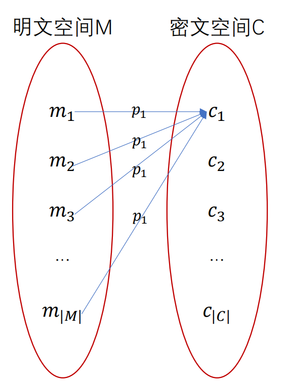

# 完美保密

CRYPTOGRAPHY · 0114 分钟阅读

## 加密模型：

一个加密方案（encryption scheme） $\Pi$ ，也叫做一个密码（cipher）或一个密码系统（cryptosystem），包含三个算法 Gen、Enc、Dec ，以及一个有限消息空间（finite message space） $\mathrm{M}$ 的规范（specification）。其中：

- Gen（密钥生成算法）：一个概率算法（probabilistic algorithm），根据一个特定的分布（distribution）， 从一个有限密钥空间（finite key space）$\mathrm{K}$ 里输出一个密钥（key）$k$ 

- Enc（加密算法）：输入密文 $m \in \mathrm{M}$ 和密钥 $k \in \mathrm{K}$ ，根据特定的算法（可以是概率的，也可以是确定性的），输出一个密文（ciphertext） $c$ 
  $$
  c \leftarrow \mathit{Enc}_k(m) (\text{probabilistic}) \text{ OR } c := \mathit{Enc}_k(m) (\text{deterministic}).
  $$

- Dec（解密算法）：输入密文 $c$ 和密钥 $k$ ，由一个确定性算法，输出明文 $m$ 

## 完美保密（Perfectly Secret Encryption）:

### 定义：

一个定义在消息空间 $\mathrm{M}$ 上的一个加密方案（Gen、Enc、Dec）是完美保密的，当且仅当：
$$
Pr[M = m \mid C=c] = Pr[M = m]
$$
对于所有 $m \in \mathrm{M} , s\in \mathrm{C},Pr[C = c] >0$ 都成立

这个公式可以理解成 **攻击者视角** ：攻击者获取了一个密钥 $c$ ，而所有明文都有相同的概率生成这个密文 $c$ 

也就是说：事件 $C = c$ 和事件 $M = m$ 是 **相对独立** 的

### 等价条件：

#### 加密者视角：

我们不妨考虑概率 $Pr(C = c \mid M = m) = Pr(C = c)$ :
$$
\begin{align*}
Pr(C = c \mid M = m ) &= \frac{Pr(M = m \mid C = c) \times Pr(C = c)}{Pr(M = m)} \\
&= \frac{Pr(M = m) \times Pr(C = c)}{Pr(M = m)} \\
&= Pr(C = c) 
\end{align*}
$$
如图：

#### 条件概率表述：

对任意 $c,m,m'$ ，都有：
$$
Pr[C = c \mid M = m] = Pr[C = c \mid M = m']
$$

这个公式描述的是：**无论明文是什么，产生某个特定密文的概率都是一样的** ，其实就是攻击者视角的另一种表述

证明：

- 必要性：

  由加密视角的条件：
  $$
  Pr[C= c\mid M = m] = Pr[C= c] = Pr[C = c \mid M = m']
  $$
  得证

- 充分性：

  由贝叶斯公式：
  $$
  \begin{align*}
  Pr[M = m \mid C = c] &= \frac{Pr[C= c \mid M = m]Pr[M = m]}{Pr[C =c]} \\
  \end{align*}
  $$
  为了使用 $Pr[C = c \mid M = m']$ 的条件，考虑将 $Pr[C = c]$ 用全概率公式展开：
  $$
  Pr[C= c] = \sum_{m' \in \mathcal{M}} Pr[M = m']Pr[C =c \mid M = m']
  $$
  联立，得：
  $$
  \begin{align*}
  Pr[M = m \mid C = c] &= \frac{\mathit{Pr}[M = m] \cdot \mathit{Pr}[C = c \mid M = m]}{\sum_{m' \in \mathcal{M}} \mathit{Pr}[M = m'] \cdot \mathit{Pr}[C = c \mid M = m']} \\
  &= \frac{Pr[M = m]}{\sum_{m' \in M} Pr[M = m']} \\
  &= Pr[M = m]
  \end{align*}
  $$

## 完美敌手不可区分性（Perfect adversarial indistinguishability）:

### 敌手不可区分性游戏（The adversarial indistinguishability game）:

我们将这个游戏记为 $\operatorname{PrivK}_{A,\Pi}^{eav}$ 

其中， $A$ 是敌手（adversary），$\Pi$ 是加密方案（Gen,Enc,Dec,M）

游戏步骤：

- $A$ 选择一对名文 $m,m' \in M$ ，将它们发送给挑战者（challenger），也就是加密方

- 挑战者用 Gen 生成一个密钥 $k$ ，并均匀地选择一个 $b \in \{0,1\}$ ，输入 Enc 生成密文 $c$ :
  $$
  c \leftarrow \mathit{Enc}_k(m_b).
  $$

- 挑战者将密文 $c$ 发回给敌手（也就是敌手获取了密文）
- 根据 $c$ ，敌手对 $b$ 的取值进行猜测，并输出 $b'$ 作为答案
- 我们定义，当 $b = b'$ 时， $\operatorname{PrivK}_{A,\Pi}^{eav} = 1$ 

### 完美不可区分性（Perfectly indistinguishable）：

定义：加密方案 $\Pi$ 是完美不可区分的，当且仅当对于任意敌手 $A$ ，都有 $\operatorname{PrivK}_{A,\Pi}^{eav} = \frac{1}{2}$ 

通俗来说，每个敌手在游戏中的表现都不会比进行均匀随机猜测更好或更差

### 与完美保密的关系：

加密方案 $\Pi$ 是完美保密的，当且仅当 $\Pi$ 是完美不可区分的，即对任意敌手 $A$，都有：

$$
\Pr[\operatorname{PrivK}_{A,\Pi}^{eav}=1]
=\Pr[b'=b]=\frac12.
$$

这里等于 $1/2$ 的是游戏获胜的概率，游戏输出本身只可能为 0 或 1

#### 完美保密推出完美不可区分：

固定任意敌手 $A$，先固定它在选择消息阶段的随机性及保留的状态。对于选出的不同消息 $m_0,m_1$，令 $M=m_b$ 表示实际被加密的消息；由于 $b$ 均匀选择，有 $\Pr[M=m_0]=\Pr[M=m_1]=1/2$ 

获胜事件由两个互斥情形组成：加密 $m_0$ 时输出 $b'=0$，或加密 $m_1$ 时输出 $b'=1$，所以：

$$
\Pr[b'=b]
=\Pr(b'=0,M=m_0)+\Pr(b'=1,M=m_1).
$$

先用乘法公式 $\Pr(E\cap F)=\Pr(E\mid F)\Pr(F)$，把两个联合概率分别展开：

$$
\begin{aligned}
&\Pr(b'=0,M=m_0)+\Pr(b'=1,M=m_1)\\
&=\Pr(b'=0\mid M=m_0)\Pr(M=m_0)\\
&\quad+\Pr(b'=1\mid M=m_1)\Pr(M=m_1).
\end{aligned}
$$

代入 $\Pr(M=m_0)=\Pr(M=m_1)=1/2$，提取共同因子：

$$
=\frac12\left[
\Pr(b'=0\mid M=m_0)
+\Pr(b'=1\mid M=m_1)
\right].
$$

敌手根据收到的密文输出猜测，因此在各自的消息条件下，按密文 $C$ 的所有可能取值使用全概率公式：
$$
\begin{aligned}
=\frac12\Bigl[
&\sum_c\Pr(b'=0,C = c\mid M=m_0)\\
+&\sum_c\Pr(b'=1,C = c\mid M=m_1)
\Bigr].
\end{aligned}
$$
再对联合概率展开：
$$
\begin{aligned}
=\frac12\Bigl[
&\sum_c\Pr(b'=0\mid C=c,M=m_0)\Pr(C=c\mid M=m_0)\\
+&\sum_c\Pr(b'=1\mid C=c,M=m_1)\Pr(C=c\mid M=m_1)
\Bigr].
\end{aligned}
$$

由完美保密，$C$ 与 $M$ 独立，所以 $\Pr(C=c\mid M=m_0)$ 和 $\Pr(C=c\mid M=m_1)$ 都等于 $\Pr(C=c)$。替换这两个因子，将求和合并并提取共同因子：

$$
\begin{aligned}
=\frac12\sum_c\Pr(C=c)\Bigl[
&\Pr(b'=0\mid C=c,M=m_0)\\
+&\Pr(b'=1\mid C=c,M=m_1)
\Bigr].
\end{aligned}
$$

接下来括号内为什么等于 1，是证明的关键：

敌手的内部状态已经固定，看到相同密文 $c$ 时，运行的是同一个 $\operatorname{attack\_algorithm}(c)$，并不知道实际消息是哪一条。因此即使判断算法带有随机性，其输出分布也不会因未告知的 $M$ 而变化，即：
$$
\begin{aligned}
\Pr(b'=0\mid C=c,M=m_0)&=\Pr(b'=0\mid C=c),\\
\Pr(b'=1\mid C=c,M=m_1)&=\Pr(b'=1\mid C=c).
\end{aligned}
$$

这里去掉 $M$ 条件依靠的是**敌手只能依据已固定的状态与收到的密文作答**，不能单凭 $C$ 与 $M$ 独立就直接去掉任意条件概率中的 $M$ 

敌手最终只能输出 0 或 1，两种输出互斥且穷尽，因此：

$$
\begin{aligned}
&\Pr(b'=0\mid C=c,M=m_0)
+\Pr(b'=1\mid C=c,M=m_1)\\
&=\Pr(b'=0\mid C=c)+\Pr(b'=1\mid C=c)\\
&=1.
\end{aligned}
$$

将括号替换为 1，原来的成功概率化为：

$$
\Pr[b'=b]=\frac12\sum_c\Pr(C=c).
$$

最后，$C$ 取遍所有可能密文的概率总和为 1，所以：

$$
\Pr[b'=b]=\frac12.
$$

上述推导对消息选择阶段的每种固定状态都成立，再对这些状态取平均，成功概率仍为 $1/2$。如果 $m_0=m_1$，实际加密的消息本就与 $b$ 无关，敌手同样只能以概率 $1/2$ 猜中

因此，任意敌手 $A$ 的获胜概率都等于 $1/2$，$\Pi$ 完美不可区分

#### 完美不可区分推出完美保密：

证明逆否命题：若 $\Pi$ 不完美保密，则 $\Pi$ 不完美不可区分

由前面完美保密的条件概率等价表述，不完美保密意味着存在 $m_0,m_1$ 和某个密文 $c_i$，使得：

$$
\Pr(C=c_i\mid M=m_0)
\neq\Pr(C=c_i\mid M=m_1).
$$

构造敌手 $A$，选择这两条消息并按以下规则猜测：

$$
\operatorname{attack\_algorithm}(c)=
\begin{cases}
0,&c=c_i,\\
1,&c\neq c_i.
\end{cases}
$$

也就是说，收到 $c_i$ 就输出 0，否则输出 1。这两条消息必然不同，否则上面的两个密文概率不可能不同

与正向证明相同：

$$
\begin{aligned}
\Pr[b'=b]
&=\Pr(b'=0,M=m_0)+\Pr(b'=1,M=m_1)\\
=\frac12\Bigl[
&\sum_c\Pr(b'=0\mid C=c,M=m_0)\Pr(C=c\mid M=m_0)\\
+&\sum_c\Pr(b'=1\mid C=c,M=m_1)\Pr(C=c\mid M=m_1)
\Bigr].
\end{aligned}
$$

由构造的 $\operatorname{attack\_algorithm}$ :

- 第一项中只有 $c=c_i$ 时输出 0，对应概率因子为 1，其余项为 0
- 第二项中所有 $c\neq c_i$ 时都输出 1，对应概率因子为 1，而 $c=c_i$ 时为 0

因此两组求和化为：
$$
=\frac12\left[
\Pr(C=c_i\mid M=m_0)
+\sum_{c\neq c_i}\Pr(C=c\mid M=m_1)
\right].
$$

由 $\sum_c\Pr(C=c\mid M=m_1)=1$ ，知：
$$
\sum_{c\neq c_i}\Pr(C=c\mid M=m_1)
=1-\Pr(C=c_i\mid M=m_1).
$$

代回，有：

$$
\Pr[b'=b]
=\frac12\left\{
\Pr(C=c_i\mid M=m_0)
+\left[1-\Pr(C=c_i\mid M=m_1)\right]
\right\}.
$$

因为最初选出的两项概率不相等，大括号内的值不等于 1，所以：

$$
\Pr[b'=b]\neq\frac12.
$$

故逆否命题成立，原命题成立

## 一种构造完美加密的方案：One-Time Pad:

### 定义：

令 $a \oplus b$ 表示两个二进制字符串（binary strings）的按位异或（bitwise excusive-or）

一次一密（One-Time Pad）的过程如下：

- 固定一个整数（integer）$l >0$ ，规定 $\mathcal{M} = \{0,1\}^l,\mathcal{K} = \{0,1\}^l,\mathcal{C} = \{0,1\}^l$ 
- $Gen$： $K \xleftarrow{\$} \mathcal{K}$ ，也就是说密钥空间是均匀的，对于每一个 $k \in \mathcal{K}$ ，都有 $Pr[K = k] = \frac{1}{2^l}$ 
- $Enc_K(M)$ ：$C := M \oplus K$ 
- $Dec_K(C)$ ：$M := C \oplus K$ 

### 一次一密的限制：

- 明文长度和密钥长度一定相等
- 同一个密钥 $K$ 只能被使用一次。如果加密名文 $m1,m2$ 都使用了密钥 $K$ ，得到 $C_1 = m_1 \oplus K,C_2 = m_2 \oplus K$ ，那么敌手得到 $C_1,C_2$ 后，可以直接计算 $C_1 \oplus C_2 = m_1 \oplus m_2$ ，消除密钥 $K$ 的影响，破坏了保密性
- 只能抵御唯密文攻击（Ciphertext-only attack）
