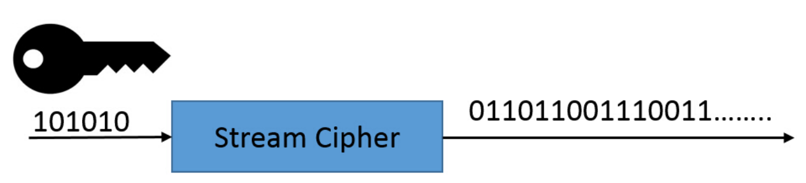
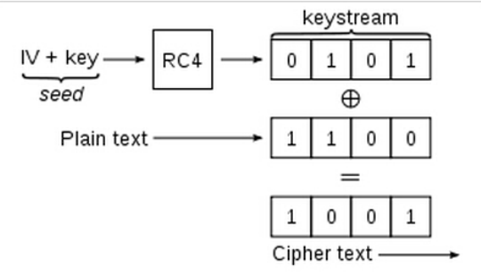
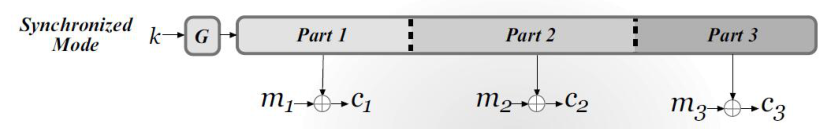
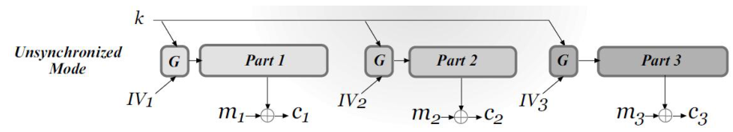
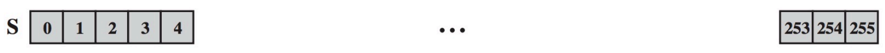
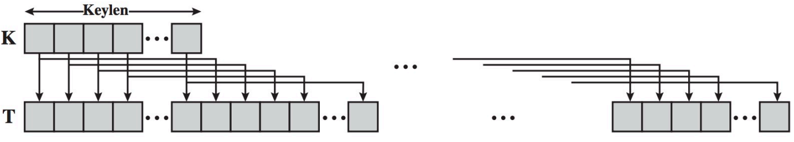
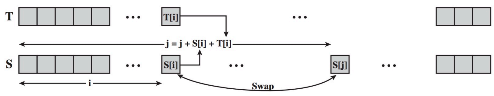
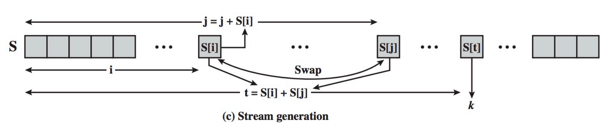
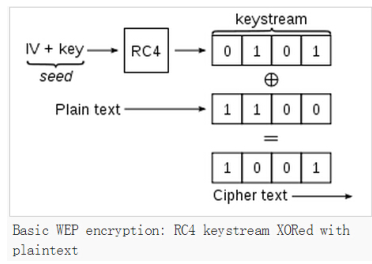

# 流密码

CRYPTOGRAPHY · 0313 分钟阅读

## 简介：

### 什么是流密码：

流密码是一种确定性算法（deterministic algorithm），用于将一个短的随机种子扩展成“看起来随机”的比特流

常常用于初始化 $PRG$ （截取特定长度的比特即可）

### 定义：

一个流密码（stream cipher） 是一对确定性算法：

- **Init（初始化算法）** ：$st_0 := Init(s,[IV])$ 
- **GetBits（获取下一个比特）**：$(y_i,st_i) := GetBits(st_{i-1})$ 

其中，$st_0,st_1,...$ 是每一个时刻的状态(state)

初始化算法的两个参数分别是：随机种子 $s$ ，初始化向量（initialization vector） $IV$ ，中括号表示可选

$GetBits$ 算法输入前一个状态，生成一个比特 $y_i$ 和下一个状态 $st_i$ （有时 $y_i$ 是多个比特组成的块，如32位比特 ）

最终，由 $y_1,y_2,...$ 组成的比特流（bit stream）叫做 $keystream$ 

## 用流密码进行加密：

### 常见方法：

使用流密码加密的最常见方法就是截取和明文相同长度的 keystream，将明文和 keystream 异或得到密文

### 优点（Pros）：

- 非常高效
- 能够处理任意比特长度的明文

### 缺点（Cons）：

#### 密钥流不能重复使用：

不能使用相同的密钥流加密两个不同的明文：

例如，如果用同一个 keystream 加密明文 $P_1,P_2$ ：
$$
C_1 = P_1 \oplus Keystream \\
C_2 = P_2 \oplus Keystream
$$
那么通过 $C_1 \oplus C_2 = P_1 \oplus P_2$ ，就能得到明文的异或信息

#### 比特翻转攻击（Bit-flipping attacks）：

容易受到比特翻转攻击：

如果攻击者截获了密文，那么即便不知道密钥，攻击者也可以恶意翻转密文中的几个比特

例如，在转账金额比特段的高位，一般都是零。攻击者可以将密文与对应位为 1 的 $\Delta$ 进行异或

那么由异或的性质，最终接收者解密出的明文就是 $P \oplus \Delta$ ，会把转账金额高位设置成 1 ，令转账数量大幅增加

## 流密码的工作模式（Stream-cipher modes of operation）：

实际使用中，流密码有两种工作模式：同步模式（Synchronized mode）和非同步模式（Unsynchronized mode）

### 同步模式（Synchronized mode）：

#### 加密过程：

使用密钥 $k$ 初始化一次流密码，然后连续生成一条密钥流，将它分成不同的部分，依次加密不同的明文：

例如，将密钥流分成 $Part_1,Part_2,Part_3$ ，分别加密 $m_1,m_2,m_3$ ：
$$
c_1 = m_1 \oplus Part_1 \\
c_2 = m_2 \oplus Part_2 \\
c_3 = m_3 \oplus Part_3
$$
每一部分的长度都与对应明文相同

注意，加密下一条消息时，流密码会从之前的状态继续生成密钥流，而不是重新从头开始

#### 解密与同步：

接收者也使用相同的初始化参数生成同一条密钥流，并取出相同位置的部分进行解密：
$$
m_i = c_i \oplus Part_i
$$
通俗来说，发送者和接收者各自拿着一条相同的密钥流，必须始终使用相同的位置，所以叫做“同步”模式

如果传输中丢失或插入了数据，导致双方使用的密钥流位置错开，那么后面的解密也会出错，需要重新同步

### 非同步模式（Unsynchronized mode）：

#### 加密过程：

仍然使用同一个密钥 $k$ ，但每条消息都使用一个不同的初始化向量 $IV_i$ ，单独初始化流密码：

对于第 $i$ 条消息：

- 用 $k$ 和 $IV_i$ 初始化：$st_0^{(i)} := Init(k,IV_i)$
- 生成与明文 $m_i$ 等长的密钥流 $Part_i$
- 计算密文：$c_i := m_i \oplus Part_i$
- 将 $IV_i$ 与 $c_i$ 一起发送给接收者

#### 解密与 IV 的要求：

接收者获取 $IV_i$ 后，用相同的 $k,IV_i$ 重新生成 $Part_i$ ，即可解密这条消息

也就是说，每条消息都可以独立处理，不需要继续上一条消息留下的内部状态

这里的 $IV$ 不需要保密，但**同一个密钥下不能重复使用同一个 IV**，否则会生成相同的密钥流

## 线性反馈移位寄存器（Linear-Feedback Shift Registers）：

### 定义：

#### 组成与状态：

LFSR 是流密码中用来生成伪随机密钥流（Keystream）的核心组件

一个 $n$ 阶（即使用 $n$ 个寄存器）的 $LFSR$ 被定义为：

- 一个包含 $n$ 个一位比特寄存器的数组：$s_{n-1},...,s_{0}$ 
- $n$ 个 **反馈系数** ：$c_{n-1},...,c_{0}$ 

当前状态 $st$ 就是这个 $n$ 位数组

#### 状态更新：

在时刻 $t$ ，确定下一个时刻 $t+1$ 状态的操作为：

- 移位（shift）：所有比特集体右移一位，最右侧的比特作为输出 $y_i$ 

  即：$s_i^{t+1} := s_{i+1}^t,i = 0,...,n-2$ 

- 线性反馈（Linear-feedback）：移位之后，数组最左侧 $s_{n-1}$ 会空出来，需要用以下算法补上：

  $s_{n-1}^{t+1} := \bigoplus_{i=0}^{n-1} c_i s_i^{t}$ ，通俗来说，就是将时刻 $t$， $c_i$ 为一的所有比特进行异或

### 特点：

由 LSFR 产生的比特流是伪随机的，因为当出现了两个同样的状态 $st_i = st_j$ 时，比特流中将会出现周期

一个 $n$ 阶的 LSFR 在产生了 $2^n$ 个比特后必定会出现周期，因为其状态总数就是 $2^n$ 

但实际上，就算 $n$ 足够大，LSFR 也不是安全的，因为其 Getbits 算法是一个完全线性（Linear）的操作

### LSFR 的破译（reconstruction）：

结论：只要我们观察到了 LSFR 输出的前 2n 个比特，我们就能破解 LSFR 的状态

假设一个 4 阶的 LSFR ，我们观察到了 8 位输出比特：1，1，0，0，1，1，1，1

破译 LSFR ，等价于找出 $(s_3^{0},...,s_0^0)$ 和 $(c_3,...,c_0)$ ：

- 显然，$(s_3^{0},...,s_0^0)$ 就等于输出的前四位：（1，1，0，0）

- 我们可以根据 LSFR 的计算方法可以列出四个方程：
  $$
  \begin{align}
  1 &= c_3 \cdot 0 \oplus c_2 \cdot 0 \oplus c_1 \cdot 1 \oplus c_0 \cdot 1 \tag{1} \\
  1 &= c_3 \cdot 1 \oplus c_2 \cdot 0 \oplus c_1 \cdot 0 \oplus c_0 \cdot 1 \tag{2} \\
  1 &= c_3 \cdot 1 \oplus c_2 \cdot 1 \oplus c_1 \cdot 0 \oplus c_0 \cdot 0 \tag{3} \\
  1 &= c_3 \cdot 1 \oplus c_2 \cdot 1 \oplus c_1 \cdot 1 \oplus c_0 \cdot 0 \tag{4}
  \end{align}
  $$
  这样便能求解出 $(c_3,...,c_0)$ 

## Rivest Cipher 4（RC4）:

### Init algorithm：

#### 准备工作：

首先，RC4 需要两个 256 位的数组：

- 状态数组 S ，初始化为： $(0,1,...,255)$ 

  

  这个数组就相当于是 [IV] 

- 用户密钥 K，如 WIFI 密码，通常短于 256 位

- 密钥数组 T，长度为 256 位，由用户密钥 K 循环重复得到

  

#### 打乱循环（Scrambling Loop）：

准备工作完成后，会进入一个 256 次的打乱循环（Scrambling Loop）

循环从 `i = 0` 循环到 `255` ，初始化 `j = 0` ：

- 计算 `j = (j + S[i] + K[i]) mod 256` 

  注意，这里引入了非线性计算

- 交换 `S[i]` 和 `S[j]` 

### GetBits algorithm：

初始化 `i = 0, j = 0` ，进行以下循环：

- `i = (i + 1) mod 256` 
- `j = (j + S[i]) mod 256` ，这是非线性的
- `swap(S[i], S[j])` 
- 计算索引：`t = (S[i] + S[j]) mod 256` ，令 `y_i = S[t]` 

## 攻击基于 RC4 的 WEP（Attacking RC4-based WEP）：

### WEP 的加密方法：

WEP 全称是 Wired Equivalent Privacy，是一种用于 WIFI 网络的协议

WEP 使用：

- **RC4**：提供消息的保密性（confidentiality）
- **CRC-32**：进行差错校验（correctness validation）

#### 密钥与 IV：

标准的 64-bit WEP 实际上由两部分组成：

- 40 位共享密钥 $k$ ，可以表示为 10 个十六进制字符
- 24 位初始化向量 $IV$ 

#### 加密与解密：

发送者和接收者首先共享同一个密钥 $k$ ，每次加密时选择不同的 $IV$ ，将 $IV$ 与密钥组合后作为 RC4 的初始化输入，生成密钥流：

然后将密钥流与明文异或，得到密文。接收者使用相同的 $k,IV$ 生成同一条密钥流进行解密

这就对应前面的非同步模式：每条消息单独初始化，使用 IV 区分不同消息的密钥流

### IV 太短的问题（The short IV flaw）：

#### IV 的取值空间：

WEP 的 IV 只有 24 位，因此最多只有：
$$
2^{24} = 16,777,216
$$
种不同的取值

如果同一个密钥一直使用，那么 IV 的空间迟早会耗尽，之后就必须重复使用之前的 IV

#### IV 耗尽的时间估算：

例如，一个繁忙的无线接入点，以 $11\ \mathrm{Mbps}$ 的速率持续发送每个大小为 1500 字节的数据包

假设每个数据包使用一个 IV，而且之前的 IV 都不重复，那么耗尽全部 IV 所需的时间约为：
$$
\begin{align*}
T &= \frac{2^{24} \times 1500 \times 8}{11 \times 10^6}\ \mathrm{s} \\
&\approx 18,302\ \mathrm{s} \\
&\approx 5.08\ \mathrm{h}
\end{align*}
$$
也就是说，按照这个简化估算，即便一开始没有重复，也只需要约 5 小时就会用完所有 IV

如果选择 IV 的过程中提前出现重复，那么问题会更早发生

### 重复 IV 如何泄露明文信息：

#### 获取明文之间的关系：

相同的密钥 $k$ 与相同的 $IV$ 会使 RC4 从相同状态开始，生成相同的密钥流

假设两个不同的明文 $P_1,P_2$ 使用了同一个 $IV$ ，那么：
$$
C_1 = P_1 \oplus Keystream \\
C_2 = P_2 \oplus Keystream
$$
敌手将两个密文异或，就能消除密钥流：
$$
\begin{align*}
C_1 \oplus C_2
&= P_1 \oplus Keystream \oplus P_2 \oplus Keystream \\
&= P_1 \oplus P_2
\end{align*}
$$
这样，敌手即便不知道密钥，也能得到两个明文之间的关系，破坏保密性

#### 已知一个明文时恢复另一个明文：

如果敌手还知道其中一个明文 $P_1$ ，就可以恢复对应长度的密钥流：
$$
Keystream = C_1 \oplus P_1
$$
再解密另一个密文对应的部分：
$$
P_2 = C_2 \oplus Keystream
$$
### WEP、WPA 与后续方案：

WEP 已不适合继续使用；使用 RC4 的 WPA 虽然改进了使用方式，但 RC4 本身也存在统计偏差（statistical biases）等密码学弱点

可以使用 WPA2 或 WPA3 作为替代方案，它们采用 AES 分组密码，并结合其他安全措施

这个例子说明：除了密码算法本身，**IV 的长度与是否重复也会直接影响加密方案的安全性**

