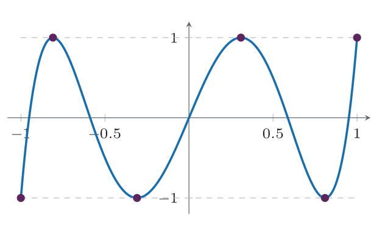
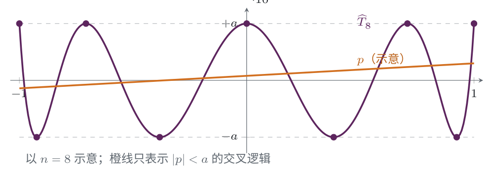
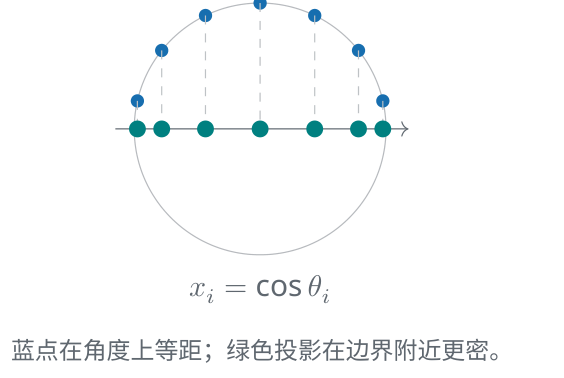

# Chebyshev 多项式与函数逼近

NUMERICAL METHODS · 312 分钟阅读

## 误差公式

### 定理：

给定 $n$ 个互不相同的节点 $x_1,...,x_n$ ，用次数至多为 $n-1$ 的多项式 $P_f$ 对函数 $f$ 进行插值

假设 $f$ 在包含这些节点与求值点的区间上连续可导至 $n$ 阶，记：
$$
\omega_n(x) := \prod_{j=1}^{n}(x-x_j)
$$
则对每个求值点 $x$ ，存在一个介于节点与 $x$ 之间的 $\xi_x$ ，使得：
$$
f(x)-P_f(x) = \frac{f^{(n)}(\xi_x)}{n!}\omega_n(x)
$$
其中，$\xi_x$ 依赖于 $x$ ，不是对整个区间固定的常数

这个公式将误差分成两个部分：

- **函数本身的因素**：$f^{(n)}(\xi_x)$ ，描述函数的高阶变化
- **节点的因素**：$\omega_n(x)$ ，由插值节点的位置决定

也就是说，即使节点数量相同，选点不同也会导致不同的误差

### 证明：

当 $x$ 不是插值节点时，定义：
$$
q(t) := P_f(t)+\lambda\omega_n(t),\qquad
\lambda := \frac{f(x)-P_f(x)}{\omega_n(x)}
$$
这样，$q$ 在 $x_1,...,x_n,x$ 共 $n+1$ 个不同点上都与 $f$ 相等

令 $\phi(t)=f(t)-q(t)$ ，$\phi$ 有 $n+1$ 个零点。反复应用 Rolle 定理，可以找到 $\xi_x$ ，使得：
$$
\phi^{(n)}(\xi_x)=0
$$
由于 $\deg P_f<n$ ，而 $\omega_n$ 的最高次项系数为 1，所以：
$$
q^{(n)}(t)=\lambda n!
$$
因此 $f^{(n)}(\xi_x)=\lambda n!$ ，代回 $\lambda$ 的定义即可得到误差公式

如果 $x$ 恰好是插值节点，那么误差和 $\omega_n(x)$ 都为零，公式直接成立

## Chebyshev 多项式（Chebyshev Polynomials）：

### 定义与递推：

#### 定义：

令 $x=\cos\theta,\theta \in [0,\pi]$ ，定义：
$$
T_n(x):=\cos(n\theta)=\cos(n\arccos x),\qquad x\in[-1,1]
$$
虽然右侧写成三角函数的形式，但它实际上是一个关于 $x$ 的多项式

例如：
$$
T_0(x)=1,\qquad T_1(x)=x,\qquad T_2(x)=2x^2-1
$$

#### 递推关系：

根据三角函数公式：
$$
\cos((n+1)\theta)+\cos((n-1)\theta)
=2\cos(n\theta)\cos\theta
$$
代入 $x=\cos\theta$ ，得到：
$$
T_{n+1}(x)=2xT_n(x)-T_{n-1}(x),\qquad n\geq 1
$$
由初始值和这个递推式，可以归纳出每个 $T_n$ 都是多项式，并依次计算它们

例如：
$$
T_3(x)=4x^3-3x,\qquad T_4(x)=8x^4-8x^2+1
$$

### 基本性质：

#### 次数与最高次项：

对于 $n\geq 1$ ，$T_n$ 的次数为 $n$ ，最高次项系数为 $2^{n-1}$ ：
$$
T_n(x)=2^{n-1}x^n+\text{低次项}
$$
这是因为递推式中的 $2xT_n$ 决定下一阶最高次项，而 $T_{n-1}$ 的次数较低，不会抵消它

#### 取值范围与端点：

在 $[-1,1]$ 上：
$$
|T_n(x)|\leq 1,\qquad T_n(1)=1,\qquad T_n(-1)=(-1)^n
$$

#### 零点：

由 $\cos(n\theta)=0$ ，得到 $n$ 个零点：
$$
x_i=\cos\frac{(2i-1)\pi}{2n},\qquad i=1,...,n
$$
这些零点互不相同，并且都位于 $(-1,1)$ 内

#### 交替极值点：

取：
$$
y_k=\cos\frac{k\pi}{n},\qquad k=0,...,n
$$
则：
$$
T_n(y_k)=(-1)^k
$$
也就是说，$T_n$ 在 $n+1$ 个点上交替达到 $+1$ 和 $-1$ ，各个峰的绝对高度都相同

这种现象叫做等振荡（equioscillation），它是证明最优性的关键

### 首一化：

为了将切比雪夫多项式首一化，定义：
$$
\widehat{T}_n(x):=2^{1-n}T_n(x),\qquad n\geq 1
$$
那么 $\widehat{T}_n$ 是首一 $n$ 次多项式，而且：
$$
\max_{x\in[-1,1]}|\widehat{T}_n(x)|=2^{1-n}
$$
缩放不改变零点，所以：
$$
\widehat{T}_n(x)=\prod_{i=1}^{n}(x-x_i),\qquad
x_i=\cos\frac{(2i-1)\pi}{2n}
$$

这样就把切比雪夫多项式化成了误差分析中 $\omega_n(x)$ 的形式

## Chebyshev 极小极大定理与最优节点：

### 极小极大定理（Minimax theorem）：

定义：对于任意首一 $n$ 次多项式 $p$ ，均有：
$$
\max_{x\in[-1,1]}|p(x)|\geq 2^{1-n}
$$
而 $\widehat{T}_n$ 恰好达到这个下界，因此它是一个最优解

### 定理的证明：

#### 交替极值迫使差多项式出现零点：

反设存在一个首一 $n$ 次多项式 $p$ ，满足：
$$
\max_{x\in[-1,1]}|p(x)|< 2^{1-n},\qquad \forall x\in[-1,1]
$$
令：
$$
r(x):=p(x)-\widehat{T}_n(x)
$$
在 $y_k=\cos(k\pi/n)$ 上，$\widehat{T}_n(y_k)=(-1)^k2^{1-n}$ ，因此：

- 当 $k$ 为偶数时，$r(y_k)<0$
- 当 $k$ 为奇数时，$r(y_k)>0$

所以 $r(y_0),...,r(y_n)$ 的符号正负交替。根据连续性，每两个相邻极值点之间至少有一个零点

这样，$r$ 至少有 $n$ 个不同的零点

#### 次数限制带来矛盾：

由于 $p$ 和 $\widehat{T}_n$ 都是首一 $n$ 次多项式，最高次项相减后抵消，因此：
$$
\deg r\leq n-1
$$
但一个次数至多为 $n-1$ 的非零多项式，不可能有 $n$ 个不同零点

如果 $r\equiv 0$ ，那么 $p=\widehat{T}_n$ ，最大绝对值仍然是 $2^{1-n}$ ，也与“严格更小”的假设矛盾

所以不存在这样的 $p$ ，定理得证

### Chebyshev 插值节点：

#### 节点的选择：

选择：
$$
x_i=\cos\frac{(2i-1)\pi}{2n},\qquad i=1,...,n
$$
则：
$$
\min_{\substack{x_1,...,x_n\in[-1,1]\\x_i\neq x_j\ (i\neq j)}}
\max_{x\in[-1,1]}|\omega_n(x)|=2^{1-n}
$$
在这些节点上进行 Lagrange 插值，得到的就是 Chebyshev 插值多项式

注意，$T_n$ 是用来设计节点的多项式；对目标函数 $f$ 插值得到的 $P_f$ ，一般不是 $T_n$ 本身

#### 为什么节点靠近边界：

角度：
$$
\theta_i=\frac{(2i-1)\pi}{2n}
$$
是等距的，但经过 $x_i=\cos\theta_i$ 投影后，$x_i$ 并不等距，而是在区间两端更密集

等距节点的节点因子容易在边界附近出现较高的峰。增加边界附近的节点，可以让峰的高度分布更均匀，缓解龙格现象

#### 最坏情形误差：

对于满足 $\|f^{(n)}\|_\infty\leq M$ 的函数，选择 Chebyshev 节点后：
$$
\|f-P_f\|_\infty\leq \frac{M}{n!}2^{1-n}
$$
而且这个上界是该函数类上的最坏误差，也是在所有 $n$ 节点设计中能够达到的最小最坏误差

这里优化的是**函数类上的最坏情形**，并不意味着对每一个固定函数，Chebyshev 节点都一定比所有其他节点更好

### 推广到一般区间 $[a,b]$ ：

#### 节点缩放：

用仿射变换：
$$
x=\frac{a+b}{2}+\frac{b-a}{2}t,\qquad t\in[-1,1]
$$
将节点搬到 $[a,b]$ ：
$$
x_i=\frac{a+b}{2}+\frac{b-a}{2}\cos\frac{(2i-1)\pi}{2n}
$$

#### 误差因子的缩放：

由于每个差值都多出一个 $(b-a)/2$ ：
$$
\prod_{i=1}^{n}(x-x_i)
=\left(\frac{b-a}{2}\right)^n\prod_{i=1}^{n}(t-t_i)
$$
所以最小节点因子变为：
$$
\left(\frac{b-a}{2}\right)^n2^{1-n}
$$
如果 $\max_{x\in[a,b]}|f^{(n)}(x)|\leq M$ ，对应的误差上界为：
$$
\|f-P_f\|_\infty
\leq \frac{M}{n!}\left(\frac{b-a}{2}\right)^n2^{1-n}
$$

## 函数空间上的线性代数：

### 函数也可以看作向量：

向量空间：支持向量加法，数的乘法，闭合的线性空间

只要支持通常的函数加法与数乘，并满足向量空间公理，就可以将函数集合看作向量空间

例如：

- $\mathbb{R}[x]$ ：所有实系数多项式
- $\mathcal{P}_{n-1}$ ：次数小于 $n$ 的实系数多项式，是 $n$ 维空间
- $C[a,b]$ ：$[a,b]$ 上的连续函数
- $C^k[a,b]$ ：$[a,b]$ 上连续可导至 $k$ 阶的函数

这里的向量不一定是一列数字，也可以是整个函数

### 线性相关与基：

#### 线性相关：

函数族 $\phi_1,...,\phi_m$ 线性相关，当且仅当存在不全为零的系数 $c_1,...,c_m$ ，使得：
$$
\sum_{i=1}^{m}c_i\phi_i(x)=0,\qquad \forall x
$$
否则称为线性无关

注意，这里必须对所有 $x$ 恒成立，仅在有限个采样点上为零并不能直接证明函数线性相关

#### 选定基后，用系数表示函数：

若 $\phi_1,...,\phi_n$ 线性无关，令：
$$
V:=\operatorname{span}\{\phi_1,...,\phi_n\}
$$
则任意 $p\in V$ 都能唯一表示为：
$$
p(x)=\sum_{j=1}^{n}c_j\phi_j(x)
$$
于是，寻找函数 $p$ 就变成了寻找系数向量：
$$
c=(c_1,...,c_n)^\mathsf{T}\in\mathbb{R}^n
$$

### Chebyshev 多项式也是一组基：

$\mathcal{P}_{n-1}$ 的常见基是：
$$
1,x,...,x^{n-1}
$$
而：
$$
T_0,T_1,...,T_{n-1}
$$
也构成同一个空间的一组基

因为 $T_0=1$ ，且对 $k\geq 1$ ：
$$
T_k(x)=2^{k-1}x^k+\text{低次项}
$$
从 Chebyshev 基到单项式基的换基矩阵是对角元非零的三角矩阵，因此可逆

也就是说，这两组基表示的是相同的多项式空间，只是同一个多项式的系数坐标不同

## 范数（Norm）：

### 函数的范数：

#### 无穷范数（Infinity norm）：

对于 $[a,b]$ 上的连续函数：
$$
\|f\|_\infty:=\sup_{x\in[a,b]}|f(x)|
$$
由于函数在闭区间上连续，这里的上确界可以取到，也可以写成最大值

$\|f-p\|_\infty$ 只看误差最大的那个点，适合要求整个区间上误差都受控的场景

#### 2-范数（$L^2$ norm）：

$$
\|f\|_2:=\left(\int_a^b|f(x)|^2\,dx\right)^{1/2}
$$
$\|f-p\|_2$ 衡量整个区间上累积的平方误差

注意，$\int_a^b|f(x)|^2\,dx$ 是 **2-范数的平方**，还需要开平方才能得到 2-范数

### 范数之间的关系：

在有限维向量空间中，各种范数是等价的，但比较它们的常数可能依赖维数

一般情况下：
$$
\|x\|_q \le \|x\|_p \le n^{\frac{1}{p} - \frac{1}{q}} \|x\|_q
$$
例如，对 $q = \infin ,p = 2$ ：
$$
\|v\|_\infty\leq\|v\|_2\leq\sqrt{n}\,\|v\|_\infty
$$
