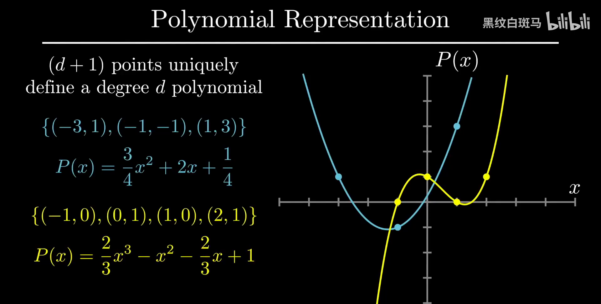
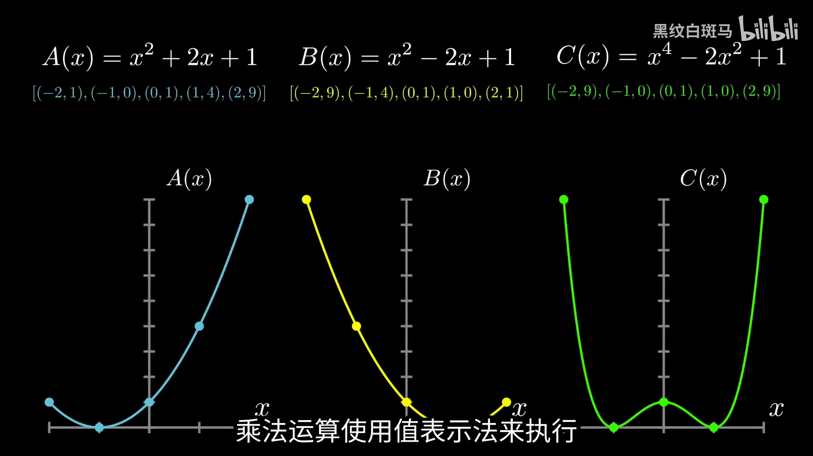
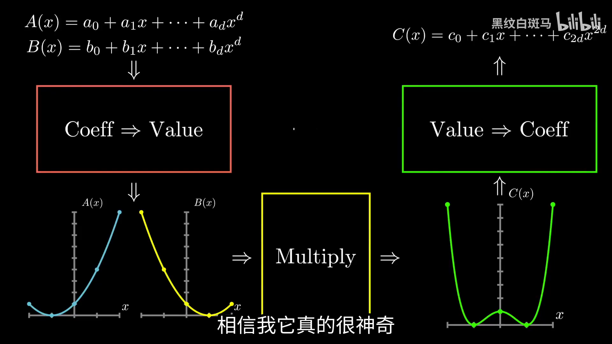
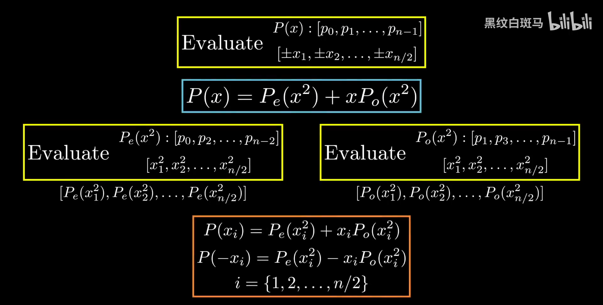
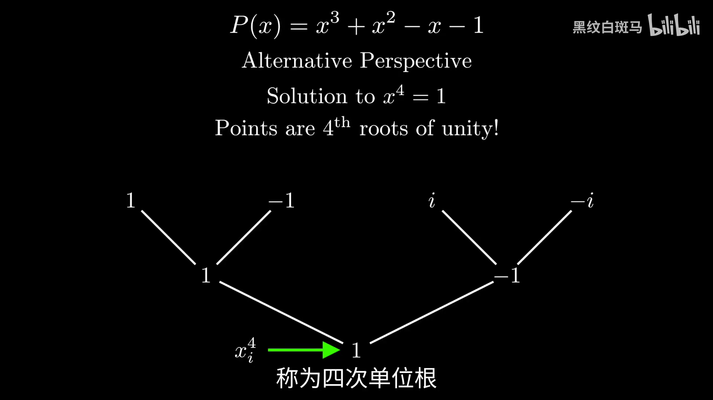
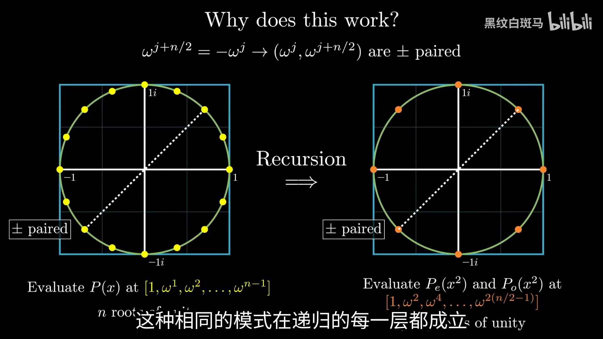
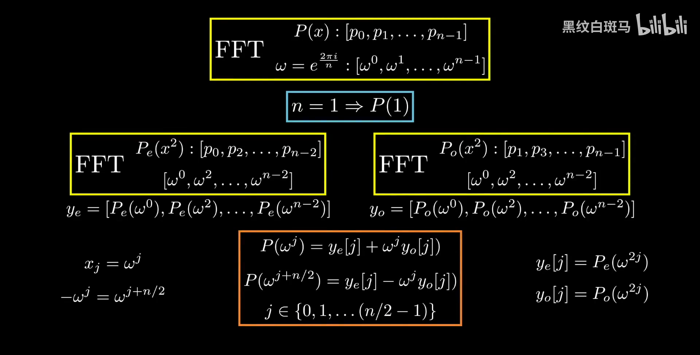
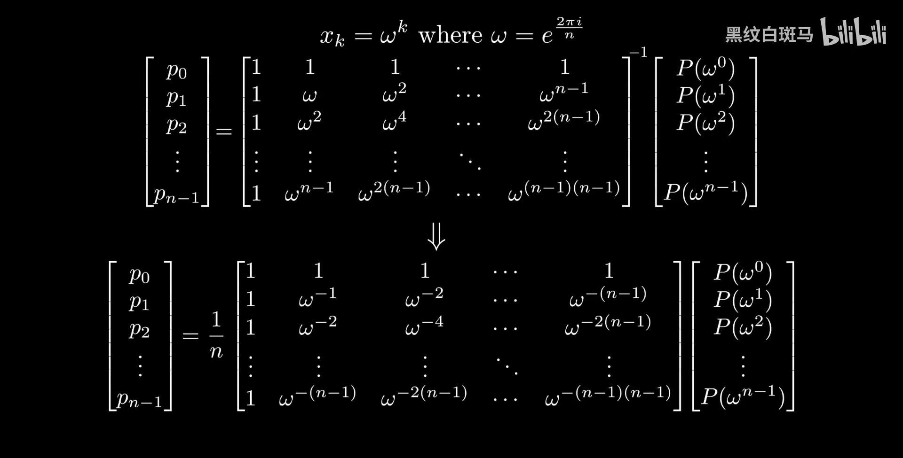

# 快速傅里叶变换（FFT）

<div class="chapter-meta"><span>NUMERICAL METHODS · 5</span><span>30 分钟阅读</span></div>


## 从多项式乘法出发：

### 系数表示与直接相乘：

希望快速计算两个多项式的乘积，例如

$$
A(x)=x^2+3x+2,\qquad B(x)=2x^2+1
$$

利用分配律，将每一项分别相乘

$$
\begin{align*}
C(x)&=A(x)B(x)\\
&=x^2(2x^2+1)+3x(2x^2+1)+2(2x^2+1)\\
&=2x^4+x^2+6x^3+3x+4x^2+2\\
&=2x^4+6x^3+5x^2+3x+2
\end{align*}
$$

在计算机中，可以按次数从低到高存储系数

$$
A=[2,3,1],\qquad B=[1,0,2],\qquad C=[2,3,5,6,2]
$$

数组下标表示幂次，缺少的项补零，例如 $B[1]=0$ 表示一次项系数为零

一般地，两个次数不超过 $d$ 的多项式可以写成

$$
A(x)=\sum_{i=0}^{d}a_ix^i,\qquad B(x)=\sum_{j=0}^{d}b_jx^j
$$

因为 $a_ix^i\cdot b_jx^j=a_ib_jx^{i+j}$，所以乘积中第 $k$ 项的系数为

$$
c_k=\sum_{\substack{i+j=k\\0\le i,j\le d}}a_ib_j,\qquad 0\le k\le 2d
$$

直接计算需要考察 $(d+1)^2$ 对系数，时间复杂度为 $O(d^2)$ 

要加速，关键问题是：**能否换一种多项式表示，使乘法本身更容易计算？** 

## 用点值表示多项式：

### 从直线的两种表示理解：

一次多项式

$$
P(x)=p_0+p_1x
$$

可以由截距 $p_0$ 和斜率 $p_1$ 确定，例如 $P(x)=-2+2x$ 或 $P(x)=2-x$ 

也可以用横坐标不同的两个点确定一条直线，例如

$$
(-2,0),\ (2,2)\quad\Longrightarrow\quad P(x)=1+0.5x
$$

因为斜率为 $(2-0)/(2-(-2))=1/2$，代入任一点得到截距为 $1$ 

同理，$(3,0)$ 与 $(-1,4)$ 确定 $P(x)=3-x$ 

系数和点值描述的是同一个多项式，只是保存的信息形式不同

### 推广到高次多项式：

<strong>次数不超过 $d$ 的多项式，可以由 $d+1$ 个横坐标互不相同的点值唯一确定</strong> 

这里应理解为“次数不超过 $d$”，点值可能恰好对应更低次的多项式

例如三个点

$$
(-3,1),\quad(-1,-1),\quad(1,3)
$$

对应的二次多项式为

$$
P(x)=\frac34x^2+2x+\frac14
$$

同理，四个点

$$
(-1,0),\quad(0,1),\quad(1,0),\quad(2,1)
$$

唯一确定一个至多三次的多项式

$$
P(x)=\frac23x^3-x^2-\frac23x+1
$$

 

一般地，设

$$
P(x)=p_0+p_1x+\cdots+p_dx^d
$$

选定互不相同的 $x_0,x_1,\ldots,x_d$，逐个代入得到

$$
\begin{align*}
P(x_0)&=p_0+p_1x_0+\cdots+p_dx_0^d\\
P(x_1)&=p_0+p_1x_1+\cdots+p_dx_1^d\\
&\ \vdots\\
P(x_d)&=p_0+p_1x_d+\cdots+p_dx_d^d
\end{align*}
$$

把这些等式合为矩阵形式

$$
\begin{bmatrix}
P(x_0)\\P(x_1)\\\vdots\\P(x_d)
\end{bmatrix}
=
\underbrace{\begin{bmatrix}
1&x_0&x_0^2&\cdots&x_0^d\\
1&x_1&x_1^2&\cdots&x_1^d\\
\vdots&\vdots&\vdots&\ddots&\vdots\\
1&x_d&x_d^2&\cdots&x_d^d
\end{bmatrix}}_{M}
\begin{bmatrix}
p_0\\p_1\\\vdots\\p_d
\end{bmatrix}
$$

当 $x_0,\ldots,x_d$ 互不相同时，$M$ 可逆，因此给定点值后，系数向量有唯一解

具体地，这个矩阵的行列式为

$$
\det M=\prod_{0\le i<j\le d}(x_j-x_i)
$$

横坐标互不相同意味着每个因子都不为零，因此行列式不为零，矩阵可逆

也可以用多项式的根解释这里的唯一性：若 $P,Q$ 的次数都不超过 $d$，且在这些点上取值相同，那么 $P-Q$ 有 $d+1$ 个不同的根；非零的至多 $d$ 次多项式不可能有这么多根，因此 $P-Q$ 只能是零多项式

这也说明方阵 $M$ 的零空间只有零向量，所以 $M$ 可逆，任意给定的 $d+1$ 个点值都有唯一的至多 $d$ 次插值多项式

由此得到两种表示

| 表示方式 | 保存的信息 | 前提 | 
| --- | --- | --- | 
| 系数表示（Coefficient Representation） | $[p_0,p_1,\ldots,p_d]$ | 约定系数按幂次从低到高排列 | 
| 点值表示（Value Representation） | $[(x_0,P(x_0)),\ldots,(x_d,P(x_d))]$ | 横坐标互异，且已知次数上界 | 

## 点值表示为什么能加速乘法：

换用另一组多项式

$$
A(x)=x^2+2x+1=(x+1)^2,\qquad B(x)=x^2-2x+1=(x-1)^2
$$

它们的乘积次数不超过 $4$，所以需要 <strong>$5$ 个不同横坐标上的乘积点值</strong> 才能唯一确定结果

虽然 $A,B$ 各自只需三个点即可表示，但为了恢复它们的乘积，需要让两者都在同样的五个点上求值

选择 $x=-2,-1,0,1,2$ 

| $x$ | $A(x)$ | $B(x)$ | $C(x)=A(x)B(x)$ | 
| --- | --- | --- | --- | 
| $-2$ | $1$ | $9$ | $9$ | 
| $-1$ | $0$ | $4$ | $0$ | 
| $0$ | $1$ | $1$ | $1$ | 
| $1$ | $4$ | $0$ | $0$ | 
| $2$ | $9$ | $1$ | $9$ | 

同一横坐标下，只需要把两个纵坐标相乘

$$
(x_j,A(x_j)),\ (x_j,B(x_j))
\quad\Longrightarrow\quad
(x_j,A(x_j)B(x_j))
$$

这些结果对应

$$
C(x)=(x+1)^2(x-1)^2=(x^2-1)^2=x^4-2x^2+1
$$

 

两个至多 $d$ 次的多项式相乘，选取 $2d+1$ 个点后，点值乘法只需 $2d+1$ 次标量乘法，因此这一阶段的时间复杂度为 $O(d)$ 

但是还不能据此认定整个算法已经达到线性时间，因为输入与输出通常采用系数表示，必须完成三个阶段

1. **求值（Evaluation）**：把 $A,B$ 的系数表示转换成同一组横坐标上的点值表示
2. **逐点相乘**：计算每个 $C(x_j)=A(x_j)B(x_j)$ 
3. **插值（Interpolation）**：根据 $C$ 的点值恢复系数

 

真正需要解决的是两端的表示转换：**如果转换仍然很慢，中间的线性乘法就无法带来整体加速** 

## 怎样加速多点求值：

### 直接代入为什么不够：

对

$$
P(x)=p_0+p_1x+\cdots+p_dx^d
$$

选取 $n\ge d+1$ 个点，若每个点都单独代入，单点求值需要 $O(d)$ 次运算，总时间为

$$
O(nd)
$$

当 $n$ 与 $d$ 同阶时，仍为 $O(d^2)$，没有得到想要的改进

因此需要让不同点之间**共享计算**，不能把它们视为互不相关的 $n$ 次求值

### 先观察偶函数：

考虑 $P(x)=x^2$，希望求出八个点的值

如果先在 $x=1,2,3,4$ 处求值，就自动知道 $x=-1,-2,-3,-4$ 处的值

$$
P(-x)=(-x)^2=x^2=P(x)
$$

对应点值分别是

$$
P(\pm1)=1,\quad P(\pm2)=4,\quad P(\pm3)=9,\quad P(\pm4)=16
$$

八个结果只需要计算四次，原因是正负成对的输入经过平方后合并为同一个输入

### 再观察奇函数：

对 $P(x)=x^3$，有

$$
P(-x)=(-x)^3=-x^3=-P(x)
$$

在 $1,2,3,4$ 处求出 $1,8,27,64$ 后，负数处的结果分别是 $-1,-8,-27,-64$ 

这里同样可以复用一半求值，额外操作只是改变符号

于是自然想到：**一般多项式同时有奇次项和偶次项，能否把两类项拆开，让这种复用仍然成立？** 

## 将一般多项式拆成奇偶两部分：

### 从具体例子看拆分：

考虑

$$
P(x)=3x^5+2x^4+x^3+7x^2+5x+1
$$

把偶次项放在一起，把奇次项提出一个 $x$ 

$$
\begin{align*}
P(x)&=(2x^4+7x^2+1)+x(3x^4+x^2+5)\\
&=P_e(x^2)+xP_o(x^2)
\end{align*}
$$

这里真正的两个低次多项式是

$$
P_e(t)=2t^2+7t+1,\qquad P_o(t)=3t^2+t+5
$$

$e$ 表示原系数中的偶数下标，$o$ 表示奇数下标；$P_o(t)$ 本身不必是奇函数，奇函数部分是 $xP_o(x^2)$ 

两者都从原来的五次降为二次，因为 $x^2$ 已经被视为新的自变量 $t$ 

现在分别代入 $x$ 和 $-x$ 

$$
\begin{align*}
P(x)&=P_e(x^2)+xP_o(x^2)\\
P(-x)&=P_e((-x)^2)+(-x)P_o((-x)^2)\\
&=P_e(x^2)-xP_o(x^2)
\end{align*}
$$

**正负两个点所需的子问题完全相同，只有合并时的加减号不同** 

### 一般形式：

设系数个数为偶数 $n$，多项式次数不超过 $n-1$ 

$$
P(x)=p_0+p_1x+\cdots+p_{n-1}x^{n-1}
$$

定义

$$
\begin{align*}
P_e(t)&=p_0+p_2t+p_4t^2+\cdots+p_{n-2}t^{n/2-1}\\
P_o(t)&=p_1+p_3t+p_5t^2+\cdots+p_{n-1}t^{n/2-1}
\end{align*}
$$

则

$$
\boxed{P(x)=P_e(x^2)+xP_o(x^2)}
$$

假设需要在正负成对的 $n$ 个点

$$
x_1,-x_1,x_2,-x_2,\ldots,x_{n/2},-x_{n/2}
$$

上求值，可以按以下过程计算

1. 在 $x_1^2,x_2^2,\ldots,x_{n/2}^2$ 处求出 $P_e$ 的点值
2. 在相同的 $n/2$ 个点处求出 $P_o$ 的点值
3. 对每个 $j$，用同一对子结果恢复正负两个输入的值

$$
\begin{align*}
P(x_j)&=P_e(x_j^2)+x_jP_o(x_j^2)\\
P(-x_j)&=P_e(x_j^2)-x_jP_o(x_j^2)
\end{align*}
$$

 

原问题是“一个 $n$ 系数多项式，在 $n$ 个点求值”，两个子问题都是“一个 $n/2$ 系数多项式，在 $n/2$ 个点求值”

如果这种结构能在每一层继续保持，就得到分治递推

$$
T(n)=2T(n/2)+O(n)
$$

其中 $O(n)$ 是拆分系数和合并点值的代价，从而有望达到 $O(n\log n)$ 

## 递归遇到的障碍与复数的引入：

### 只有第一层正负配对还不够：

上一层的输入为 $\pm x_1,\ldots,\pm x_{n/2}$，下一层的输入却是

$$
x_1^2,x_2^2,\ldots,x_{n/2}^2
$$

如果最初只选择非零实数，平方后全部变成正数，无法再次正负成对，因此下一层不能继续用同样的技巧

例如最初取 $\pm1,\pm2,\pm3,\pm4$，平方后只剩 $1,4,9,16$，它们并不包含各自的相反数

选择零也无法解决问题，因为 $0=-0$，不能贡献两个不同的求值点

所以需要一组特殊点：**当前层正负成对，平方并去掉重复后，下一层仍然正负成对，直到只剩一个点** 

复数允许平方得到负数，例如 $i^2=-1$，由此有可能维持这种结构

### 从四个求值点倒推：

考虑三次多项式

$$
P(x)=x^3+x^2-x-1
$$

它有四个系数，需要四个不同的点值，设初始点为

$$
x_1,-x_1,x_2,-x_2
$$

平方后，四个点合并成两个点 $x_1^2,x_2^2$；为了让这两个点仍然正负配对，要求

$$
x_2^2=-x_1^2
$$

再次平方，两者变为相同的 $x_1^4$ 

取 $x_1=1$，就有

$$
x_1^2=1,\qquad x_2^2=-1
$$

于是可以取 $x_2=i$，得到最初的四个点

$$
1,-1,i,-i
$$

它们的平方过程为

$$
\{1,-1,i,-i\}\ \xrightarrow{\text{平方并去重}}\ \{1,-1\}\ \xrightarrow{\text{平方并去重}}\ \{1\}
$$

 

换一个角度，这四个数都满足

$$
x^4=1
$$

它们恰好是 **四次单位根（4th Roots of Unity）** 

### 从四个点推广到更多点：

如果多项式为

$$
P(x)=x^5+2x^4-x^3+x^2+1
$$

次数为 $5$，至少需要 $6$ 个不同的点值

为了每层都能二等分，可以把系数长度补到 $n=8$，选择八次单位根；补入的高次项系数都是零，多项式本身没有改变

八个点平方后得到四次单位根，再平方得到二次单位根，最后只剩 $1$ 

一般地，选择

$$
n=2^k\ge d+1
$$

并在所有 $n$ 次单位根处求值，就能让同一种二分过程一直进行到长度为 $1$ 

这里的 $d$ 是当前求值多项式的次数上界；做乘法时，应按乘积的次数上界选择长度

## 单位根为什么恰好满足递归要求：

### 复平面上的表示：

$n$ 次单位根是方程

$$
z^n=1
$$

的全部复数解，它们均匀分布在复平面的单位圆上，相邻两点的夹角为 $2\pi/n$ 

利用欧拉公式

$$
e^{i\theta}=\cos\theta+i\sin\theta
$$

定义

$$
\omega=e^{2\pi i/n}
$$

就可以依次表示所有单位根

$$
\omega^0,\omega^1,\omega^2,\ldots,\omega^{n-1}
$$

因为

$$
(\omega^j)^n=e^{2\pi ij}=1
$$

而 $0\le j<n$ 对应不同的圆周角，所以它们是 $n$ 个互异的根，且 $\omega^n=1=\omega^0$ 

于是目标变为

$$
[P(\omega^0),P(\omega^1),\ldots,P(\omega^{n-1})]
$$

### 性质一：相差半圈的两个点互为相反数：

当 $n$ 为偶数时

$$
\omega^{n/2}=e^{\pi i}=-1
$$

因此

$$
\boxed{\omega^{j+n/2}=-\omega^j},\qquad 0\le j<n/2
$$

这说明第 $j$ 个根与第 $j+n/2$ 个根构成正负一对，恰好对应之前的 $x$ 与 $-x$ 

### 性质二：平方后得到半数规模的单位根：

一对相反数平方后相同

$$
(\omega^{j+n/2})^2=(-\omega^j)^2=\omega^{2j}
$$

所以所有 $n$ 个单位根平方后，只有 $n/2$ 个不同结果

$$
1,\omega^2,\omega^4,\ldots,\omega^{n-2}
$$

而

$$
\omega^2=e^{4\pi i/n}=e^{2\pi i/(n/2)}
$$

恰好是规模为 $n/2$ 时所需的基本单位根，因此这组平方结果就是全部 $n/2$ 次单位根

 

当 $n=2^k$ 时，只要下一层规模大于 $1$，它仍然是偶数，仍有正负配对，因而递归结构能够持续保持

每下降一层，发生两件相互配合的事：**系数按奇偶下标拆成两半，求值点通过平方变成半数规模的单位根** 

## FFT 的完整递归推导：

下面采用长度为 $2$ 的幂时的二分递归版本，其他长度也有相应的 FFT 算法

快速傅里叶变换（Fast Fourier Transform，FFT）在这里完成的任务是：输入按升幂排列的 $n$ 个系数，输出在 $n$ 次单位根处依次排列的 $n$ 个点值，其中 $n$ 为 $2$ 的幂

### 递归边界：

当 $n=1$ 时

$$
P(x)=p_0
$$

这是常数多项式，唯一需要的点值为 $P(1)=p_0$，直接返回 $[p_0]$ 

### 拆分并递归求值：

对于 $n>1$，取

$$
\begin{align*}
P_e&=[p_0,p_2,\ldots,p_{n-2}]\\
P_o&=[p_1,p_3,\ldots,p_{n-1}]
\end{align*}
$$

分别递归调用 FFT，得到

$$
\begin{align*}
y_e[j]&=P_e((\omega^2)^j)=P_e(\omega^{2j})\\
y_o[j]&=P_o((\omega^2)^j)=P_o(\omega^{2j}),\qquad 0\le j<n/2
\end{align*}
$$

子调用只需根据自己的长度 $n/2$ 定义基本单位根，就会自动得到父调用需要的 $\omega^2$ 

### 从子结果恢复原多项式：

将 $x=\omega^j$ 代入奇偶拆分公式

$$
\begin{align*}
P(\omega^j)&=P_e((\omega^j)^2)+\omega^jP_o((\omega^j)^2)\\
&=P_e(\omega^{2j})+\omega^jP_o(\omega^{2j})\\
&=y_e[j]+\omega^jy_o[j]
\end{align*}
$$

再利用 $\omega^{j+n/2}=-\omega^j$ 

$$
\begin{align*}
P(\omega^{j+n/2})&=P(-\omega^j)\\
&=P_e(\omega^{2j})-\omega^jP_o(\omega^{2j})\\
&=y_e[j]-\omega^jy_o[j]
\end{align*}
$$

因此一次循环可以生成两个输出

$$
\boxed{\begin{aligned}
y[j]&=y_e[j]+\omega^jy_o[j]\\
y[j+n/2]&=y_e[j]-\omega^jy_o[j]
\end{aligned}},\qquad 0\le j<n/2
$$

 

$y_e$ 和 $y_o$ 按输入系数的奇偶下标区分，**并不是原输出数组的偶数位和奇数位**；原输出数组的前半、后半都要由这两组子结果共同合成

最终输出顺序为

$$
y=[P(\omega^0),P(\omega^1),\ldots,P(\omega^{n-1})]
$$

### 时间复杂度：

每个规模为 $n$ 的调用产生两个规模为 $n/2$ 的子调用，拆分和合并花费线性时间

$$
T(n)=2T(n/2)+O(n),\qquad T(1)=O(1)
$$

递归有 $\log_2n$ 层，每一层所有子问题的规模之和都是 $n$，因此总时间为

$$
\boxed{T(n)=O(n\log n)}
$$

这里按照标量或复数算术操作的次数计时，循环内的 $\omega^j$ 可以通过不断乘以 $\omega$ 在线性次数的运算中生成

### 递归实现：

下面将奇偶拆分与合并直接对应到 Python 代码，输入长度须为正的 $2$ 的幂

```python
import cmath


def FFT(P):
    n = len(P)
    if n == 1:
        return P[:]

    omega = cmath.exp(2j * cmath.pi / n)
    ye = FFT(P[::2])       # 偶数下标系数，在 n/2 次单位根处求值
    yo = FFT(P[1::2])      # 奇数下标系数，在同一组点处求值

    y = [0j] * n
    w = 1                 # 当前的 omega**j，从 j=0 开始
    for j in range(n // 2):
        t = w * yo[j]     # 同一乘积同时服务于正负两个点
        y[j] = ye[j] + t
        y[j + n // 2] = ye[j] - t
        w *= omega
    return y
```

`P[::2]` 从下标 $0$ 开始隔一个取一个，`P[1::2]` 从下标 $1$ 开始隔一个取一个；二者保存的是 $P_e(t),P_o(t)$ 的系数，不需要在数组中保留被跳过的零项

Python 3 中，循环长度与数组下标使用整数除法 `n // 2` 

## 从 FFT 到离散傅里叶变换：

### 把求值重新写成矩阵：

前面的多项式求值可以写成

$$
y_k=P(\omega^k)=\sum_{j=0}^{n-1}p_j\omega^{kj},\qquad 0\le k<n
$$

即

$$
\underbrace{\begin{bmatrix}
P(\omega^0)\\P(\omega^1)\\P(\omega^2)\\\vdots\\P(\omega^{n-1})
\end{bmatrix}}_{y}
=
\underbrace{\begin{bmatrix}
1&1&1&\cdots&1\\
1&\omega&\omega^2&\cdots&\omega^{n-1}\\
1&\omega^2&\omega^4&\cdots&\omega^{2(n-1)}\\
\vdots&\vdots&\vdots&\ddots&\vdots\\
1&\omega^{n-1}&\omega^{2(n-1)}&\cdots&\omega^{(n-1)^2}
\end{bmatrix}}_{F}
\underbrace{\begin{bmatrix}
p_0\\p_1\\p_2\\\vdots\\p_{n-1}
\end{bmatrix}}_{p}
$$

这个特殊的求值矩阵就是离散傅里叶变换（Discrete Fourier Transform，DFT）矩阵，其第 $k$ 行、第 $j$ 列为

$$
F_{kj}=\omega^{kj},\qquad 0\le k,j<n
$$

DFT 给出变换 $y=Fp$，FFT 利用单位根和奇偶拆分的结构，在 $O(n\log n)$ 时间内完成这次矩阵向量乘法

如果把矩阵的每一行都单独与系数向量相乘，则仍然需要 $O(n^2)$ 时间；加速来自这些行之间可以共享的计算

### 插值就是反向求解：

已知 $y$，希望恢复 $p$，需要计算

$$
p=F^{-1}y
$$

因此最后的问题是：$F^{-1}$ 是否也具有能使用 FFT 的结构？

## 逆矩阵为什么只改变指数符号并除以长度：

### 观察逆矩阵的形式：

定义矩阵

$$
G_{jk}=\omega^{-jk}
$$

它与 $F$ 的形式相同，只是指数符号相反

结论为

$$
\boxed{F^{-1}=\frac1nG}
$$

即

$$
F^{-1}=\frac1n
\begin{bmatrix}
1&1&1&\cdots&1\\
1&\omega^{-1}&\omega^{-2}&\cdots&\omega^{-(n-1)}\\
1&\omega^{-2}&\omega^{-4}&\cdots&\omega^{-2(n-1)}\\
\vdots&\vdots&\vdots&\ddots&\vdots\\
1&\omega^{-(n-1)}&\omega^{-2(n-1)}&\cdots&\omega^{-(n-1)^2}
\end{bmatrix}
$$

 

### 核对这一形式为什么成立：

计算 $GF$ 的第 $j$ 行、第 $\ell$ 列

$$
(GF)_{j\ell}=\sum_{k=0}^{n-1}\omega^{-jk}\omega^{k\ell}
=\sum_{k=0}^{n-1}\omega^{k(\ell-j)}
$$

若 $j=\ell$，每一项都是 $1$，所以和为 $n$ 

若 $j\ne\ell$，令 $r=\omega^{\ell-j}$。由于 $j,\ell$ 都在 $0,\ldots,n-1$ 范围内，$\ell-j$ 不是 $n$ 的倍数，因此 $r\ne1$，同时 $r^n=1$ 

由等比数列求和

$$
\sum_{k=0}^{n-1}r^k=\frac{1-r^n}{1-r}=0
$$

所以

$$
GF=nI\quad\Longrightarrow\quad\frac1nGF=I
$$

因此 $F^{-1}=G/n$，并得到逐项恢复系数的公式

$$
\boxed{p_j=\frac1n\sum_{k=0}^{n-1}y_k\omega^{-jk}},\qquad 0\le j<n
$$

这段等比求和说明了两个变化的不同作用：<strong>指数取反让不同下标的项互相抵消，整体除以 $n$ 则消除相同下标累加出的 $n$ 倍因子</strong> 

## 逆 FFT 的实现与归一化位置：

### 把逆变换当作同结构的求值：

对输入点值数组 $[y_0,y_1,\ldots,y_{n-1}]$，临时构造

$$
Q(t)=y_0+y_1t+\cdots+y_{n-1}t^{n-1}
$$

则

$$
Q(\omega^{-j})=\sum_{k=0}^{n-1}y_k\omega^{-jk}=np_j
$$

所以逆快速傅里叶变换（Inverse FFT，IFFT）可以复用相同的奇偶递归，只需要

1. 把每层基本单位根改为 $e^{-2\pi i/m}$，其中 $m$ 是该层的数组长度
2. 在整次变换结束后，将所有输出统一除以最初的长度 $n$ 

最终关系是

$$
\operatorname{IFFT}(y)=\frac1n\operatorname{FFT}_{\text{负指数}}(y)
$$

### 归一化不能放进单位根：

<strong>$1/n$ 乘在整个变换结果上，不能把单位根直接定义为 $(1/n)e^{-2\pi i/n}$</strong> 

如果使用后一个写法，第 $jk$ 次幂会变成

$$
\left(\frac1n e^{-2\pi i/n}\right)^{jk}
=\frac1{n^{jk}}e^{-2\pi ijk/n}
$$

而逆矩阵需要的是

$$
\frac1n e^{-2\pi ijk/n}
$$

二者的缩放因子不同；前者还破坏了单位根的模长及递归配对性质

例如 $n=2$、输入 $y=[2,0]$，正确逆变换是 $[1,1]$。若只把单位根改成 $\frac12e^{-\pi i}$，原递归合并仍会返回 $[2,2]$，因为这一层只用到零次幂，根本没有完成整体除以 $2$ 

另一种正确方式是在逆变换的每一层，把合并生成的两个输出都除以 $2$；经过 $\log_2n$ 层后累计缩放为 $1/n$。下面选择最终统一除以 $n$，使缩放位置更直接

### 同时支持正、逆变换的代码：

```python
import cmath


def _transform(P, sign):
    n = len(P)
    if n == 1:
        return P[:]

    # 当前层长度决定单位根，sign 只改变旋转方向
    omega = cmath.exp(sign * 2j * cmath.pi / n)
    ye = _transform(P[::2], sign)
    yo = _transform(P[1::2], sign)

    y = [0j] * n
    w = 1
    for j in range(n // 2):
        t = w * yo[j]
        y[j] = ye[j] + t
        y[j + n // 2] = ye[j] - t
        w *= omega
    return y


def FFT(P):
    # P 为系数表示，长度须为正的 2 的幂
    return _transform(P, 1)


def IFFT(y):
    # y 按 omega**0, ..., omega**(n-1) 的顺序存放
    n = len(y)
    values = _transform(y, -1)
    return [value / n for value in values]
```

这里沿用 $\omega=e^{2\pi i/n}$ 的正变换约定，逆变换采用负指数；两者成对使用，满足

$$
\operatorname{IFFT}(\operatorname{FFT}(P))=P
$$

在浮点实现中，等式会有舍入误差，原本为实数的结果可能带有接近零的虚部

## 将求值、逐点相乘和插值连起来：

### 确定共同的变换长度：

设输入系数数组的长度分别为 $r,s$，对应多项式的次数分别不超过 $r-1,s-1$ 

乘积的次数不超过

$$
(r-1)+(s-1)=r+s-2
$$

所以需要至少 $r+s-1$ 个点值来确定乘积，取满足

$$
n\ge r+s-1
$$

的最小 $2$ 的幂，并将两个系数数组的末尾都补零到长度 $n$ 

这同时满足两个要求：点值数量足够恢复乘积，且递归可以一直二等分

例如 $A,B$ 都为二次多项式时，乘积至多四次，至少需要五个点；使用二分 FFT 时，长度应补到八，而非只按各自的三个系数选择长度四

### 完整计算过程：

补零后分别计算

$$
\begin{align*}
a_k&=A(\omega^k)=\operatorname{FFT}(A)_k\\
b_k&=B(\omega^k)=\operatorname{FFT}(B)_k
\end{align*}
$$

在相同单位根处逐项相乘

$$
c_k=a_kb_k=A(\omega^k)B(\omega^k)=C(\omega^k)
$$

再进行逆变换

$$
[c_0^{\mathrm{coef}},\ldots,c_{n-1}^{\mathrm{coef}}]
=\operatorname{IFFT}([c_0,\ldots,c_{n-1}])
$$

这里用上标 $\mathrm{coef}$ 区分结果系数和中间点值；保留前 $r+s-1$ 个系数即可，其余理论上为零

例如最初的输入

$$
A=[2,3,1],\qquad B=[1,0,2]
$$

都补到长度八，得到

$$
\begin{align*}
A'&=[2,3,1,0,0,0,0,0]\\
B'&=[1,0,2,0,0,0,0,0]
\end{align*}
$$

两次 FFT 后逐点相乘，再进行 IFFT，恢复

$$
[2,3,5,6,2,0,0,0]
$$

对应 $C(x)=2+3x+5x^2+6x^3+2x^4$，与分配律展开一致

使用上一节的 `FFT` 和 `IFFT`，对应代码为

```python
def multPolynomial(A, B):
    # A、B 为非空系数数组，按幂次从低到高排列
    size = len(A) + len(B) - 1
    n = 1
    while n < size:
        n *= 2

    a = FFT(list(A) + [0] * (n - len(A)))
    b = FFT(list(B) + [0] * (n - len(B)))
    c = [a[k] * b[k] for k in range(n)]
    return IFFT(c)[:size]
```

计算包含两次正变换、一次线性点乘和一次逆变换，总时间为

$$
2O(n\log n)+O(n)+O(n\log n)=O(n\log n)
$$

对两个次数至多为 $d$ 的多项式，选择的最小二次幂长度满足 $n=O(d+1)$，因此渐近时间从直接相乘的 $O(d^2)$ 降为 $O(d\log d)$（按 $d$ 增长时计）
