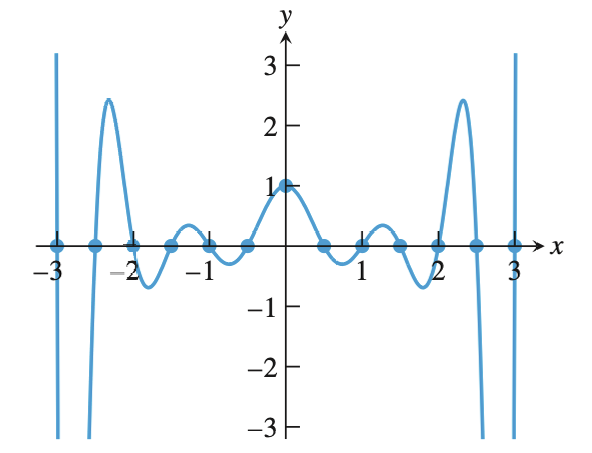

# 插值、秘密分享、自纠错码

NUMERICAL METHODS · 211 分钟阅读

## 插值（Interpolation）:

### 什么是插值？

假设目标函数为 $f$ ，现已知函数 $f$ 上的 $n$ 个点：$(x_i,y_i),i = 1,...,n$ 

找一个函数 $p$ 穿过这 $n$ 点，用 $p$ 来近似函数 $f$ 

### 插值函数 $p$ 需要满足的条件：

- 能够被 $n$ 个点 **唯一确定** 
- 光滑连续，且需要有高阶导数用于确定 $p$ 与目标函数 $f$ 之间的差距

### 多项式插值：

#### 多项式定义：

$$
p(x) = a_0 + a_1x + ... + a_n x^n
$$

其中，$a_0,...,a_n$ 称为多项式的系数；若 $a_n \neq 0$ ，则称 $n$ 为多项式的次数

由代数基本定理，$n$ 次多项式 $P(x) = 0$ 一定有 $n$ 个根：$r_1,...,r_n$ ，$r_i$ 可能为复数，且复数根总是成对出现的

那么，多项式 $p$ 也可以用另一种形式表述：
$$
P(x) = a_n(x - r_1)...(x - r_n)
$$

#### 为什么选用多项式插值？

- $n$ 次多项式有 $n+1$ 个自由度（系数）
- 加、乘、求导、积分都封闭且易算
- Weierstrass 逼近定理：在闭区间上的任意连续函数，无论有多不规则，都可以被一个多项式 **任意一致逼近** ，也就是给定任意极小误差 $\varepsilon > 0$，总能找到一个多项式 $P(x)$ ，使得在整个区间上， $P(x)$ 与目标函数的最大偏移差都小于 $\varepsilon$ 

### 插值本质上是多项式空间的一次坐标变换

#### 多项式构成的向量空间：

一个次数小于 $n$ 的多项式：
$$
P(x) = a_0 + a_1x + ... + a_{n-1}x^{n-1}
$$
所有这样的多项式集合构成了一个 $n$ 维线性空间，这个空间可以用不同的坐标进行表示

#### 系数坐标（Coefficient Coordinates）:

取这个多项式空间的基为：$\{1,x,...,x^{n-1}\}$ 

则多项式 $P(x)$ 可以用向量 $a = \{a_0,a_1,...,a_{n-1}\}$ 作为坐标进行表示，公式为：
$$
P(x) = \sum_{j = 0}^{n - 1}a_j x_j
$$
这是我们熟悉且直接的表示，代数运算极其简单，但求值麻烦

#### 取值坐标（Value Coordinates）：

在这个坐标下，基是 **拉格朗日基多项式** $\{l_1(x),l_2(x), ... ,l_n(x)\}$ 

在 $P(x)$ 上取 $n$ 个横坐标两两不同的点: $(x_1,y_1),...,(x_n,y_n)$ 

那么有 $y_i = p(x_i)$ ，该多项式可以表示为：
$$
P(x) = y_1l_1(x) + y_2l_2(x) + ... + y_nl_n(x)
$$
也就是说，$P(x)$ 在这组基上的坐标为：$\{y_1,y_2,....,y_n\}$ ，故该坐标被称为“取值坐标”

#### 两种坐标的转化：

不难得出：
$$
y_i = a_0 + a_1x_i + ... + a_{n-1}x_i^{n-1}
$$
写成矩阵的形式，就是 $y = Va$ ，其中，$V$ 被称为 **范德蒙德矩阵（Vandermonde matrix）** ，$V_{ij} = x_i^{j-1}$ 

在线性代数中，范德蒙德矩阵有这样的结论：
$$
 \det(V) = \prod_{1 \le i < j \le n} (x_j - x_i)
$$
由于取的点横坐标两两不同，故 $\det(V) \neq 0$ ，也就是 $V$ 一定可逆

$V$ 可逆意味着 $V$ 满秩，线性方程组 $y = Va$ 有唯一解 $a = V^{-1}y$ 

这也就证明了，给定 $n$ 个横坐标两两不同的点，存在唯一一个次数小于 $n$ 的多项式穿过它们

## 拉格朗日插值（Lagrange Interpolation）：

### 拉格朗日基函数：

我们想找出多项式 $L_k(x)$ ，满足：
$$
L_k(x_k) = 1,L_k(x_j) = 0 , \forall j \neq k
$$
为满足后半部分条件，不妨设：
$$
L_k(x) = A_k(x - x_1)...(x - x_{k-1})(x - x_{k+1})...(x - x_n)
$$
再满足前半部分条件，令：
$$
A_k = \frac{1}{(x_k - x_1)...(x_k - x_{k-1})(x_k - x_{k+1})...(x_k - x_n)}
$$

### 拉格朗日插值：

将拉格朗日基函数用 $y$ 坐标加权相加：
$$
P_{n-1}(x) = y_1L_1(x) + ... + y_nL_n(x)
$$
这样利用 $n$ 个点求出多项式的方法就是拉格朗日插值

### 用拉格朗日插值来证明多项式唯一性：

我们已经用拉格朗日基函数构造出了一个次数至多为 $n-1$ 的多项式 $P_{n-1}(x)$ 

假设有另一个多项式 $Q_{n-1}(x)$ 也过同样的 $n$ 个点且次数至多为 $n-1$ 

那么考虑多项式 $H(x) = P(x) - Q(x)$ ，$H$ 的次数也最多为 $n-1$ ，且满足：
$$
H(x_1) = H(x_2) =... =H(x_n) = 0
$$
也就是 $H(x)$ 至少有 $n$ 个零点

由代数基本定理，$H(x)$ 的次数至少为 $n$ ，与前面矛盾

故不存在与 $P_{n-1}(x)$ 的 $Q_{n-1}(x)$ ，多项式具有唯一性

### 误差分析：

#### 误差公式：

对于连续 $n$ 次可导函数 $f$ ，在 $x_1,x_2,...,x_n$ 上进行拉格朗日插值，误差公式为：
$$
f(x) - p(x) = \frac{(x - x_1)...(x-x_n)}{n!} f^{(n)}(c)
$$
这里的 $c$ 不是固定的常数，它依赖于正在求值的点 $x$ ，即 $c$ 是介于 $x$ 和 $x_1,...,x_n$ 之间的一个值

#### 证明：

令 $q(t)$ 为 $x_1,...,x_n,x$ 上插值的多项式

现在我们已经有了 $P(t)$ 穿过 $x_1,...,x_n$ ，需要再加上一个点 $(x,f(x))$ ，构造一个新多项式 $q(t)$ 

首先，我们希望新多项式不破坏原有的插值，即 $q(x_1) = ... = q(x_n) = 0$ 

考虑构造 $q(t) = p(t) + \lambda \prod(t-x_j)$ 

其次，我们希望 $q(t)$ 穿过点 $(x,f(x))$ ，即 $q(x) = f(x)$ 

带入上面的 $q(t)$ 方程，解出：
$$
\lambda =\frac{f(x) - P(x)}{\prod_{j=1}^n (x - x_j)}
$$

此时， $q(t)$ 就是经过 $n+1$ 个点的多项式

考虑函数 $\phi(t) = f(t) - q(t)$ ，则 $\phi(t)$ 在 $x_1,...,x_n,x$ 上均为零，也就是有 $n+1$ 个零点

由罗尔定理， $\phi'(t)$ 有 $n$ 个零点

以此类推， $\phi^{(n)}(t)$ 一定存在一个零点 $c$ ，在该点处，有：
$$
\phi^{(n)}(c) = 0 \implies f^{(n)}(c) - q^{(n)}(c) = 0
$$
最终得出：
$$
f^{(n)}(c) = q^{(n)}(c) = \lambda n!
$$
再将 $\lambda =\frac{f(x) - P(x)}{\prod_{j=1}^n (x - x_j)}$ 带入 $f^{(n)}(c) = \lambda n!$ ，得到误差公式：
$$
f(x) - p(x) = \frac{(x - x_1)...(x-x_n)}{n!} f^{(n)}(c)
$$

#### 与Taylor展开对比：

在 $x_0$ 处进行泰勒展开，拉格朗日余项为：
$$
R_{T}(x) = \frac{(x - x_0)^n}{n!}f^{(n)}(c)
$$
其中 $c$ 是介于 $x_0$ 和 $x$ 之间的一个值

从这里可以看出，拉格朗日插值的余项和泰勒展开的余项非常相像，但是拉格朗日插值的结论更强：

- 泰勒展开是局部的，只有离 $x_0$ 很近时，误差才小
- 拉格朗日插值是在整个区间上分布的，是全局逼近

### 缺陷：

若均匀取点进行拉格朗日插值，会出现“龙格现象”：

## 插值的应用：

### 分享秘密：

#### 典型场景：

11 位科学家希望保护一个高度机密档案：当且仅当至少六个人在场，才能打开档案

这时，我们可以用一个 **五次多项式** 来进行加密，每个人手里有多项式上的一个点 $(x_i,p(x_i))$ ，点值互不相同

那么，有六个人在场时，就有六个有效已知点，进行拉格朗日插值就能够唯一确定秘密多项式

理论上说，秘密多项式可以定义在实数域上，但现实会存在很多问题：

- 精度问题：实数在计算机中无法精确表示（比如 $\pi$ ），如果多项式计算出现一点点误差，插值还原出来的密码就会完全错误。
- 实际做法：密码学中，会使用 **有限域** 来定义多项式

#### 有限域多项式：

定义：
$$
\begin{aligned}
& p(x) = a_0 + a_1 x + a_2 x^2 + a_3 x^3 + \cdots + a_k x^k \pmod q \\
& p: \{0, \dots, q - 1\} \to \{0, \dots, q - 1\} \\
& a_i \in \{0, \dots, q - 1\}
\end{aligned}
$$
通常来说，$q$ 取素数

### 纠删码（Erasure codes）：

场景：发送端有 $n$ 个数据包需要传输，但中途发生了 **丢包** ，传统的网络协议（如TCP）遇到丢包的做法是重传，但这样做非常浪费

需求：根据未丢失的包，直接计算出丢失的数据包，避免重传

做法：在发送时，不只发送 n 个数据包，再传输一些冗余数据用于恢复，分两种情况：擦除错误和一般错误

在讨论这两种错误之前，先来定义汉明距离：

#### 汉明距离（Hamming distance）:

考虑 $s,t,\in \mathbb{F}_q^m$ ，这表示 $s,t$ 是长度为 $m$ ，在有限域 $\mathbb{F}_q$ 中的两个“码字”，也就是需要传输的数据

定义：
$$
d(s, t) = \# \{ i : s_i \neq t_i \}
$$
也就是说，$d(s,t)$ 表示 $s,t$ 的 $m$ 位中，有多少位不相同

接下来定义最小汉明距离：
$$
d_{\min}(C) = \min_{u \neq v} d(C(u), C(v))
$$
其中，$C$ 是一种编码方式，$d_{min}(C)$ 代表的是，在 $C$ 这种编码方式下，传输的数据两两之间的最小汉明距离

最小汉明距离  - 1 = 所需的冗余数量

#### 擦除错误（Erasure errors）:

这种情况下，丢包的 **位置** 是已知的，也就是说我们知道哪些点是错误的

如果删掉任意 $k$ 个坐标后，不同码字之间仍能被区分，需要：
$$
d_{min} \ge k + 1
$$
那么，假如需要发送 $n$ 个数据包，预计最多丢包的数目是 $k$ ，那么就只需要传输 $n+k$ 个正确数据

若存在 $k$ 个丢包，就用剩下的 $n$ 个数据包恢复即可 

#### 一般错误（General errors）：

在这种情况下，丢包的位置是未知的

假如删除了数据包 $r$ ，且有：
$$
d(r,C(u)) \le k,d(r,C(v)) \le k
$$
那么就会产生解码歧义，接收方不能确定原本发送的信息是 $u$ 还是 $v$ 

为了不让这种情况出现，由三角不等式，有：
$$
d_{min} \ge 2k+1
$$
那么需要发送的数据量是 $n+2k$ 
