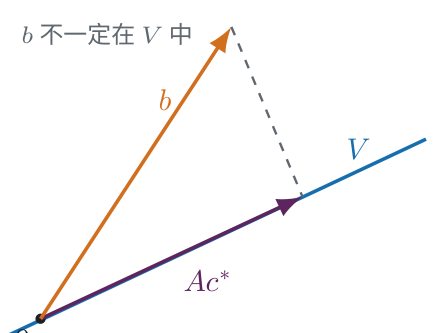

# 最小二乘法与 QR 分解

NUMERICAL METHODS · 426 分钟阅读

## 最小二乘法概述：

### 问题转化：

问题：现在我们有 $m$ 个采样点：$(t_i,f(t_i))$ ，现在希望找到函数 $f(x)$ ，让这 $m$ 个点的平方误差之和最小

如果希望用函数 $p(x)$ 进行拟合，则选定基 $\phi_1,...,\phi_n$ ，将候选函数写成：
$$
p(x)=\sum_{j=1}^{n}x_j\phi_j(x)
$$
给定 $m$ 个采样点 $t_1,...,t_m$ ，定义：
$$
A_{ij}:=\phi_j(t_i),\qquad b_i:=f(t_i)
$$
于是 $A\in\mathbb{R}^{m\times n}$ ，$b\in\mathbb{R}^m$ ，那么：
$$
(Ax-b)_i=p(t_i)-f(t_i)
$$
所以，如果候选函数精确通过所有样本点，就等价于解线性方程：
$$
Ax=b
$$

### 离散线性最小二乘：

#### 优化目标：

当无法让所有样本点误差都为零时，改为让平方误差之和最小：
$$
\min_{x\in\mathbb{R}^n}\|Ax-b\|_2^2
=\min_x\sum_{i=1}^{m}|p(t_i)-f(t_i)|^2
$$
这就是离散线性最小二乘法

这里的“线性”指的是候选函数对系数 $x$ 线性，不要求 $p(x)$ 必须是一条直线

#### 几何意义：

将矩阵的列记为 $A_1,...,A_n$ ，则：
$$
Ax=x_1A_1+...+x_nA_n
$$
所有可能的 $Ax$ 恰好组成列空间：
$$
V:=\operatorname{span}\{A_1,...,A_n\}\subseteq\mathbb{R}^m
$$
因此，最小二乘就是在 $V$ 中寻找离 $b$ 最近的向量：
$$
Ax^*\in\underset{v\in V}{\operatorname{argmin}}\|v-b\|_2^2
$$

如果 $b\in V$ ，最小误差就是零，退化为精确求解线性方程；如果 $b\notin V$ ，则寻找一个最接近的近似结果

### 离散与连续平方逼近：

离散版本只计算样本点上的误差：
$$
\sum_{i=1}^{m}|p(t_i)-f(t_i)|^2
$$
连续版本则计算整个区间上的平方误差：
$$
\int_a^b|p(x)-f(x)|^2\,dx
$$
两者都在选定的函数空间中寻找最佳逼近，但一个使用有限个样本点，另一个使用整个区间

范数决定“接近”的含义，基决定候选函数如何表示；选定两者后，就能将函数逼近转化为系数的优化问题

## 最小二乘的计算：

### 几何解释：残差与列空间正交：

记最小二乘解为 $\bar{x}$ ，即：

$$
\bar{x}\in\underset{x\in\mathbb{R}^n}{\operatorname{argmin}}\|Ax-b\|_2^2
$$

对应的最近点为 $A\bar{x}$ ，记残差为：

$$
r=A\bar{x}-b
$$

最优点处，残差必须与整个列空间 $V=\operatorname{Col}(A)$ 正交，否则还能沿着列空间中的某个方向进一步靠近 $b$ 

对列空间中的任意向量 $Ax$ ，必须有：

$$
(Ax)^\top(A\bar{x}-b)=0,\qquad\forall x\in\mathbb{R}^n
$$

也就是：

$$
x^\top A^\top(A\bar{x}-b)=0,\qquad\forall x\in\mathbb{R}^n
$$

只有 $A^\top(A\bar{x}-b)=0$ 才能使它对所有 $x$ 成立

于是得到 **法线方程** ：
$$
\boxed{A^\top A\bar{x}=A^\top b}
$$

### 微积分解释：对平方误差求梯度

最小化 $\|Ax-b\|_2$ 与最小化它的平方等价，使用平方可以避免求导时出现根号

令：

$$
E(x):=\|Ax-b\|_2^2
=x^\top A^\top Ax+b^\top b-b^\top Ax-x^\top A^\top b
$$

其中 $b^\top Ax=x^\top A^\top b$ ，两项相等是因为它们是互为转置的标量

求梯度，得：
$$
\nabla\|Ax-b\|_2^2
=\left(\frac{\partial}{\partial x_1},\frac{\partial}{\partial x_2},...,\frac{\partial}{\partial x_n}\right)\|Ax-b\|_2^2
=2A^\top Ax-2A^\top b
$$

在最小点 $\bar{x}$ 处令梯度为零，同样得到：

$$
A^\top A\bar{x}=A^\top b
$$

这是方程组的理论表达式；实际计算通常不显式求 $(A^\top A)^{-1}$ ，求解线性方程组与计算逆矩阵是不同的操作

这里的驻点确实是全局最小点，因为：

$$
\nabla^2E(x)=2A^\top A,\qquad
z^\top A^\top Az=\|Az\|_2^2\geq 0
$$

因此 $E$ 是凸函数；若 $A$ 列满秩，则对非零 $z$ 上式严格大于零，$E$ 严格凸，最小点唯一

### 变分解释：任意扰动都不能降低误差：

令 $E(x):=\|Ax-b\|_2^2$ ，要证明的结论是：

$$
A^\top A\bar{x}=A^\top b
\iff
\forall y\in\mathbb{R}^n,\ E(\bar{x})\leq E(\bar{x}+y)
$$

对任意扰动 $y$ ，展开平方误差：

$$
E(\bar{x}+y)=E(\bar{x})+(Ay)^\top Ay
+2y^\top A^\top(A\bar{x}-b)
$$

若 $\bar{x}$ 满足法线方程，最后一项为零，因此：

$$
E(\bar{x}+y)=E(\bar{x})+\|Ay\|_2^2\geq E(\bar{x})
$$

这证明了法线方程足以保证全局最优，也给出了误差的勾股分解

反过来，若 $g=A^\top(A\bar{x}-b)\neq 0$ ，取 $y=-\varepsilon g$ ，则：

$$
E(\bar{x}-\varepsilon g)-E(\bar{x})
=-2\varepsilon\|g\|_2^2+\varepsilon^2\|Ag\|_2^2
$$

当 $\varepsilon>0$ 足够小时，一次负项超过二次项，右侧为负，因此 $\bar{x}$ 不可能是最小点

所以，**满足法线方程与取得最小平方误差互为充要条件** 

### 解的存在性与唯一性：

有限维子空间 $V$ 中，$b$ 的正交投影总是存在且唯一，因此最小二乘问题总有解，拟合向量 $A\bar{x}$ 也总是唯一的

但解 $x$ 是否唯一，还要看 $A$ 是否列满秩：

- 从线性组合角度，这个结论是显然的

- 可以从可逆角度分析：

  若 $A$ 列满秩，则 $A^TA \in \mathbb{R}^{n*n}$ 是可逆矩阵

  可以解出唯一 $x = (A^\top A)^{-1}A^\top b$

若 $A$ 不列满秩，任取一个最小二乘解 $x_0$ ，全部最小二乘解为：

$$
x=x_0+z,\qquad z\in\ker A
$$

## 正交化与 QR 分解：

### 为什么要换一组基：

如果 $A$ 的列已经是标准正交的（orthonormal），即：

每一列都是单位向量，且不同列之间两两正交
$$
A_i^\top A_j=\begin{cases}1,&i=j\\0,&i\neq j\end{cases}
$$

则 $A^\top A=I_n$ ，最小二乘解直接化为：

$$
\bar{x}=A^\top b
$$

下面假设 $m\geq n$ ，且 $A$ 的 $n$ 列线性无关

### Gram–Schmidt 正交化：

目标是在不改变列空间的前提下，将 $A_1,...,A_n$ 变成标准正交向量 $q_1,...,q_n$ 

先处理第一列：

$$
y_1=A_1,\qquad q_1=\frac{y_1}{\|y_1\|_2}
$$

第二列先减去它在 $q_1$ 上的投影，再标准化：

$$
y_2=A_2-q_1(A_2^\top q_1),\qquad q_2=\frac{y_2}{\|y_2\|_2}
$$

一般地：

$$
y_j=A_j-q_1(A_j^\top q_1)-q_2(A_j^\top q_2)-\cdots-q_{j-1}(A_j^\top q_{j-1}),
\qquad q_j=\frac{y_j}{\|y_j\|_2}
$$

### 经典算法（CGS）：

不妨记：
$$
r_{ij}=q_i^\top A_j=A_j^\top q_i,\quad i<j,
\\ r_{jj}=\|y_j\|_2
$$

于是 ：
$$
y_j=A_j-\sum_{i=1}^{j-1}r_{ij}q_i
$$
则经典算法可描述为：

**for** $j = 1, 2, \ldots, n$

	$y = A_j$

	**for** $i = 1, 2, \ldots, j - 1$

		$r_{ij} = q_i^T A_j$

		$y = y - r_{ij} q_i$

	**end**

		$r_{jj} = \|y\|_2$

		$q_j = y / r_{jj}$
**end**

注意到该算法的 $r_{ij}$ 在外层循环就固定好了，不会随 $y$ 的变化而变化

这样可能会导致算法精度丢失

### 进阶算法（MGS）：

#### 理论基础：

因为 $q_1,...,q_n$ 标准正交，所以 $A_j$ 和 $y$ 在 $q_i$ 方向上的投影是一样的

所以可以将 $r_{ij}$ 的计算改为：
$$
r_{ij} = q_i^Ty
$$
证明：

$$
q_i^T y = q_i^T \left( A_j - \sum_{k=1}^{i-1} r_{kj} q_k \right)=
q_i^T A_j - \sum_{k=1}^{i-1} r_{kj} \left( q_i^T q_k \right)
$$

由于 $q_1,...,q_n$ 标准正交，所以有：

- $k \neq i$ ：$q_i^Tq_k = 0$ 
- $k = i$ ：$q_i^Tq_k = 1$ 

故上式可化简为：
$$
q_i^T y = q_i^T A_j - 0 = q_i^T A_j
$$

#### 算法：

**for** $j = 1, 2, \ldots, n$

	$y = A_j$

	**for** $i = 1, 2, \ldots, j - 1$

		$r_{ij} = q_i^T y$

		$y = y - r_{ij} q_i$

	**end**

		$r_{jj} = \|y\|_2$

		$q_j = y / r_{jj}$
**end**

这个算法中，$r_{ij}$ 随 $y$ 的更新而更新

虽然两个算法在数学上等价，但在计算机实际执行的过程中，进阶算法的精度要比传统算法高很多

### 基于正交化的 QR 分解：

#### 什么是 QR 分解：

在正交化之后，我们可以把 $A$ 的每一列表述为：
$$
\begin{aligned}
A_1 &= r_{11}q_1 \\
A_2 &= r_{12}q_1 + r_{22}q_2 \\
A_3 &= r_{13}q_1 + r_{23}q_2 + r_{33}q_3 \\
&\dots \\
A_j &= r_{1j}q_1 + r_{2j}q_2 + \dots + r_{jj}q_j
\end{aligned}
$$
化成矩阵的形式，就是：
$$
[A_1, A_2, \dots, A_n] = [q_1, q_2, \dots, q_n]
\begin{pmatrix}
r_{11} & r_{12} & \cdots & r_{1n} \\
0 & r_{22} & \cdots & r_{2n} \\
\vdots & \vdots & \ddots & \vdots \\
0 & 0 & \cdots & r_{nn}
\end{pmatrix}
$$
即：
$$
A = QR
$$
$Q$ 是标准正交化矩阵，$R$ 是上三角矩阵

#### 用 QR 分解求最小二乘的解：

将 $A=QR$ 代入法线方程，并利用 $Q^\top Q=I_n$ ：

$$
\begin{align*}
A^\top A\bar{x}=A^\top b
&\iff R^\top Q^\top QR\bar{x}=R^\top Q^\top b\\
&\iff R^\top R\bar{x}=R^\top Q^\top b\\
&\iff R\bar{x}=Q^\top b
\end{align*}
$$

最后一步利用 $R^\top$ 满秩，可逆

因此：
$$
\boxed{\bar{x}=R^{-1}Q^\top b}
$$

也就是说，对于满秩矩阵 $A$ ，计算时只需求解 $R\bar{x}=Q^\top b$ ，不需要先构造 $A^\top A$ 

在实际中，也可以不用求 $R^{-1}$ ，直接解方程即可

## 伪逆与欠定方程的最小范数解：

### 列满秩

当 $A$ 列满秩时，$A^TA$ 是 $n$ 阶满秩方阵，一定可逆

定义 $A$ 的伪逆（Pseudoinverse）：
$$
A^+=(A^\top A)^{-1}A^\top\in\mathbb{R}^{n\times m}
$$

于是对任意 $b$ ：

$$
\bar{x}=A^+b,\qquad A^+A=I_n
$$

### 行满秩：

若 $m<n$ 且 $\operatorname{rank}(A)=m$ ，则 $A$ 的列空间为整个 $\mathbb{R}^m$ ，所以对任意 $b$ ，$Ax=b$ 都有解

此时 $AA^\top$ 可逆，定义：

$$
A^+=A^\top(AA^\top)^{-1}
$$

并取：

$$
\boxed{\bar{x}=A^\top(AA^\top)^{-1}b}
$$

首先验证它是精确解：

$$
A\bar{x}=AA^\top(AA^\top)^{-1}b=b
$$

其次，任意其他解都能写成 $x=\bar{x}+z$ ，其中 $Az=0$ ，而：

$$
\bar{x}^\top z
=\big((AA^\top)^{-1}b\big)^\top Az=0
$$

因此：

$$
\|x\|_2^2=\|\bar{x}\|_2^2+\|z\|_2^2\geq\|\bar{x}\|_2^2
$$

等号当且仅当 $z=0$ ，所以 $\bar{x}$ 是**唯一的最小范数解** 

## 内积空间中的连续最小二乘：

### 从向量内积到函数内积：

实向量的标准内积为 $\langle u,v\rangle=u^\top v$ ，函数也可以定义内积：

$$
\langle f,g\rangle=\int_a^b f(x)g(x)\,dx
$$

带权版本为：

$$
\langle f,g\rangle_w=\int_a^b f(x)g(x)w(x)\,dx
$$

实内积满足：

$$
\begin{align*}
\langle x,y\rangle&=\langle y,x\rangle\\
\langle ax+by,z\rangle&=a\langle x,z\rangle+b\langle y,z\rangle\\
\langle x,x\rangle&>0,\qquad x\neq0
\end{align*}
$$

内积天然诱导范数 $\|x\|=\sqrt{\langle x,x\rangle}$ ，对应的函数范数为：

$$
\|f\|_w=\sqrt{\langle f,f\rangle_w}
$$

### 正交函数族与正交多项式：

称函数族 $\phi_1(x),\phi_2(x),...$ 是正交化的，如果它们满足：

$$
\langle\phi_i,\phi_j\rangle=
\begin{cases}
C_i,&i=j\\
0,&i\neq j
\end{cases}
$$

这里 $C_i=\langle\phi_i,\phi_i\rangle$ ，即第 $i$ 个函数与自身的内积；不同函数之间的内积为零

如果 $\phi_1(x),\phi_2(x),...$ 是多项式，也称之为正交多项式

Chebyshev 多项式也是多项式的一组基，它关于权函数：

$$
w(x)=\frac{1}{\sqrt{1-x^2}}
$$

所定义的内积是正交的，这个带权内积为：

$$
\langle f,g\rangle_w:=\int_{-1}^{1}f(x)g(x)\frac{dx}{\sqrt{1-x^2}}
$$

因此，判断函数族是否正交，需要使用指定的内积；这里 Chebyshev 多项式的正交性使用的是上述带权内积

### Chebyshev 多项式正交性的证明：

由 Chebyshev 多项式的定义：

$$
T_k(x)=\cos(k\arccos x)
$$

令 $x=\cos\theta$ ，其中 $\theta\in[0,\pi]$ ，则：

$$
T_k(\cos\theta)=\cos(k\theta),\qquad
dx=-\sin\theta\,d\theta,\qquad
\sqrt{1-x^2}=\sin\theta
$$

对非负整数 $i,j$ ，换元得到：

$$
\begin{align*}
\langle T_i,T_j\rangle_w
&=\int_{-1}^{1}T_i(x)T_j(x)\frac{dx}{\sqrt{1-x^2}}\\
&=\int_{\pi}^{0}\cos(i\theta)\cos(j\theta)(-d\theta)\\
&=\int_0^\pi\cos(i\theta)\cos(j\theta)\,d\theta
\end{align*}
$$

权函数 $w(x)=1/\sqrt{1-x^2}$ 恰好抵消了换元时 $dx$ 中的 $\sin\theta$ 因子，使带权内积变成余弦函数的普通积分

当 $i\neq j$ 时，使用积化和差公式：

$$
\begin{align*}
\langle T_i,T_j\rangle_w
&=\frac12\int_0^\pi\big(\cos((i-j)\theta)+\cos((i+j)\theta)\big)\,d\theta\\
&=\frac12\left[\frac{\sin((i-j)\theta)}{i-j}
+\frac{\sin((i+j)\theta)}{i+j}\right]_0^\pi\\
&=0
\end{align*}
$$

当 $i=j\geq1$ 时：

$$
\langle T_i,T_i\rangle_w
=\int_0^\pi\cos^2(i\theta)\,d\theta
=\frac12\int_0^\pi\big(1+\cos(2i\theta)\big)\,d\theta
=\frac\pi2
$$

当 $i=j=0$ 时，$T_0(x)=1$ ，所以：

$$
\langle T_0,T_0\rangle_w=\int_0^\pi1\,d\theta=\pi
$$

因此：

$$
\boxed{
\langle T_i,T_j\rangle_w=
\begin{cases}
0,&i\neq j\\
\pi,&i=j=0\\
\pi/2,&i=j\geq1
\end{cases}}
$$

这正好满足正交函数族的定义，其中 $C_0=\pi$ ，$C_i=\pi/2\ (i\geq1)$ 

## 正交系统中的最小二乘法：傅里叶级数：

### 三角函数族的选择：

给定函数 $f$ 和一组基函数 $\phi_i$ ，希望找到系数 $\{c_i\}$ ，使得：

$$
f(x)\approx\sum_i c_i\phi_i(x)
$$

取：

$$
\phi_0=\frac12 \\
\phi_k(x)=\cos(kx),\quad k=1,2,...,n, \\
\phi_{n+k}(x)=\sin(kx),\quad k=1,2,...,n-1
$$

则函数族 $\phi_0(x),\phi_1(x),...$ 在 $[-\pi,\pi]$ 上关于内积：

$$
\langle f,g\rangle=\int_{-\pi}^{\pi}f(x)g(x)\,dx
$$

是正交的

### 三角函数族正交性的证明：

对于正整数 $k$ ：

$$
\int_{-\pi}^{\pi}\cos(kx)\,dx=0,
\qquad
\int_{-\pi}^{\pi}\sin(kx)\,dx=0
$$

因此，常数函数 $\phi_0=1/2$ 与其余基函数正交

再使用积化和差公式：

$$
\begin{align*}
\sin y\cos x&=\frac12\big(\sin(y-x)+\sin(y+x)\big)\\
\cos y\cos x&=\frac12\big(\cos(y-x)+\cos(y+x)\big)\\
\sin y\sin x&=\frac12\big(\cos(y-x)-\cos(y+x)\big)
\end{align*}
$$

例如，对不同的正整数 $j,k$ ：

$$
\begin{align*}
\langle\cos(jx),\cos(kx)\rangle
&=\frac12\int_{-\pi}^{\pi}\big(\cos((j-k)x)+\cos((j+k)x)\big)\,dx\\
&=0
\end{align*}
$$

因为 $j-k\neq0$ 且 $j+k\neq0$ ，两项的积分均为零；同理，不同频率的正弦函数之间也正交

正弦函数与余弦函数的乘积可化为正弦函数之和，其积分也为零，因此两类函数之间同样正交

### 用最小二乘法确定系数（选讲）：

给定函数 $f$ ，希望找到系数 $\{a_i,b_i\}$ ，使得：

$$
f(x)\approx\frac{a_0}{2}+a_n\cos nx
+\sum_{k=1}^{n-1}\big(a_k\cos kx+b_k\sin kx\big)
$$

记误差函数为：

$$
E(x):=f(x)-\left(\frac{a_0}{2}+a_n\cos nx
+\sum_{k=1}^{n-1}\big(a_k\cos kx+b_k\sin kx\big)\right)
$$

考虑使误差函数的 2-范数平方最小：

$$
\|E(x)\|_2^2=\langle E(x),E(x)\rangle
=\int_{-\pi}^{\pi}E(x)^2\,dx
$$

对它关于系数 $\{a_i,b_i\}$ 求偏导并设为零，即得到法线方程

固定一个 $k\in\{1,...,n\}$ ，对 $a_k$ 求偏导时，将 $x$ 、其他系数以及目标函数 $f$ 都视为不变；$E(x)$ 中只有 $-a_k\cos kx$ 这一项含有 $a_k$ 

因此，先对误差函数求偏导，再用链式法则对误差的平方求偏导：

$$
\frac{\partial E(x)}{\partial a_k}=-\cos kx,
\qquad
\frac{\partial E(x)^2}{\partial a_k}
=2E(x)\frac{\partial E(x)}{\partial a_k}
=-2E(x)\cos kx
$$

积分区间固定，而误差是系数的有限线性组合，所以这里可以在积分号内求导：

$$
\frac{\partial}{\partial a_k}\int_{-\pi}^{\pi}E(x)^2\,dx
=\int_{-\pi}^{\pi}2E(x)\frac{\partial E(x)}{\partial a_k}\,dx
$$

对于 $k=1,...,n$ ，由于 $\partial E(x)/\partial a_k=-\cos kx$ ：

$$
\frac{\partial}{\partial a_k}\|E(x)\|_2^2
=-2\int_{-\pi}^{\pi}E(x)\cos kx\,dx
=-2\langle E,\cos kx\rangle=0
$$

在最小点处，偏导数为零，因此 $\langle E,\cos kx\rangle=0$ 

为区分求和下标与固定的 $k$ ，将误差函数中的求和下标记为 $j$ ，并把单独写出的 $a_n\cos nx$ 并入余弦求和：

$$
E(x)=f(x)-\frac{a_0}{2}
-\sum_{j=1}^{n}a_j\cos jx
-\sum_{j=1}^{n-1}b_j\sin jx
$$

利用内积对加减和数乘的线性性，将 $\langle E,\cos kx\rangle=0$ 展开为：

$$
\begin{align*}
0={}&\langle f,\cos kx\rangle
-\frac{a_0}{2}\langle1,\cos kx\rangle\\
&-\sum_{j=1}^{n}a_j\langle\cos jx,\cos kx\rangle
-\sum_{j=1}^{n-1}b_j\langle\sin jx,\cos kx\rangle
\end{align*}
$$

由前面证明的正交性，各项分别满足：

- 常数函数与 $\cos kx$ 正交，所以 $\langle1,\cos kx\rangle=0$ 
- 当 $j\neq k$ 时，不同频率的余弦函数正交，所以 $\langle\cos jx,\cos kx\rangle=0$ 
- 所有正弦基函数都与 $\cos kx$ 正交，所以 $\langle\sin jx,\cos kx\rangle=0$ 

于是，余弦求和中只有 $j=k$ 的一项保留下来，正弦求和与常数项全部为零

注意，$f$ 是要逼近的目标函数，基函数之间的正交性并不能推出 $\langle f,\cos kx\rangle=0$ ，因此这一项也必须保留

将 $E$ 展开后，由于正交性，除 $a_k\cos kx$ 外的其余基函数与 $\cos kx$ 的内积均为零，因此：

$$
\langle f,\cos kx\rangle-a_k\langle\cos kx,\cos kx\rangle=0
$$

从而得到：

$$
\boxed{a_k=\frac{\langle f,\cos kx\rangle}{\langle\cos kx,\cos kx\rangle}},
\qquad k=1,...,n
$$

同理，对 $b_k$ 求偏导并设为零，得到：

$$
\boxed{b_k=\frac{\langle f,\sin kx\rangle}{\langle\sin kx,\sin kx\rangle}},
\qquad k=1,...,n-1
$$

常数项对应基函数 $\phi_0=1/2$ ，对 $a_0$ 求偏导时有 $\partial E(x)/\partial a_0=-1/2$ ，因此：

$$
\frac{\partial}{\partial a_0}\|E(x)\|_2^2
=-2\left\langle E,\frac12\right\rangle=0
$$

利用其余基函数与常数函数正交，得到：

$$
\left\langle f,\frac12\right\rangle
-a_0\left\langle\frac12,\frac12\right\rangle=0,
\qquad
a_0=\frac{\left\langle f,\frac12\right\rangle}{\left\langle\frac12,\frac12\right\rangle}
$$

正交性使每个系数的方程只包含它自身，不同系数不再相互耦合，因此可以分别求出

对于正整数 $k$ ，使用平方降幂公式计算分母：

$$
\begin{align*}
\langle\cos kx,\cos kx\rangle
&=\int_{-\pi}^{\pi}\cos^2 kx\,dx
=\frac12\int_{-\pi}^{\pi}(1+\cos 2kx)\,dx=\pi\\
\langle\sin kx,\sin kx\rangle
&=\int_{-\pi}^{\pi}\sin^2 kx\,dx
=\frac12\int_{-\pi}^{\pi}(1-\cos 2kx)\,dx=\pi
\end{align*}
$$

常数基函数的平方范数与对应的分子分别为：

$$
\left\langle\frac12,\frac12\right\rangle
=\int_{-\pi}^{\pi}\frac14\,dx=\frac\pi2,
\qquad
\left\langle f,\frac12\right\rangle
=\frac12\int_{-\pi}^{\pi}f(x)\,dx
$$

代入前面的系数公式，最终得到：

$$
\boxed{
\begin{aligned}
a_k&=\frac1\pi\int_{-\pi}^{\pi}f(x)\cos kx\,dx,
&&k=1,...,n\\
b_k&=\frac1\pi\int_{-\pi}^{\pi}f(x)\sin kx\,dx,
&&k=1,...,n-1\\
a_0&=\frac1\pi\int_{-\pi}^{\pi}f(x)\,dx
\end{aligned}}
$$

注意，近似式中的常数项是 $a_0/2$ ，所以实际的常数项为：

$$
\frac{a_0}{2}=\frac1{2\pi}\int_{-\pi}^{\pi}f(x)\,dx
$$
