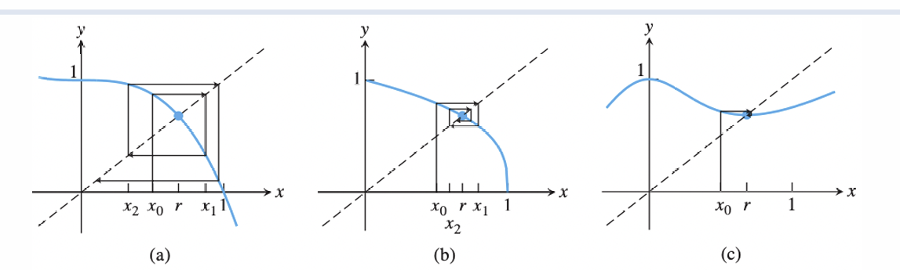
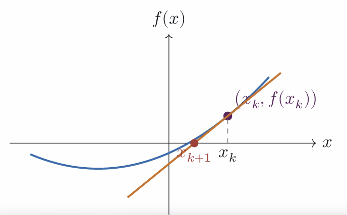

# 二分法、牛顿法

NUMERICAL METHODS · 1.28 分钟阅读

##  基本问题：

给定<strong>$f$</strong>，求<strong>$r$</strong>使得<strong>$f(r) = 0$</strong>

有两种方法来进行求解：**二分法**、**牛顿法**

## 二分法：

###  前提

 **介值定理**：若 $f$ 连续且 $f(a)f(b) < 0$ ，则 $[a,b]$ 内至少有一个根。

### 做法：不确定性收缩

查询中点 $m_k$

检查 $f(m_k)$ 的符号

区间缩小为异号半区

重复以上步骤，直至区间长度缩小至误差范围 $\varepsilon$ 内

### 收敛速度分析：

设初始区间长度 $L_0 = b - a$ ，$k$ 次后：
$$
L_k \le \frac{b - a}{2^{k + 1}}
$$
输出中点 $x_k$ ，则某个被保留的根 $r$ 满足：
$$
|x_k - r| \le  \frac{b-a}{2^{k + 1}}
$$
要达到 $|x_k - r| \le \varepsilon$ ，只需：
$$
k \ge \left\lceil \log_2 \frac{b - a}{2\varepsilon} \right\rceil
$$
类似与二分法，若一个算法每一步把不确定性缩小一个常数因子 $\rho < 1$ ，通常意味着达到精度 $\varepsilon$ 需要$O(\log(1/\varepsilon))$ 步

## 不动点迭代法：

### 不动点：

若 $g(r) = r$ 则称 $r$ 为 $g$ 的一个不动点

可以把求根问题 $f(x) = 0$ 改写为 $x = g(x)$ ，用不动点迭代进行求解

### 做法：

- 猜测一个 $x_0$ 
- $x_{i+1} = g(x_i)$ ，$i = 0,1,2,...$ 

### 性质：

不一定收敛，如对于 $g(x) = x + 1$，无法收敛到不动点

但对于连续函数 $g$ ，如果 $x_i$ 收敛，则一定收敛到不动点

证明：若 $x_{k+1} = g(x_k)$ ， $g$ 连续，且 $x_k$ 收敛，则：
$$
\begin{align*}
g(r) &= g(\lim_{k \to \infty}x_k) \\
&= \lim_{k \to \infty} g(x_k) \\
&= \lim_{k \to \infty} x_{k+1} \\
&= \lim_{k \to \infty} x_k \\
&= r
\end{align*}
$$

### 收敛速度：

#### 定义：

记第 $k$ 次迭代的误差为：
$$
e_k = |x_k - r|
$$
若下列极限存在，称：
$$
S = \lim_{k \to \infty} \frac{e_{k+1}}{e_k}
$$
为 **收敛速度** 

若 $0 < S < 1$ ，则称为线性收敛

若 $S = 0$ ，则需要更高阶导数来进行收敛速度的计算

#### 计算：

局部收敛性：若 $g$ 连续可导，且 $r$ 满足 $g(r) = r, S = |g'(r)| < 1$ ，则对于任意足够接近 $r$ 的起始点 $x_0$ ，$g$ 的不动点迭代会线性收敛到 $r$ ，且收敛速度为 $S$ 

证明：由中值定理：
$$
x_{k+1} - r = g(x_k) - g(r) = g'(\xi_k)(x_k - r)
$$
由 $e_k = |x_k - r|$ ，知：
$$
e_{k+1} = |g'(\xi_k)| e_k
$$
取 $k \to \infty$ :
$$
S = \lim_{k \to \infty} \frac{e_{k+1}}{e_k} = \lim_{k \to \infty} |g'(\xi_k) | = | g'(r) | < 1 
$$
所以误差的理想收敛速度是 $S$ ，但不一定能达到。下面考虑最坏收敛速度：

因为 $0<S<1$ ，则有 $(S+1)/2 < 1$ ，那么由极限的特性，在 $r$ 的一个足够小的邻域内，满足：
$$
|g'(\xi_k) | < (S+1)/2
$$
所以在这个邻域内，最坏收敛速度为 $(S+1)/2$ ，这也是为什么这个性质叫 **局部收敛性** 

### 不动点的稳定性：

- 稳定的不动点： $g'(r) < 1$ ，局部收敛（local convergence），误差会越来越小
- 不稳定的不动点： $g'(r) > 1$ ,局部发散，误差越来越大（与“混沌”现象有关）

## 根的敏感性：

对于简单根（$f'(r) \neq 0$） 该问题等价于 **误差分析** 中的 **绝对条件数** ：
$$
\kappa_{\text{root}}^{\text{abs}} = \frac{1}{|f'(r)|}
$$
也就是说， $f'(r)$ 绝对值越小，根越敏感

## 牛顿法（Newton-Raphson）:

### 什么是牛顿法：

对于连续函数 $f$ ，在$x_k$ 附近，有一阶近似：
$$
f(x) \approx f(x_k) + f'(x_k)(x - x_k)
$$
在求根问题中， $f(x) = 0$ 

那么有：
$$
0 = f(x_k) + f'(x_k)(x_{k+1} - x_k) \\
\implies x_{k+1} = x_k - \frac{f(x_k)}{f'(x_k)}
$$
相当于在 $(x_k,f(x_k))$ 处作切线，将其与 $x$ 轴的交点作为 $x_{k+1}$ 

牛顿法是一种特殊的不动点迭代法。我们不妨设:
$$
g(x) = x - \frac{f(x)}{f'(x)}
$$
满足 $g(r) = r - \frac{f(r)}{f'(r)} = r$ 的不动点方程要求

### 牛顿法的二次收敛（Quadratic convergence）:

同样，记 $e_k = |x_k - r |$ 为第 $k$ 次迭代的误差

定理：若 $f \in C^2$ （即 $f$ 有二阶连续的导数）， $f(r) = 0$ 且 $f'(r) \neq 0$ ，则当 $x_0$ 足够接近 $r$ 时，牛顿法收敛，且有：
$$
\lim_{k \to \infty} \frac{e_{k+1}}{e_k^2} = |\frac{f''(r)}{2f'(r)} |
$$
证明：

牛顿法等价于不等点方程 $x_{k+1} = x_k,g(x) = x - \frac{f(x)}{f'(x)}$ ，$g$ 的不动点对应 $f$ 的根
$$
g'(x) = 1 - \frac{f'(x)^2 - f(x)f''(x)}{f'(x)^2} = \frac{f(x)f''(x)}{f'(x)^2} 
$$
在 $r$ 处，有 $g'(r) = 0$ ，因此牛顿法局部收敛

在 $x_k$ 处二次展开 $r$ :
$$
f(r) = 0 = f(x_k) + f'(x_k)(r - x_k) + \frac{1}{2}f''(\xi_k) (r - x_k)^2
$$
且牛顿法满足：
$$
f(x_k) + f'(x_k) (x_{k+1} - x_k) = 0
$$
联立两式，有：
$$
f'(x_k) r + \frac{1}{2}f''(\xi_k) (r - x_k)^2 = f'(x_k)x_{k+1} \\
\iff 
\frac{1}{2}f''(\xi_k) (r - x_k)^2 = f'(x_k)(x_{k+1} - r) \\
\iff
\frac{x_{k+1} - r}{(r - x_k)^2} = \frac{f''(\xi_k)}{2f'(x_k)} \\
\iff
\frac{e_{k+1}}{e_k} = |\frac{f''(\xi_k)}{2f'(x_k)}|
$$
取极限即得证

### 当导数不易求时：

可以采用 **割线法（Secant method）** ：用两次函数值近似导数
$$
x_{k+1} = x_k - f(x_k)\frac{x_k - x_{k - 1}}{f(x_k) - f(x_{k-1})} 
$$
在简单根和常规光滑条件下，该做法的收敛阶为： $\frac{\sqrt{5} +1}{2} \approx 1.618$ 

## 总结：

现实中，往往会结合二分法牛顿/割线法

- 二分法保证全局收敛

- 牛顿/割线法保证在足够接近近似解的时候，更快地收敛到需要的精度

## 动手试一试：牛顿法

改变初值，逐步观察切线怎样把近似值带向根。残差和迭代差会同时显示。

<NewtonDemo />
