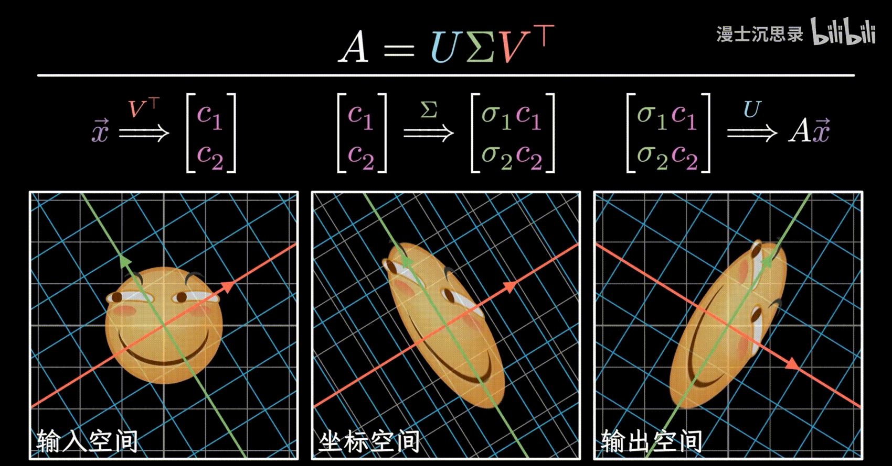
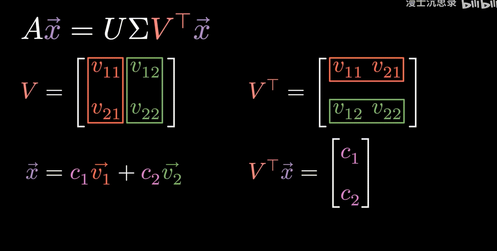
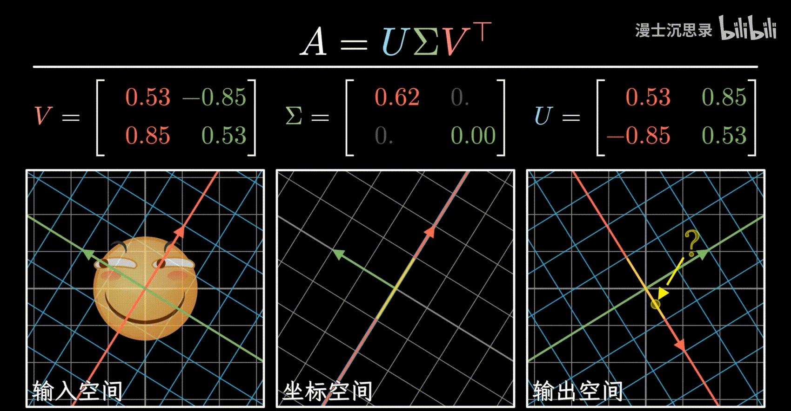
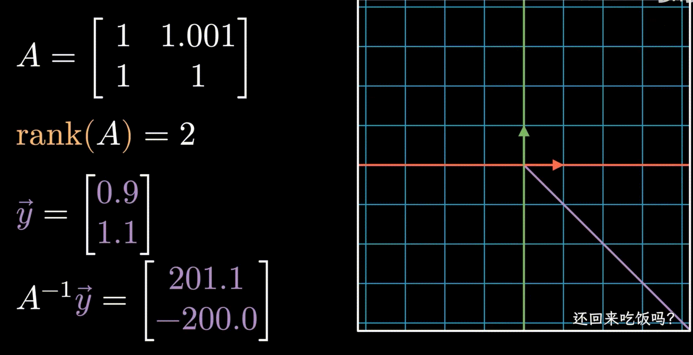
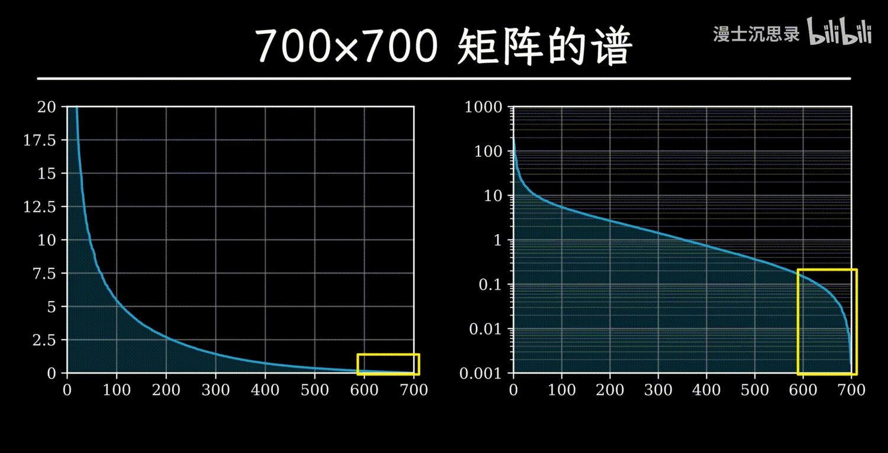
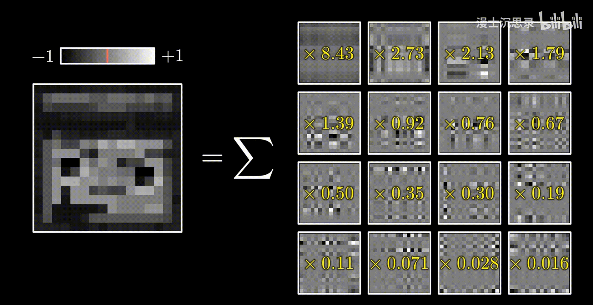
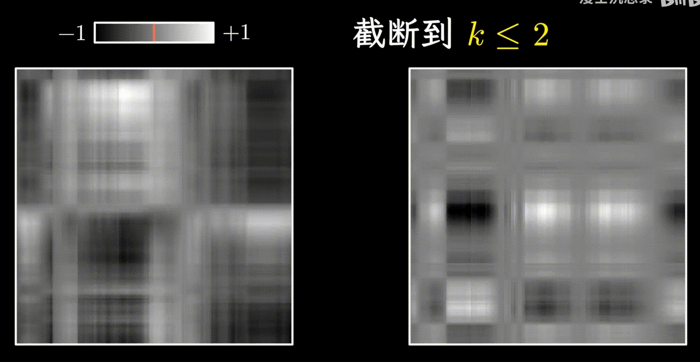
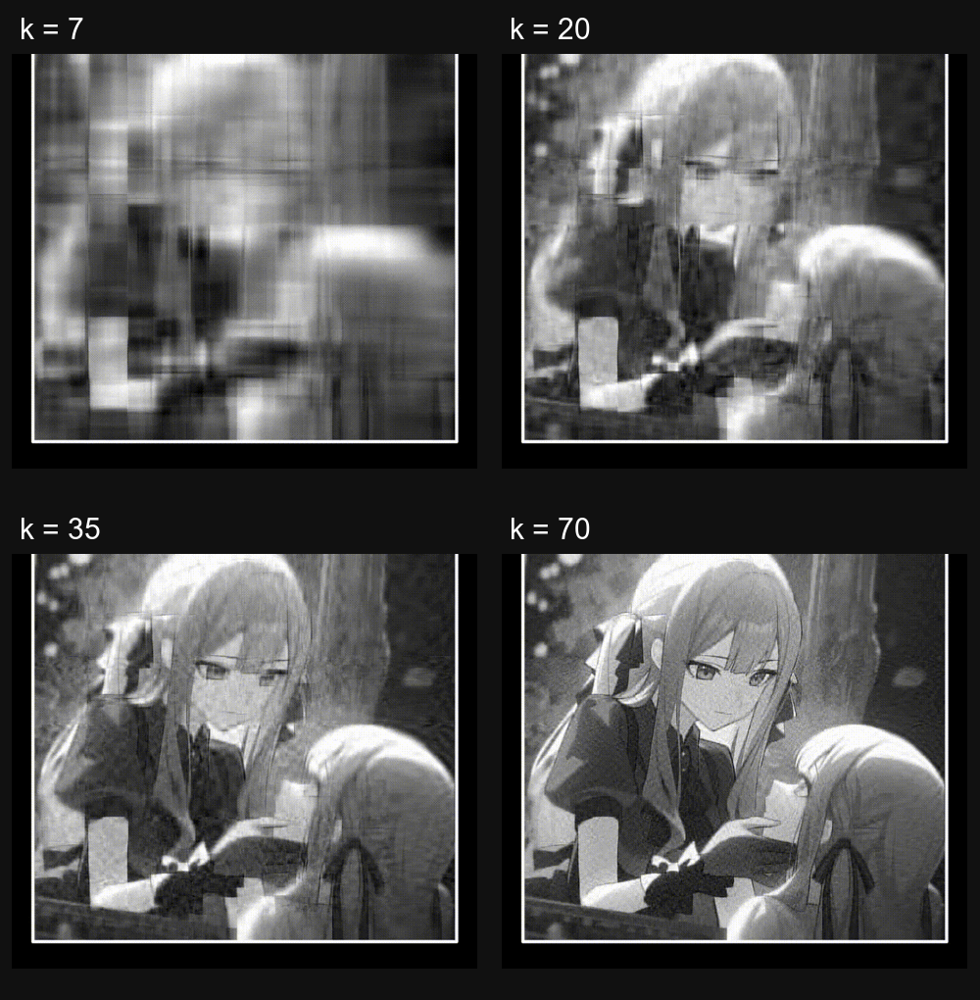

# 奇异值分解（SVD）

NUMERICAL METHODS · 825 分钟阅读

## 把矩阵作用拆成三个步骤：

矩阵 $A$ 所描述线性变换，把输入向量 $x$ 送到输出向量 $Ax$ ，这个过程也可以拆成 **提取坐标、沿坐标轴伸缩、按新的坐标轴重新组合** 三个步骤

这就是奇异值分解（Singular Value Decomposition，SVD）：

$$
A=U\Sigma V^{\mathsf T}
$$

矩阵乘法从右往左作用，因此处理向量的顺序是

$$
x
\xrightarrow{\,V^{\mathsf T}\,}
c
\xrightarrow{\,\Sigma\,}
d
\xrightarrow{\,U\,}
Ax
$$

先在二维情形理解这三个矩阵：

| 矩阵 | 结构 | 对向量的作用 | 
| --- | --- | --- | 
| $V=[v_1\ v_2]$ | 列向量是一组单位正交基 | $V^{\mathsf T}$ 提取 $x$ 在输入基底下的坐标 | 
| $\Sigma=\operatorname{diag}(\sigma_1,\sigma_2)$ | 对角元非负，其余元素为零 | 第 $i$ 个坐标乘以 $\sigma_i$ | 
| $U=[u_1\ u_2]$ | 列向量是另一组单位正交基 | 将伸缩后的坐标按输出基底重新组合 | 

 

**SVD 适用于任意实矩阵**，包括方阵、长方阵、可逆矩阵与不可逆矩阵。“奇异值分解”并不要求被分解的矩阵本身一定是奇异矩阵

若 $A\in\mathbb R^{m\times n}$，完整分解中各矩阵的尺寸为

$$
\underbrace{A}_{m\times n}
=
\underbrace{U}_{m\times m}
\underbrace{\Sigma}_{m\times n}
\underbrace{V^{\mathsf T}}_{n\times n}
$$

$V$ 的列向量构成输入空间 $\mathbb R^n$ 的单位正交基，$U$ 的列向量构成输出空间 $\mathbb R^m$ 的单位正交基；$\Sigma$ 是长方形的对角矩阵，主对角线上至多有 $p=\min(m,n)$ 个奇异值

与特征值分解相比，关键变化是：这里允许**输入与输出采用两组不同的基底**。特征值分解 $A=Q\Lambda Q^{-1}$ 要求方阵可对角化，而 SVD 不需要这个条件

## 奇异值分解的全过程：

### 计算输入坐标系上的坐标（系数）：

#### 组合系数可直接用内积提取：

设二维输入空间中有两根坐标轴 $v_1,v_2$，它们满足

$$
\|v_1\|=\|v_2\|=1,
\qquad
v_1^{\mathsf T}v_2=v_2^{\mathsf T}v_1=0
$$

两根轴相互垂直且长度为 $1$，因此它们构成单位正交基。任意向量都可以唯一表示为

$$
x=c_1v_1+c_2v_2
$$

此时只知道存在系数 $c_1,c_2$，还不知道它们的具体数值。为了提取 $c_1$，让两边与 $v_1$ 做内积：

$$
\begin{align*}
v_1^{\mathsf T}x
&=v_1^{\mathsf T}(c_1v_1+c_2v_2)\\
&=c_1(v_1^{\mathsf T}v_1)+c_2(v_1^{\mathsf T}v_2)\\
&=c_1\|v_1\|^2+c_2\cdot0\\
&=c_1
\end{align*}
$$

同理：

$$
v_2^{\mathsf T}x=c_2
$$

因此，**与某根单位正交坐标轴做内积，就能消掉其他轴上的分量，留下这根轴上的组合系数** 

#### 把多个内积堆叠起来，得到转置：

$$
\begin{bmatrix}
v_1^{\mathsf T}x\\
v_2^{\mathsf T}x
\end{bmatrix}
=
\begin{bmatrix}
v_1^{\mathsf T}\\
v_2^{\mathsf T}
\end{bmatrix}x
=
\begin{bmatrix}
v_{11}&v_{21}\\
v_{12}&v_{22}
\end{bmatrix}x
=
\begin{bmatrix}
c_1\\c_2
\end{bmatrix}
$$

原来的列向量变成了行向量，因此左侧矩阵 $\begin{bmatrix} v_1^{\mathsf T}\\ v_2^{\mathsf T} \end{bmatrix}$ 恰好就是 $V^{\mathsf T}$：
$$
c=V^{\mathsf T}x
$$

 

#### 乘以 $V$ 与乘以 $V^{\mathsf T}$ 是相反的翻译：

提取坐标之后，再乘以 $V$：

$$
Vc
=[v_1\ v_2]
\begin{bmatrix}c_1\\c_2\end{bmatrix}
=c_1v_1+c_2v_2
=x
$$

因此有两种方向相反的操作：

$$
\text{向量 }x
\xrightarrow{\,V^{\mathsf T}\,}
\text{在 }V\text{ 基底下的坐标 }c,
\qquad
c\xrightarrow{\,V\,}x
$$

从矩阵乘法看，单位正交条件意味着

$$
V^{\mathsf T}V
=
\begin{bmatrix}
v_1^{\mathsf T}v_1&v_1^{\mathsf T}v_2\\
v_2^{\mathsf T}v_1&v_2^{\mathsf T}v_2
\end{bmatrix}
=I
$$

因为 $V$ 是方阵，所以 $V^{-1}=V^{\mathsf T}$，也有 $VV^{\mathsf T}=I$。这种方阵称为**正交矩阵** 

### 在输入坐标系上伸缩：

在二维情形中

$$
\Sigma=
\begin{bmatrix}
\sigma_1&0\\
0&\sigma_2
\end{bmatrix},
\qquad
\sigma_1,\sigma_2\ge0
$$

因此

$$
d=\Sigma c
=
\begin{bmatrix}
\sigma_1c_1\\
\sigma_2c_2
\end{bmatrix}
$$

第一坐标只与 $\sigma_1$ 相乘，第二坐标只与 $\sigma_2$ 相乘，两个方向之间没有混合

对整个空间中的点都进行相同操作，就形成沿坐标轴方向的均匀伸缩

- $\sigma_i>1$：该方向被拉长
- $0<\sigma_i<1$：该方向被压缩
- $\sigma_i=1$：该方向长度保持不变
- $\sigma_i=0$：该方向的坐标完全丢失

这些非负伸缩倍数就是**奇异值** 

负号所表达的方向翻转可以交给正交基的朝向，因此不必把奇异值取成负数

### 放入输出坐标系：

设输出空间的单位正交基为 $u_1,u_2$，并写成

$$
U=[u_1\ u_2]
$$

把坐标 $d$ 按这组基底组合成输出向量：

$$
\begin{align*}
Ax
&=Ud\\
&=[u_1\ u_2]
\begin{bmatrix}
\sigma_1c_1\\
\sigma_2c_2
\end{bmatrix}\\
&=\sigma_1c_1u_1+\sigma_2c_2u_2
\end{align*}
$$

第一坐标沿 $u_1$ 摆放，第二坐标沿 $u_2$ 摆放

把 $c=V^{\mathsf T}x$ 代回去：

$$
Ax=U\Sigma V^{\mathsf T}x
$$

这一关系对任意 $x$ 都成立，因而对应的矩阵就是 $A=U\Sigma V^{\mathsf T}$ 

### 每一对输入轴与输出轴怎样对应：

取输入 $x=v_i$ ，$v_i$ 是矩阵 $V$ 的第 $i$ 个列向量，则有：

$$
V^{\mathsf T}v_i=e_i
$$

于是

$$
Av_i
=U\Sigma e_i
=U(\sigma_i e_i)
=\sigma_i u_i
$$

因此 SVD 最直接的方向对应关系是

$$
\boxed{Av_i=\sigma_i u_i}
$$

$v_i$ 称为右奇异向量，$u_i$ 称为左奇异向量

沿输入轴 $v_i$ 的单位长度，经过 $A$ 后变成沿输出轴 $u_i$ 的 $\sigma_i$ 倍长度；当 $\sigma_i=0$ 时，输出就是零向量，不再有方向

对于单位圆上的向量，$c_1^2+c_2^2=1$。设输出在 $U$ 基底中的坐标为 $d_1,d_2$，若两个奇异值都非零，则

$$
\frac{d_1^2}{\sigma_1^2}
+\frac{d_2^2}{\sigma_2^2}
=c_1^2+c_2^2
=1
$$

所以单位圆变成以 $u_1,u_2$ 为主轴、半轴长分别为 $\sigma_1,\sigma_2$ 的椭圆

## 单独调节三个矩阵，会发生什么：

### 固定两个坐标系，只改变伸缩倍数：

先取 $U=V=I$，两个坐标系都与标准坐标系重合，此时

$$
A=\Sigma
$$

变换只沿水平、竖直方向伸缩

### 改变 $V$，就是改变输入分量的提取方向：

先令 $U=\Sigma=I$，只让 $V$ 旋转。若

$$
V=R_\theta
=
\begin{bmatrix}
\cos\theta&-\sin\theta\\
\sin\theta&\cos\theta
\end{bmatrix}
$$

则

$$
A=V^{\mathsf T}=R_{-\theta}
$$

所以输入基底转过 $\theta$，输出图案会反向转过 $\theta$ 

### 改变 $U$，就是改变成品的摆放方向：

保持 $V,\Sigma$ 不变，向量已经完成坐标提取和伸缩

此时改变 $U$，相当于让伸缩后的图案跟随输出坐标轴一起改变朝向

## 零奇异值造成不可逆与降秩：

### 一个方向乘以零，会让一整条线的输入重合：

在二维情形，设 $\sigma_1>0$，$\sigma_2=0$。对于任意输入

$$
x=c_1v_1+c_2v_2
$$

输出为

$$
Ax=\sigma_1c_1u_1+0\cdot c_2u_2
=\sigma_1c_1u_1
$$

结果完全不依赖 $c_2$。无论输入沿 $v_2$ 方向移动多少，输出都不会变化：

$$
A(x+tv_2)=Ax+tAv_2=Ax,
\qquad t\in\mathbb R
$$

因此一个输出对应无穷多个输入，无法唯一恢复原来的点，圆形区域被压成直线

 

在方阵情形，**可逆当且仅当所有奇异值都严格大于零**。只要某个奇异值为零，就存在非零输入方向被送到零向量，映射不再一一对应

这里的“奇异”指的就是方阵的退化、不可逆

奇异值则把各个方向的伸缩程度量化出来，包括是否已经完全压到零

### 非零奇异值的个数等于秩：

设按大小排列后共有 $r$ 个正奇异值，其余为零。任意输入经过变换后都可以写成

$$
Ax=\sum_{i=1}^{r}\sigma_i(v_i^{\mathsf T}x)u_i
$$

因此列空间恰好为

$$
\operatorname{Col}(A)
=\operatorname{span}\{u_1,\ldots,u_r\},
\qquad
\operatorname{rank}(A)=r
$$

也可以直接推导（左右乘可逆矩阵不改变矩阵的秩）：
$$
\operatorname{rank}(A)
=\operatorname{rank}(U\Sigma V^{\mathsf T})
=\operatorname{rank}(\Sigma)
=r
$$

对于 $m\times n$ 的长方阵，仍然有“秩等于正奇异值个数”，但通常不存在普通意义上的双侧逆矩阵。尤其当 $n>m$ 时，即使列出的 $p=m$ 个奇异值全都为正，仍有 $n-m$ 个输入方向无法保留

如果所有奇异值都是零，则 $A=0$，所有输入都压到原点，秩为零

## 奇异值比秩更能体现矩阵的性质：

### 很小的扰动便可以改变矩阵的秩：

考虑

$$
A_0=
\begin{bmatrix}
1&1\\
1&1
\end{bmatrix}
$$

它的两个列向量相同，因此

$$
A_0
\begin{bmatrix}x_1\\x_2\end{bmatrix}
=
(x_1+x_2)
\begin{bmatrix}1\\1\end{bmatrix}
$$

所有输出都在直线 $y=x$ 上，所以 $\operatorname{rank}(A_0)=1$ 

现在只把右上角的 $1$ 改成 $1.001$：

$$
A_\varepsilon=
\begin{bmatrix}
1&1.001\\
1&1
\end{bmatrix},
\qquad
\det A_\varepsilon=1-1.001=-0.001
$$

行列式虽然很小，但严格非零，因此它已经满秩、可逆

理论上有了第二个输出方向，但这个方向被压缩得极其严重

### 可逆不代表求逆过程稳定：

要求解

$$
A_\varepsilon x=
\begin{bmatrix}0.9\\1.1\end{bmatrix}
$$

对应方程组为

$$
\begin{cases}
x_1+1.001x_2=0.9\\
x_1+x_2=1.1
\end{cases}
$$

解得：
$$
x=
\begin{bmatrix}201.1\\-200\end{bmatrix}
$$
输出 $(0.9,1.1)^{\mathsf T}$ 只是稍微偏离直线 $y=x$，对应输入却改变非常大

 

这个矩阵的奇异值约为

$$
\sigma_1\approx2.000500125,
\qquad
\sigma_2\approx0.000499875
$$

第一个方向的长度约放大两倍，第二个方向却只剩约万分之五；逆向恢复第二个方向时，就需要放大约 $2000$ 倍

秩只能区分 $\sigma_2=0$ 与 $\sigma_2\ne0$，无法直接区分 $0.000499875$ 与 $1$ 所代表的巨大差异

### 奇异值谱把“几乎压扁”的方向显示出来：

考虑四阶矩阵

$$
M=
\begin{bmatrix}
0.63&-1.04&0.79&-1.64\\
0.25&-0.36&0.24&-0.61\\
0.45&-1.00&0.97&-1.34\\
-0.53&0.37&0.12&1.04
\end{bmatrix}
$$

对这些显示到小数点后两位的元素计算，奇异值约为

$$
3.2217,\quad
0.6980,\quad
4.22\times10^{-3},\quad
1.45\times10^{-4}
$$

它的四个奇异值都非零，所以严格的秩为 $4$；但后两个方向几乎没有输出，相对于前两个主要方向，可以把它看成接近一个秩为 $2$ 的矩阵

把奇异值按从大到小排列得到的序列，称为**奇异值谱（spectrial）**。这里需要明确“奇异值”：通常单说矩阵的谱，指的是特征值集合，两者不能直接混用

奇异值谱不仅告诉我们保留了多少个方向，还告诉我们每个方向保留了多少长度。谱的尾部越接近零，相应方向就越接近完全丢失

## 奇异值分解与特征值分解的关系：

### 用转置做第二次变换：

先让 $x$ 经过 $A$，再经过 $A^{\mathsf T}$，结果是

$$
x\longmapsto Ax\longmapsto A^{\mathsf T}(Ax)
=(A^{\mathsf T}A)x
$$

考虑 $A$ 为方阵时，由转置的性质：

$$
A^{\mathsf T}
=(U\Sigma V^{\mathsf T})^{\mathsf T}
=V\Sigma^{\mathsf T}U^{\mathsf T}
= V\Sigma U^{\mathsf T}：
$$

则有：
$$
\begin{align*}
A^{\mathsf T}A
&=(V\Sigma U^{\mathsf T})(U\Sigma V^{\mathsf T})\\
&=V\Sigma(U^{\mathsf T}U)\Sigma V^{\mathsf T}\\
&=V\Sigma I\Sigma V^{\mathsf T}\\
&=V\Sigma^2V^{\mathsf T}
\end{align*}
$$

整个 $A^{\mathsf T}A$ 的过程因此变成：

$$
\text{在 }V\text{ 下提取坐标}
\ \longrightarrow\
\text{第 }i\text{ 个坐标乘 }\sigma_i^2
\ \longrightarrow\
\text{按同一个 }V\text{ 重新组合}
$$

### 与特征值的关系：

由 2.4 ：
$$
{Av_i=\sigma_i u_i}
$$
则有：
$$
\begin{align*}
A^{\mathsf T}Av_i
&=\sigma_i^2v_i
\end{align*}
$$

这满足特征向量的定义，因此

$$
\boxed{A^{\mathsf T}Av_i=\sigma_i^2v_i}
$$

也就是说，$v_i$ 是 $A^{\mathsf T}A$ 的特征向量，$\sigma_i^2$ 是它对应的特征值

再与一般的特征值分解比较：

$$
B=Q\Lambda Q^{-1},
\qquad
A^{\mathsf T}A=V\Sigma^2V^{\mathsf T}
$$

这里 $Q$ 对应 $V$，$\Lambda$ 对应 $\Sigma^2$；由于 $V$ 是正交矩阵，$V^{-1} = V^{\mathsf T}$ 

### 长方阵时，平方要改成 $\Sigma^{\mathsf T}\Sigma$：

当 $A$ 不为方阵时，推导应写成：

$$
\begin{align*}
A^{\mathsf T}A
&=V\Sigma^{\mathsf T}U^{\mathsf T}U\Sigma V^{\mathsf T}\\
&=V(\Sigma^{\mathsf T}\Sigma)V^{\mathsf T}
\end{align*}
$$

其中 $\Sigma^{\mathsf T}\Sigma$ 是 $n\times n$ 对角矩阵，其非零对角元仍然是正奇异值的平方。相应地

$$
AA^{\mathsf T}
=U(\Sigma\Sigma^{\mathsf T})U^{\mathsf T}
$$

其中 $\Sigma\Sigma^{\mathsf T}$ 是 $m\times m$ 对角矩阵

两者有相同的正特征值，但零特征值的个数可能不同。如果 $n>m$，则 $A^{\mathsf T}A$ 除了 $p=m$ 个奇异值的平方外，还至少多出 $n-m$ 个零特征值

### 由特征值计算奇异值:

#### $A^TA$ 是实对称半正定矩阵:

首先

$$
(A^{\mathsf T}A)^{\mathsf T}
=A^{\mathsf T}A
$$

所以 $A^{\mathsf T}A$ 是实对称矩阵,而任何实对称矩阵，都必定能正交对角化

对任意向量 $z$：

$$
z^{\mathsf T}(A^{\mathsf T}A)z
=(Az)^{\mathsf T}(Az)
=\|Az\|^2
\ge0
$$

因此 $A^{\mathsf T}A$ 不仅对称，而且是 **半正定矩阵** ，所以有:

$$
\sigma=\sqrt{\lambda}
$$

是非负实数

#### 计算 $A^TA$ 的特征值和特征向量:

由 6.3 的推导可知,求 $A$ 的奇异值就等价于求 $A^TA$ 的特征值

列出特征值方程:
$$
(A^TA - \lambda I)\vec{v} = 0\\
$$
这相当于解行列式方程:
$$
det(A^TA - \lambda I) = 0 
$$
解出:
$$
\lambda_1,...,\lambda_n , v_1,...,v_n
$$
注意,这里的 $v_i$ 是标准正交的(在特征值有重根时需要用施密特正交化)

那么 $A$ 的奇异值和输入坐标 $V$ 就是:
$$
\sigma_i = \sqrt{\lambda_i} ,V = [v_1,...,v_n]
$$
同理,通过求 $AA^T$ 的特征向量就可以求出输出坐标 $U$ 

## 在奇异值分解的视角下看逆矩阵：

### 求逆等价于按相反顺序撤销三步：

设 $A$ 为可逆方阵，所有奇异值都严格大于零。已知输出

$$
y=U\Sigma V^{\mathsf T}x
$$

要恢复 $x$，依次做：

1. 乘以 $U^{\mathsf T}$，把 $y$ 在输出基底下拆成坐标
2. 乘以 $\Sigma^{-1}$，把每个坐标除以原来的伸缩倍数
3. 乘以 $V$，按输入基底组合回原来的向量

用公式逐步写出：

$$
\begin{align*}
U^{\mathsf T}y
&=\Sigma V^{\mathsf T}x\\
\Sigma^{-1}U^{\mathsf T}y
&=V^{\mathsf T}x\\
V\Sigma^{-1}U^{\mathsf T}y
&=x
\end{align*}
$$

所以

$$
\boxed{A^{-1}=V\Sigma^{-1}U^{\mathsf T}}
$$

其中

$$
\Sigma^{-1}
=\operatorname{diag}
\left(\frac1{\sigma_1},\ldots,\frac1{\sigma_n}\right)
$$

与 $A^T$ 进行对比,会发现只有中间的缩放矩阵 $\Sigma$ 不同 :
$$
A^{\mathsf T}=V\Sigma U^{\mathsf T},
\qquad
A^{-1}=V\Sigma^{-1}U^{\mathsf T}
$$

故转置一般不等于逆矩阵

对于可逆方阵，两者相等当且仅当每个 $\sigma_i=1$：因为 $\sigma_i=1/\sigma_i$ 且 $\sigma_i>0$，只能有 $\sigma_i=1$。这时 $A$ 就是正交矩阵

若某个 $\sigma_i=0$，取倒数这一步无法完成，对应的信息也已经丢失，逆矩阵不存在

## 谱分解:

### 将矩阵分块相乘:

对于 $n\times n$ 方阵,把 $U$ 按列、$V^{\mathsf T}$ 按行展开：
$$
U=[u_1\ u_2\ \cdots\ u_n],
\qquad
V^{\mathsf T}=
\begin{bmatrix}
v_1^{\mathsf T}\\
v_2^{\mathsf T}\\
\vdots\\
v_n^{\mathsf T}
\end{bmatrix}
$$

右乘对角矩阵 $\Sigma$，就是分别缩放 $U$ 的各列：

$$
U\Sigma
=[\sigma_1u_1\ \sigma_2u_2\ \cdots\ \sigma_nu_n]
$$

继续乘以 $V^{\mathsf T}$：

$$
\begin{align*}
A
&=[\sigma_1u_1\ \cdots\ \sigma_nu_n]
\begin{bmatrix}
v_1^{\mathsf T}\\
\vdots\\
v_n^{\mathsf T}
\end{bmatrix}\\
&=\sigma_1u_1v_1^{\mathsf T}
+\sigma_2u_2v_2^{\mathsf T}
+\cdots
+\sigma_nu_nv_n^{\mathsf T}
\end{align*}
$$

对一般 $m\times n$ 矩阵，设 $r=\operatorname{rank}(A)$，则

$$
{
A=\sum_{i=1}^{p}\sigma_i u_i v_i^{\mathsf T}
=\sum_{i=1}^{r}\sigma_i u_i v_i^{\mathsf T}
},
\qquad p=\min(m,n)
$$

### $u_iv_i^{\mathsf T}$ 是秩一矩阵：

把外积的元素写开：

$$
u_iv_i^{\mathsf T}
=
\begin{bmatrix}
u_{1i}v_{1i} & u_{1i}v_{2i} & \cdots & u_{1i}v_{ni} \\
u_{2i}v_{1i} & u_{2i}v_{2i} & \cdots & u_{2i}v_{ni} \\
\vdots & \vdots & \ddots & \vdots \\
u_{ni}v_{1i} & u_{ni}v_{2i} & \cdots & u_{ni}v_{ni}
\end{bmatrix}
$$

对于这个矩阵的第 $k$ 列 ,可以写成 $v_{ki}u_i$ ,其中 $v_{ki}$ 是标量

那么,这个矩阵所有的列向量都是 $u_i$ 的倍数

结合 $u_i,v_i$ 都是单位向量，$u_i\ne0,v_u\ne 0$ 可知:
$$
\operatorname{rank}(u_iv_i^{\mathsf T})=1
$$

当权重 $\sigma_i>0$ 时，$\sigma_i u_i v_i^{\mathsf T}$ 的秩也为 $1$；当权重为零时，这一项变成零矩阵，秩为零

### 低秩近似的应用:数据压缩

灰度图像可以写成像素矩阵 $A$，元素 $A_{ab}$ 表示第 $a$ 行、第 $b$ 列像素的亮度。对它做 SVD：

$$
A=\sigma_1u_1v_1^{\mathsf T}
+\sigma_2u_2v_2^{\mathsf T}
+\cdots
$$

每个 $u_iv_i^{\mathsf T}$ 都与原图尺寸相同，因此也能显示成一幅图，再按 $\sigma_i$ 加权叠加

将奇异值按大小排列，保留前 $k$ 项：

$$
{
A_k=\sum_{i=1}^{k}\sigma_i u_iv_i^{\mathsf T}
}
$$

也可以把相应列取出来：

$$
U_k=[u_1\ \cdots\ u_k],
\qquad
V_k=[v_1\ \cdots\ v_k],
\qquad
\Sigma_k=\operatorname{diag}(\sigma_1,\ldots,\sigma_k)
$$

于是

$$
A_k=U_k\Sigma_kV_k^{\mathsf T}
$$

以低秩矩阵代替原矩阵，就是**低秩近似（Low-rank Approximation）** 

对于 $700\times700$ 的灰度图像，最多有 $700$ 个奇异值。逐个加入分量时，每次增加的就是

$$
A_k=A_{k-1}+\sigma_k u_kv_k^{\mathsf T}
$$

单个新增分量未必像原图，但它与之前分量相加，会修正某些位置的亮度，使整体越来越接近原矩阵

 

只保留很少的项时，还不足以叠加出细致曲线，横纵方向的粗糙结构会比较明显。继续增加分量，明暗、轮廓与细节逐渐补齐

 

| 保留项数 $k$ | 占 $700$ 个分量的比例 | 重建图像的变化 | 
| --- | --- | --- | 
| $7$ | $1\%$ | 大致明暗色块出现，仍然有明显横纵条带 | 
| $20$ | 约 $2.9\%$ | 依旧模糊，但人物形状已经可以区分，粗条带减弱 | 
| $35$ | $5\%$ | 人物轮廓与辨识特征更明确 | 
| $70$ | $10\%$ | 线条与局部细节已经较为清晰 | 

继续增加 $k$，对这张图来说，新增分量更多是在修补更细的纹理与误差。数学上的平方误差会继续减小，但视觉改善未必像最初加入主要分量时那样明显
